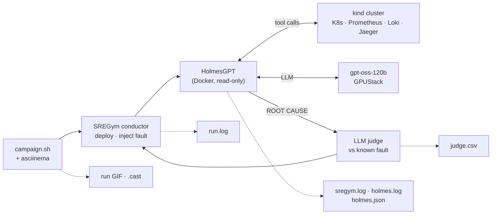
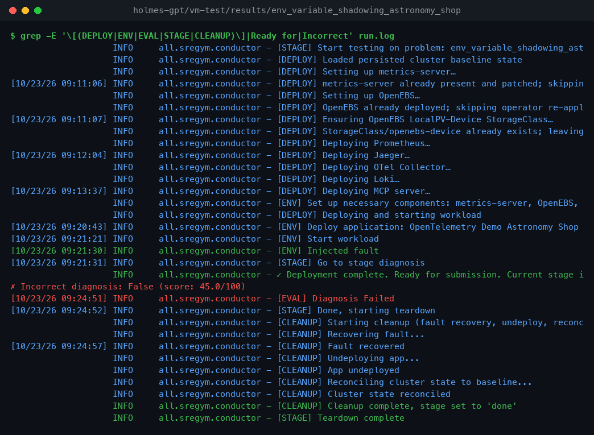
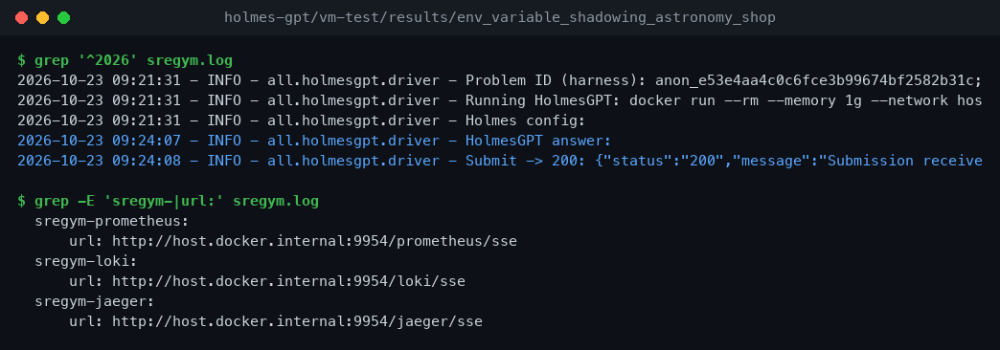
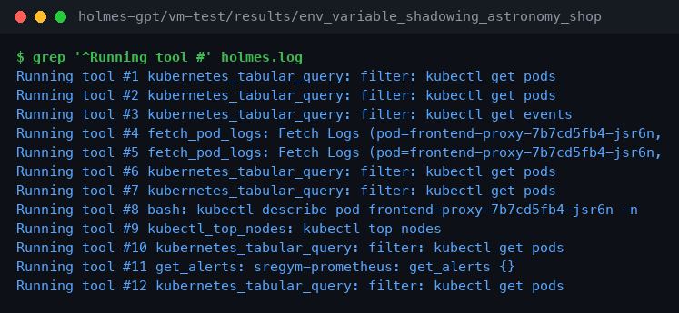
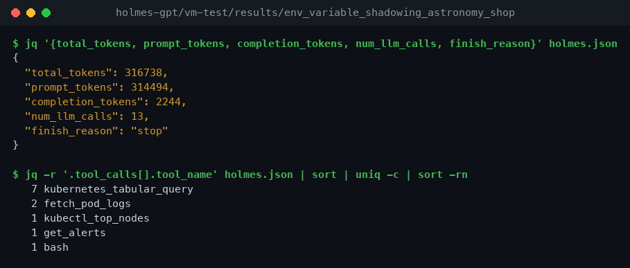
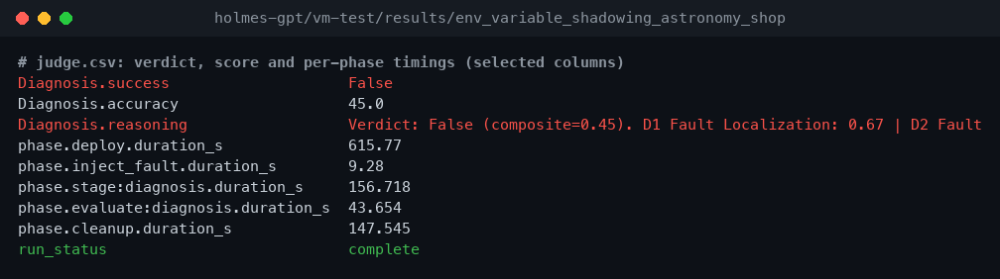

# AI for SRE

Exploring AI tooling for SRE and platform teams. Each experiment runs a tool against real failure scenarios - what it detects, what it misses, and how much cluster access it needs etc.

## Architecture


Each experiment is an independent silo. HolmesGPT and K8sGPT were run against [iximiuz Labs](https://labs.iximiuz.com) challenge playgrounds; OpenSRE was run against the local observability sandbox in [`opensre/observability-stack/`](opensre/observability-stack/README.md), which is where alert-driven RCA needs Prometheus, Loki, and Tempo present.


## Experiments


| SNo | Experiment | Version | Date | Test environment | README |
|-------|------------|---------|------|------------------|--------|
| 1 | `holmes-gpt/1-iximiuz-v0.30/` | 0.30.0 | 2026-05-18 | iximiuz Labs (K8s + Linux challenges) | [README](holmes-gpt/1-iximiuz-v0.30/README.md) |
| 2 | `k8sgpt/` | 0.4.33 | 2026-05-18 | iximiuz Labs (K8s challenge) | [README](k8sgpt/README.md) |
| 3 | `opensre/` | 0.1 | 2026-05-24 | Local `observability-stack` sandbox | [README](opensre/README.md) |
| 4 | `holmes-gpt/2-sre-gym-sandbox/` | 0.45.0 | 2026-10-20 | Local `observability-stack` sandbox (kind + Prometheus + Loki + Tempo) | [README](holmes-gpt/2-sre-gym-sandbox/README.md) |
| 5 | `holmes-gpt/3-sregym-lite/` | 0.45.0 | 2026-10-21 | [SREGym-Lite](https://github.com/SREGym/SREGym/blob/main/docs/SREGym-Lite.md) benchmark, 17 graded problems (kind, `svelte` profile, 8 GB) | [README](holmes-gpt/3-sregym-lite/README.md) |
| 6 | `holmes-gpt/vm-test/` | 0.45.0 | 2026-10-23 | SREGym-Lite on a VM: 4-node kind, `full` profile, self-hosted `gpt-oss-120b` | [README](holmes-gpt/vm-test/README.md) |


**Combined report:** [HolmesGPT — Combined Evaluation](holmes-gpt/README.md) merges experiments 1, 4 and 5 into one verdict, compared against K8sGPT and OpenSRE.

## Scorecard

<!-- SCORECARD:START -->
Updated automatically after every SREGym-Lite problem. Experiments 1–4 are hand-picked scenarios;
experiments 5 and 6 are graded by SREGym's LLM judge against the known root cause.

| # | Experiment | Test set | Correct RCA | Avg judge score | Verdict |
|---|------------|----------|-------------|----------------:|---------|
| 1 | [HolmesGPT v0.30](holmes-gpt/1-iximiuz-v0.30/README.md) | iximiuz Labs, 3 scenarios | 2/3 (+1 partial) | — | Defer |
| 2 | [K8sGPT 0.4.33](k8sgpt/README.md) | iximiuz Labs, 2 scenarios | 0/2 (CLI) | — | Reject |
| 3 | [OpenSRE 0.1](opensre/README.md) | observability-stack, 3 scenarios | 0/3 | — | Defer |
| 4 | [HolmesGPT v0.45](holmes-gpt/2-sre-gym-sandbox/README.md) | observability-stack, 3 scenarios | 2/3 (+1 partial) | — | Pilot |
| 5 | [HolmesGPT v0.45 on SREGym-Lite](holmes-gpt/3-sregym-lite/README.md) | SREGym-Lite, 10/17 problems run | 1/7 (14%) | 19/100 | In progress |
| 6 | [HolmesGPT v0.45 + gpt-oss-120b (VM)](holmes-gpt/vm-test/README.md) | SREGym-Lite `full`, 8/17 problems run | 0/6 (0%) | 8/100 | In progress |

_Last updated 2026-10-21 16:57._
<!-- SCORECARD:END -->

## How a benchmark run looks

SREGym-Lite runs are recorded end to end with [asciinema](https://asciinema.org): HolmesGPT on a VM
against SREGym's 4-node kind cluster, with a self-hosted `gpt-oss-120b`. Each run deploys the app,
injects a fault, lets HolmesGPT investigate blind (read-only K8s plus Prometheus, Loki and Jaeger over
MCP), then SREGym's LLM judge grades the `ROOT CAUSE` against the known fault.
Details: [holmes-gpt/vm-test](holmes-gpt/vm-test/README.md).



**Full run, 20× speed** (`env_variable_shadowing_astronomy_shop`):


**HolmesGPT's answer and the judge's verdict:**


**Replay with asciinema:**


The full-speed terminal session, for scrubbing through any step:

```sh
asciinema play holmes-gpt/vm-test/recordings/run-env_variable_shadowing_astronomy_shop.cast
```

**Run lifecycle: [`run.log`](holmes-gpt/vm-test/results/env_variable_shadowing_astronomy_shop/run.log)**



SREGym's conductor deploys the stack and the app, injects the fault, hands over to the agent, grades the answer and
cleans up.

**HolmesGPT driver: [`sregym.log`](holmes-gpt/vm-test/results/env_variable_shadowing_astronomy_shop/sregym.log)**



The driver starts HolmesGPT in Docker with the Prometheus, Loki and Jaeger MCP servers, then submits the answer.

**Investigation transcript: [`holmes.log`](holmes-gpt/vm-test/results/env_variable_shadowing_astronomy_shop/holmes.log)**



Each tool call HolmesGPT made, in order, before it wrote its `ROOT CAUSE`.

**Tool calls and tokens: [`holmes.json`](holmes-gpt/vm-test/results/env_variable_shadowing_astronomy_shop/holmes.json)**



The machine-readable record: token use, LLM calls, every tool call with its result, and the final answer.

**Judge verdict: [`judge.csv`](holmes-gpt/vm-test/results/env_variable_shadowing_astronomy_shop/judge.csv)**



The verdict, the 0–100 score and its reasoning, and the time spent in each phase.

Every problem has the same set: GIFs and casts in [`recordings/`](holmes-gpt/vm-test/recordings/),
screenshots in [`docs/img/`](holmes-gpt/vm-test/docs/img/), logs in [`results/`](holmes-gpt/vm-test/results/).

## Test environments

| Environment | Used by | What it provides |
|-------------|---------|------------------|
| [iximiuz Labs](https://labs.iximiuz.com/playgrounds) challenge playgrounds | HolmesGPT, K8sGPT | Pre-broken K8s and Linux scenarios with a known correct answer, so tool output can be scored against ground truth |
| [`opensre/observability-stack/`](opensre/observability-stack/README.md) | OpenSRE, HolmesGPT SRE Gym | Local Docker Desktop K8s sandbox: instrumented Go services, Grafana stack, real alerts, chaos targets |

What the local sandbox exposes:

| Layer | What's observable |
|-------|------------------|
| HTTP/API | Gateway → backend request latency, status codes, RED metrics |
| Logs | Structured `log` JSON on stdout carrying `trace_id`, shipped by Promtail to Loki |
| Traces | OpenTelemetry spans from both services into Tempo; pivot from a Loki `trace_id` to the trace and back |
| Datastores | Postgres and Redis calls as child spans, with up/down alerts |
| Alerting | `kube-prometheus-stack` `PrometheusRule`s firing real `AppPostgresDown` / `AppRedisDown` / `AppBackendDown` / `AppGatewayDown` into Alertmanager and Slack |

Quick links:

| Topic | Link |
|-------|------|
| Stack setup and `make` targets | [observability-stack README](opensre/observability-stack/README.md) |
| End-to-end verification (`make verify`) | [observability-stack Makefile](opensre/observability-stack/Makefile) |
| Chaos scenarios | [opensre Makefile](opensre/Makefile) |
| Captured Alertmanager payloads | [opensre/tests/](opensre/tests/) |

## Personas

| Persona | What they care about |
|---------|---------------------|
| On-call SRE | Does the agent shorten time-to-root-cause on a real incident? |
| Platform engineer | What cluster access does it need, and what can it write? |
| Security/Compliance | What cluster data leaves the perimeter, and to which provider |

## License

[MIT](LICENSE) © One2N
