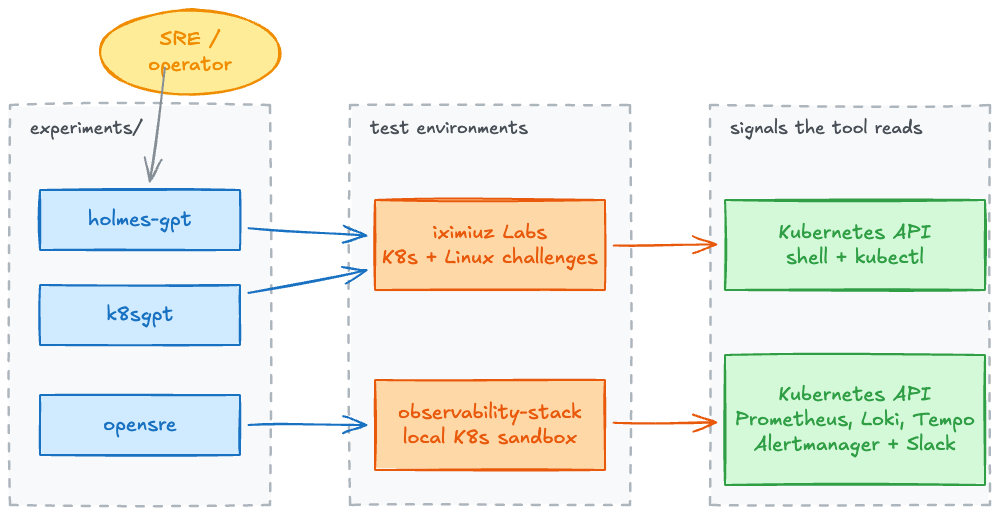

# AI for SRE

Exploring AI tooling for SRE and platform teams. Each experiment runs a tool against real failure scenarios - what it detects, what it misses, and how much cluster access it needs etc.

## Architecture

Each experiment is an independent silo. HolmesGPT and K8sGPT were run against [iximiuz Labs](https://labs.iximiuz.com) challenge playgrounds; OpenSRE was run against the local observability sandbox in [`opensre/observability-stack/`](opensre/observability-stack/README.md), which is where alert-driven RCA needs Prometheus, Loki, and Tempo present.

## Experiments

| SNo | Experiment | Version | Date | Test environment | README |
|-------|------------|---------|------|------------------|--------|
| 1 | `holmes-gpt/` | 0.30.0 | 2026-05-18 | iximiuz Labs (K8s + Linux challenges) | [README](holmes-gpt/README.md) |
| 2 | `k8sgpt/` | 0.4.33 | 2026-05-18 | iximiuz Labs (K8s challenge) | [README](k8sgpt/README.md) |
| 3 | `opensre/` | 0.1 | 2026-05-24 | Local `observability-stack` sandbox | [README](opensre/README.md) |
| 4 | `holmes-gpt-sre-gym/` | 0.45.0 | 2026-10-20 | Local `observability-stack` sandbox (kind + Prometheus + Loki + Tempo) | [README](holmes-gpt-sre-gym/README.md) |
| 5 | `holmes-gpt-sregym-lite/` | 0.45.0 | 2026-10-21 | [SREGym-Lite](https://github.com/SREGym/SREGym/blob/main/docs/SREGym-Lite.md) benchmark, 17 graded problems (kind, `svelte` profile, 8 GB) | [README](holmes-gpt-sregym-lite/README.md) |

## Scorecard

<!-- SCORECARD:START -->
Updated automatically after every SREGym-Lite problem. Experiments 1–4 are hand-picked scenarios;
experiment 5 is graded by SREGym's LLM judge against the known root cause.

| # | Experiment | Test set | Correct RCA | Avg judge score | Verdict |
|---|------------|----------|-------------|----------------:|---------|
| 1 | [HolmesGPT v0.30](holmes-gpt/README.md) | iximiuz Labs, 3 scenarios | 2/3 (+1 partial) | — | Defer |
| 2 | [K8sGPT 0.4.33](k8sgpt/README.md) | iximiuz Labs, 2 scenarios | 0/2 (CLI) | — | Reject |
| 3 | [OpenSRE 0.1](opensre/README.md) | observability-stack, 3 scenarios | 0/3 | — | Defer |
| 4 | [HolmesGPT v0.45](holmes-gpt-sre-gym/README.md) | observability-stack, 3 scenarios | 2/3 (+1 partial) | — | Pilot |
| 5 | [HolmesGPT v0.45 on SREGym-Lite](holmes-gpt-sregym-lite/README.md) | SREGym-Lite, 5/17 problems run | 0/3 (0%) | 0/100 | In progress |

_Last updated 2026-10-21 13:47._
<!-- SCORECARD:END -->

## Test environments

| Environment | Used by | What it provides |
|-------------|---------|------------------|
| [iximiuz Labs](https://labs.iximiuz.com/playgrounds) challenge playgrounds | HolmesGPT, K8sGPT | Pre-broken K8s and Linux scenarios with a known correct answer, so tool output can be scored against ground truth |
| [`opensre/observability-stack/`](opensre/observability-stack/README.md) | OpenSRE, HolmesGPT SRE Gym | Local Docker Desktop K8s sandbox: instrumented Go services, Grafana stack, real alerts, chaos targets |

What the local sandbox exposes:

| Layer | What's observable |
|-------|------------------|
| HTTP/API | Gateway → backend request latency, status codes, RED metrics |
| Logs | Structured `log` JSON on stdout carrying `trace_id`, shipped by Promtail to Loki |
| Traces | OpenTelemetry spans from both services into Tempo; pivot from a Loki `trace_id` to the trace and back |
| Datastores | Postgres and Redis calls as child spans, with up/down alerts |
| Alerting | `kube-prometheus-stack` `PrometheusRule`s firing real `AppPostgresDown` / `AppRedisDown` / `AppBackendDown` / `AppGatewayDown` into Alertmanager and Slack |

Quick links:

| Topic | Link |
|-------|------|
| Stack setup and `make` targets | [observability-stack README](opensre/observability-stack/README.md) |
| End-to-end verification (`make verify`) | [observability-stack Makefile](opensre/observability-stack/Makefile) |
| Chaos scenarios | [opensre Makefile](opensre/Makefile) |
| Captured Alertmanager payloads | [opensre/tests/](opensre/tests/) |

## Personas

| Persona | What they care about |
|---------|---------------------|
| On-call SRE | Does the agent shorten time-to-root-cause on a real incident? |
| Platform engineer | What cluster access does it need, and what can it write? |
| Security/Compliance | What cluster data leaves the perimeter, and to which provider |

## License

[MIT](LICENSE) © One2N
