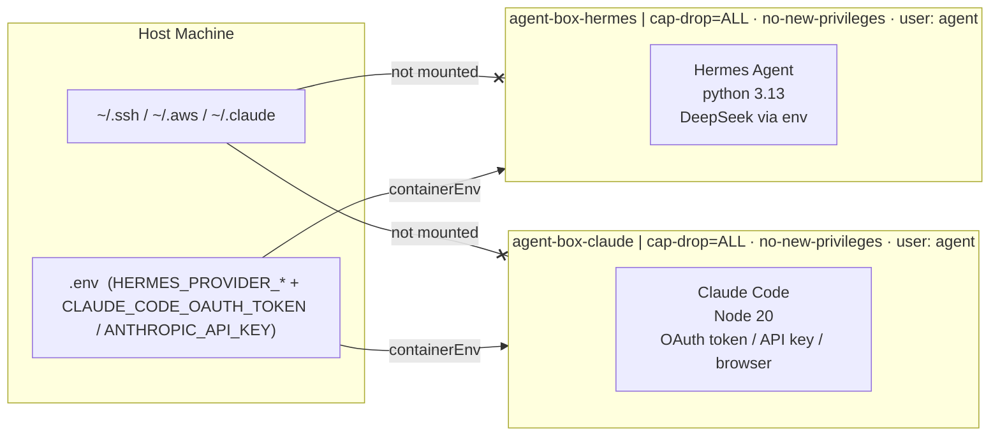

# agent-box - PoC Evaluation

| | |
| --- | --- |
| **Author** | Asutosh Panda |
| **Date** | `2026-05-20` |
| **Time invested** | `~6 hours` |
| **Tool version tested** | Hermes Agent `v2026.4.30` · Claude Code `v2.1.159` |
| **Source / Docs** | [NousResearch/hermes-agent](https://github.com/NousResearch/hermes-agent) · [@anthropic-ai/claude-code](https://www.npmjs.com/package/@anthropic-ai/claude-code) · [containers.dev spec](https://containers.dev/) |
| **License** | MIT (Hermes) · Anthropic terms (Claude Code) |
| **Category** | AI coding agent · devcontainer · workload isolation |

---

## 1. What problem does this tool solve?

AI coding agents (Hermes, Claude Code) run with full access to your host filesystem and credentials by default. Every agent session can silently read `~/.ssh`, `~/.aws`, environment variables, and anything else the process can reach on your machine. There is no isolation boundary between the agent and your host.

**agent-box** is a minimal, config-driven sandbox for running AI coding agents in isolated containers. Security controls (capability drop, no-new-privileges) are applied at the container level. No host dotfiles or credential directories are mounted. Multiple auth paths are supported per agent so the setup works for API keys, long-lived OAuth tokens (for ralph loops / non-interactive use), and interactive OAuth flows without code changes.

---

## 2. How it works (architecture)

Two separate images - one per agent - built from a single multi-stage `Dockerfile`. Agent config lives in `.devcontainer/agents.json`. `make hermes` / `make claude` call `scripts/start.sh` which reads `agents.json`, generates `devcontainer.json` via `jq`, builds the image if missing, and starts the container. Provider config (name, base URL, API key env var) comes from `.env` - switching providers is a config change, not a code change. Adding a new agent requires only a new stage in `Dockerfile` and a new entry in `agents.json`.



**Auth paths:**

- **Hermes + DeepSeek API key:** set `HERMES_PROVIDER_*` and `DEEPSEEK_API_KEY` in `.env` before running `make hermes`. The Makefile configures Hermes inside the container, then VS Code opens with a terminal already running the chat session.
- **Claude Code -- two auth options (pick one in `.env`):**
  - **OAuth token (recommended for ralph loops / non-interactive use):** generate once on the host with `claude setup-token`, paste the printed token into `CLAUDE_CODE_OAUTH_TOKEN` in `.env`. Uses Pro/Max subscription rates. Valid ~1 year. Persistent across container rebuilds.
  - **Anthropic API key:** set `ANTHROPIC_API_KEY` in `.env` (from [console.anthropic.com](https://console.anthropic.com/settings/keys)). Uses Anthropic API pricing.

  The image bakes `~/.claude.json` with `hasCompletedOnboarding` + a trusted `/workspace` entry so first-run prompts (theme picker, syntax picker, `/login` URL, folder trust) are all skipped. Auth precedence per the [Claude Code docs](https://code.claude.com/docs/en/authentication): if both env vars are set, `ANTHROPIC_API_KEY` wins over `CLAUDE_CODE_OAUTH_TOKEN`.

**What is in each image:**

| Tool | Image | Version | Purpose |
|------|-------|---------|---------|
| python:3.13-slim | both (base) | - | Debian bookworm runtime |
| Hermes Agent | hermes only | v2026.4.30 | AI coding agent (OpenAI-compatible) |
| Node.js | claude only | 20.x (LTS) | Claude Code runtime |
| Claude Code | claude only | 2.1+ | AI coding agent (Anthropic OAuth/API) |

Each image contains exactly one agent and its runtime. Neither image installs the other agent's dependencies.

---

## 3. Setup and reproduction steps

### Prerequisites

- Docker Desktop or OrbStack
- VS Code + [Dev Containers extension](https://marketplace.visualstudio.com/items?itemName=ms-vscode-remote.remote-containers)
- `jq` installed on host (`brew install jq`)
- `@devcontainers/cli` installed (`npm install -g @devcontainers/cli`)
- Choose one auth method per agent:
  - **Hermes:** a DeepSeek API key from [platform.deepseek.com](https://platform.deepseek.com)
  - **Claude:** either (see "Auth paths" above for details):
    - `CLAUDE_CODE_OAUTH_TOKEN` from `claude setup-token` on the host (recommended; Pro/Max subscription)
    - `ANTHROPIC_API_KEY` from [console.anthropic.com](https://console.anthropic.com/settings/keys)

### Step-by-step

```bash
# 1. Clone the repo
git clone https://github.com/one2nc/ai-bites.git
cd ai-bites/agent-box

# 2a. Hermes + DeepSeek
make hermes
# → if .env is missing, it is created from .env.example and the script exits
# → fill in DEEPSEEK_API_KEY in .env, then re-run make hermes
# → first run builds the image (~3 min); subsequent runs reuse it (~5s)
# → starts container, configures Hermes, opens VS Code with chat auto-running

# 2b. Claude Code (pick one auth method in .env, then run)
#
#  OPTION A -- OAuth token (recommended for ralph loops / non-interactive):
#    On the host (one time):
#      claude setup-token       # prints a token, does not save
#    Then paste the token into CLAUDE_CODE_OAUTH_TOKEN in .env
#
#  OPTION B -- Anthropic API key:
#    Set ANTHROPIC_API_KEY in .env (from console.anthropic.com)
make claude
# → builds image on first run (~3 min), then reuses it
# → first-run onboarding (theme/syntax/login/trust) is pre-skipped via baked
#   ~/.claude.json — container starts straight at the Claude REPL
```

Both `make hermes` and `make claude` are idempotent - re-running them reuses the existing container and image.

### `.env` reference

```bash
# Provider config for hermes
HERMES_PROVIDER_NAME=deepseek
HERMES_PROVIDER_BASE_URL=https://api.deepseek.com/v1
HERMES_PROVIDER_API_KEY_ENV=DEEPSEEK_API_KEY

# API key for the provider above
DEEPSEEK_API_KEY=sk-your-key-here

# Model to use (passed to hermes -m)
HERMES_MODEL=deepseek-v4-pro

# Claude Code auth -- set ONE
#   OPTION A: long-lived OAuth token (Pro/Max subscription; ralph-loop friendly)
#     Generate on host: claude setup-token
CLAUDE_CODE_OAUTH_TOKEN=

#   OPTION B: Anthropic API key (API pricing)
ANTHROPIC_API_KEY=
```

To switch Hermes providers, change the three `HERMES_PROVIDER_*` vars and add the new API key. To switch Claude auth, set the corresponding env var and leave the other empty. No code changes needed.

### Known setup gotchas

- **`.env` is created automatically on first run** - fill in `DEEPSEEK_API_KEY` and re-run. All other vars have working defaults.
- **Image is built automatically on first run** - no separate build step. Takes ~3 min for hermes, ~3 min for claude. Subsequent runs use Docker cache.
- **Claude auth is persistent** -- both `CLAUDE_CODE_OAUTH_TOKEN` and `ANTHROPIC_API_KEY` are read from `.env` on every container start, so auth survives `make down` + rebuild.
- **`devcontainer` CLI required** - `make hermes` / `make claude` use `@devcontainers/cli`. Install with `npm install -g @devcontainers/cli`.
- **VS Code mode is macOS-only for auto-activation** -- terminal mode (the default) works on Linux and macOS. The `vscode` attach mode uses `osascript` to bring VS Code to front, which is mac-only; on Linux, switch VS Code to front manually.

---

## 4. Scenarios tested

### Scenario 1: Tools and user inside the container

**What I did:** Ran `make hermes`, opened VS Code terminal.

**What I expected:** Hermes chat session starts automatically, user is `agent` (non-root).

**What actually happened:**
```
agent@<container-id>:/home/agent$ hermes -m deepseek-v4-pro chat
# chat session started immediately
```

Hermes functional, running as non-root.

---

### Scenario 2: Claude Code non-interactive auth via `CLAUDE_CODE_OAUTH_TOKEN`

**What I did:**
```bash
# One-time on host
claude setup-token   # printed an sk-ant-oat01-... token
# Paste the token into CLAUDE_CODE_OAUTH_TOKEN in .env
make claude          # terminal mode
```

**What I expected:** Container starts, no browser, no OAuth URL, Claude REPL ready immediately.

**What actually happened:**
```
  ✓  claude auth: CLAUDE_CODE_OAUTH_TOKEN
╭─── Claude Code v2.1.159 ─────────────────────────╮
│  Welcome back!                                   │
│  Sonnet 4.6 · Claude API                         │
│  /workspace                                      │
╰──────────────────────────────────────────────────╯
❯
```

No theme picker, no syntax picker, no `/login` URL, no folder-trust dialog -- all four first-run prompts skipped via baked `~/.claude.json`. First prompt ran successfully on the env token.

---

### Scenario 3: `make hermes` and `make claude` - zero-click VS Code + terminal

**What I did:**
```bash
# Terminal A - Hermes
make hermes   # .env already filled in

# Terminal B - Claude (separate run, no key needed)
make claude
```

**What I expected:** VS Code opens with a terminal already inside the container. The correct agent starts automatically.

**What actually happened:**
- `make hermes`: VS Code opened attached to the running container. Terminal appeared automatically. Hermes chat session started immediately.
- `make claude`: Same VS Code flow. Terminal appeared, auth banner printed (`✓ claude auth: CLAUDE_CODE_OAUTH_TOKEN`), Claude REPL launched directly with no browser prompt.

Both commands complete in ~5s after the first build.

---

## 5. Demo

A recording will be added once this PoC receives a green signal for pilot. The commands are intentionally designed to be the live demo - `make hermes` and `make claude` each complete end-to-end in under 10 seconds after the first build, making them suitable for live demonstration without a pre-recorded video.

| Demo | Link | Duration |
|------|------|----------|
| `make hermes` end-to-end | pending green signal | ~5s (after first build) |
| `make claude` end-to-end | pending green signal | ~5s (after first build) |

---

## 6. Observations

- **Hermes** is a thin OpenAI-SDK wrapper. It is OpenAI-API-compatible - works with DeepSeek, Gemini, or any local Ollama endpoint by changing `HERMES_PROVIDER_*` in `.env`. MIT licensed, actively maintained by NousResearch.
- **Claude Code** needs OAuth (personal Pro/Max) or an Anthropic API key (expensive for team use). OAuth inside a devcontainer works cleanly - VS Code handles the browser forwarding via port forwarding.
- **Image size (~370 MB hermes, ~760 MB claude):** each image carries one runtime and one agent. The `base` layer is intentionally minimal (ca-certificates, curl, git, jq, make). Size is dominated by the agent runtime (Python 3.13 for hermes, Node 20 for claude), not system tools.
- **`make hermes` / `make claude` are macOS-only** due to `osascript`. On Linux, attach via VS Code's "Attach to Running Container" or open a terminal manually.
- **agent-box vs kiln:** agent-box is container-level isolation (shared kernel). Kiln targets Firecracker VM isolation. Complementary - agent-box is the good-enough answer for internal teams today.

---

## 7. Comparison with alternatives

Docker recently shipped [AI Sandboxes (`sbx`)](https://docs.docker.com/ai/sandboxes/agents/claude-code/) - a managed sandbox runtime for Claude Code. It is the closest direct alternative.

| Dimension | agent-box (this) | Docker AI Sandboxes (sbx) | Run locally (no isolation) |
|-----------|-----------------|--------------------------|---------------------------|
| Isolation level | Container (cap-drop=ALL, no-new-privileges) | Container (Docker Desktop managed) | None |
| Credential exposure | Only explicit `containerEnv` forwarded | Docker-managed; host socket required | Full host access |
| Reproducible environment | Yes - config-driven via `agents.json` + pinned Dockerfile | No - runtime-provisioned, no image control | No |
| Agent choice | Any - Hermes, Claude Code, or add more | Claude Code only (sbx is Claude-specific) | Any |
| Auth - API key | Yes (Hermes + any OpenAI-compat provider) | Anthropic API key required | Yes |
| Auth - OAuth | Yes (Claude Code) | Not documented | Yes |
| Provider switching | Yes - change `HERMES_PROVIDER_*` in `.env` | No | N/A |
| One-command open with terminal | Yes (`make hermes` / `make claude`) | No - manual VS Code flow | N/A |
| Works without Docker Desktop | Yes (OrbStack or any Docker runtime) | Docker Desktop required | Yes |
| Team portability | Yes - clone and run, image buildable anywhere | Requires Docker Desktop + sbx plugin | N/A |
| Open source / auditable | Yes - Dockerfile, agents.json, Makefile | Closed - managed by Docker | N/A |
| Cost | Free (API key costs only) | Free (Docker Desktop) | Free |

**Summary:** sbx solves the same problem for Claude Code specifically, but requires Docker Desktop and only supports one agent. agent-box is runtime-agnostic, team-portable, and supports multiple agents with a reproducible, auditable image. For one2n's use case (team tooling, multiple agent choices, existing OrbStack/Linux infra), agent-box is the better fit.

---

## 8. Pros

- Zero host credential exposure - `~/.ssh`, `~/.aws`, `~/.claude` are not mounted by design
- Provider-agnostic via `HERMES_PROVIDER_*` in `.env` - swap DeepSeek for Gemini or Ollama with a config change
- `make hermes` / `make claude` give a Codespaces-like experience locally - one command, VS Code opens with the agent running
- Auto-builds image on first run, reuses on subsequent runs - no separate build step
- Fully portable - works on any machine with Docker + VS Code when cloned
- Follows one2n Dockerfile principles - ARG-based UID, non-root, single RUN, OCI LABELs, `SHELL pipefail`, JSON CMD, `.dockerignore`

---

## 9. Cons

- Each image is ~370-760 MB - acceptable for a devcontainer, not a production runtime
- First run takes ~3 min each to build; subsequent runs use Docker cache (~5s)
- Auto-activating VS Code uses `osascript` (macOS-only). Terminal mode works on both macOS and Linux; on Linux + `vscode` mode, bring VS Code to front manually
- `@devcontainers/cli` and `jq` are host dependencies

---

## 10. Cost analysis

- **Token/API costs:** DeepSeek v4 Pro ~$0.14/M input, ~$0.28/M output. Typical coding session under 100K tokens - under $0.05/session. Claude Code with a Pro subscription has no per-token cost for individuals.
- **Infra costs:** Docker only - no cloud compute, no registry fee. Image built locally.
- **Human costs:** ~6 hours initial setup. Ongoing maintenance is low - Hermes is pinned by git tag, Claude Code is installed via npm. Updates are a one-line bump and rebuild.

---

## 11. Verdict

**Pilot** - trial with the one2n team for 2-3 weeks on a real project.

The isolation story is solid for internal developer tooling. The `make hermes` / `make claude` experience matches Codespaces closely enough for a compelling demo. The main thing to validate in a pilot is day-to-day friction: does the 3-minute first-build time put people off, and does the env-token rotation cadence (~1 year per `claude setup-token`) need any team-wide tooling.

### Next steps for pilot

- Push image to GHCR so team members skip the first build
- Add CI: `hadolint` + `docker build --check` on every PR to `agent-box/`
- Record demo (Loom or asciinema) once pilot is approved - `make hermes` flow end-to-end
- Evaluate adding Gemini as a third auth path (Hermes supports it natively via `HERMES_PROVIDER_*`)

### Revisit trigger

If the baked `lastOnboardingVersion` marker stops being honored by future Claude Code releases (i.e. fresh containers start showing onboarding prompts again), revisit by checking what new keys `~/.claude.json` gains after a manual first-run on host and bake those in alongside.

---

## 12. Issues / PRs filed

None filed upstream. Build failures worked around during development:

- **Wrong Hermes git tag**: pip install failed with `v0.12.0` - Hermes uses date-based tags. Fixed by using `v2026.4.30`.
- **NodeSource setup script requires gnupg**: `apt-get install gnupg` added to the `claude` stage before running the NodeSource setup script.

| Type | Link | Status |
|------|------|--------|
| - | - | - |

---

## 13. References

- [NousResearch/hermes-agent](https://github.com/NousResearch/hermes-agent)
- [@anthropic-ai/claude-code on npm](https://www.npmjs.com/package/@anthropic-ai/claude-code)
- [VS Code Dev Containers spec](https://containers.dev/)
- [Docker AI Sandboxes - Claude Code](https://docs.docker.com/ai/sandboxes/agents/claude-code/)
- [Sysdig - Dockerfile security best practices](https://sysdig.com/learn-cloud-native/dockerfile-best-practices)
- [Docker official build best practices](https://docs.docker.com/build/building/best-practices/)
- [Docker build checks reference](https://docs.docker.com/reference/build-checks/)

---

## Appendix: Raw notes / logs

<details>
<summary>Click to expand</summary>

### Build failures encountered and fixed

**Failure 1 - wrong Hermes git tag**

`pip install hermes-agent @ git+...@v0.12.0` failed - Hermes uses date-based tags (`v2026.x.x`), not semver. Fixed by using `v2026.4.30`.

**Failure 2 - combined agent stage caused image bloat and reviewer concern**

Initial Dockerfile installed both Hermes and Claude Code in a single `agent-box` stage. Reviewer question: "Do we need both at the same time?" Fixed by splitting into separate `hermes` and `claude` stages - each builds independently and contains exactly one agent.

**Failure 3 - unnecessary tools in base image**

gh CLI, kubectl, and helm were added to `base` without being requested. Removed entirely - the base layer now contains only `ca-certificates curl git jq make`. Node.js moved to the `claude` stage only.

**Failure 4 - autorun not firing in attached container**

`.bashrc` checked `TERM_PROGRAM=vscode` which VS Code only sets in integrated terminals, not attached containers. Fixed by also checking `VSCODE_IPC_HOOK_CLI` which VS Code sets for all remote sessions.

**Failure 5 - terminal panel too tall on first open**

`customizations.vscode.settings` in `devcontainer.json` is ignored for attached containers. Fixed by baking `.vscode/settings.json` into the image at `/home/agent/.vscode/settings.json`.

### Final image tool versions

hermes image:
```
user:    agent (non-root)
hermes:  v0.12.0 (2026.4.30)
```

claude image:
```
user:    agent (non-root)
node:    v20.20.2
claude:  2.1.159 (Claude Code)
```

</details>
