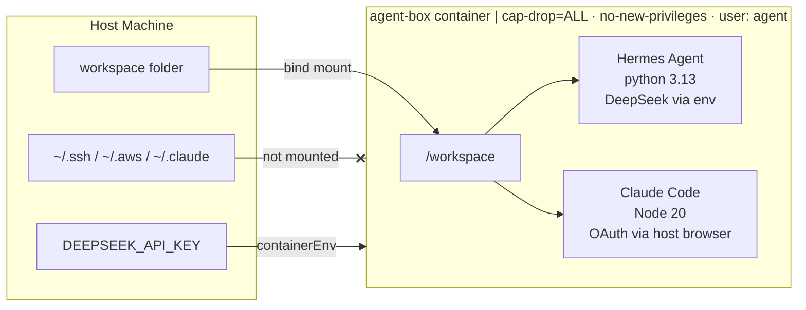

# agent-box - PoC Evaluation

| | |
| --- | --- |
| **Author** | Asutosh Panda |
| **Date** | `2026-05-20` |
| **Time invested** | `~6 hours` |
| **Tool version tested** | Hermes Agent `v2026.4.30` · Claude Code `v2.1.144` |
| **Source / Docs** | [NousResearch/hermes-agent](https://github.com/NousResearch/hermes-agent) · [@anthropic-ai/claude-code](https://www.npmjs.com/package/@anthropic-ai/claude-code) · [containers.dev spec](https://containers.dev/) |
| **License** | MIT (Hermes) · Anthropic terms (Claude Code) |
| **Category** | AI coding agent · devcontainer · workload isolation |

---

## 1. What problem does this tool solve?

AI coding agents (Hermes, Claude Code) run with full access to your host filesystem and credentials by default. Every agent session can silently read `~/.ssh`, `~/.aws`, environment variables, and anything else the process can reach on your machine. There is no isolation boundary between the agent and your host.

**agent-box** is a golden devcontainer image that gives any engineer on the team a reproducible, isolated sandbox for running AI coding agents. The agent sees only `/workspace` - the project directory - nothing else from the host. Security controls (capability drop, no-new-privileges) are applied at the container level, not left to the developer to remember. Two auth paths are supported so the image works for both personal accounts and shared API key setups without code changes.

---

## 2. How it works (architecture)

The image bundles two agents and supporting CLI tools into a single non-root devcontainer. VS Code's Dev Containers extension handles mounting the project directory and forwarding the API key as an environment variable. No host dotfiles, credentials directories, or Docker socket are mounted.



**Auth paths:**

- **Option A - Hermes + DeepSeek API key:** set `DEEPSEEK_API_KEY` and optionally `HERMES_MODEL` in `.env` before running `make hermes`. The default model is `deepseek-v4-pro`. The Makefile configures Hermes inside the container, then VS Code opens with a terminal already running the chat session.
- **Option B - Claude Code + OAuth:** no key needed. `make claude` opens VS Code with a terminal that triggers `claude auth login`. The browser OAuth flow completes on the host; the session lives inside the container only.

**What is in the image:**

| Tool | Version | Purpose |
|------|---------|---------|
| python:3.13-slim | base | Hermes runtime, Debian bookworm |
| Node.js | 20.x (LTS) | Claude Code runtime |
| Hermes Agent | v2026.4.30 | AI coding agent (OpenAI-compatible) |
| Claude Code | 2.1+ | AI coding agent (Anthropic OAuth/API) |
| gh CLI | 2.x | GitHub operations from inside agent |
| kubectl | latest stable at build | Kubernetes operations |
| helm | 3.x | Helm operations |

---

## 3. Setup and reproduction steps

### Prerequisites

- Docker Desktop or OrbStack
- VS Code + [Dev Containers extension](https://marketplace.visualstudio.com/items?itemName=ms-vscode-remote.remote-containers)
- `jq` installed on host (`brew install jq`)
- `@devcontainers/cli` installed (`npm install -g @devcontainers/cli`)
- Choose one auth method:
  - **Option A:** a DeepSeek API key from [platform.deepseek.com](https://platform.deepseek.com)
  - **Option B:** a Claude Pro/Max account - no key needed

### Step-by-step

```bash
# 1. Clone the repo
git clone https://github.com/one2nc/ai-bites.git
cd ai-bites/agent-box

# 2. Build the image (one-time, ~5 min - warms Docker layer cache)
make build

# 3a. Hermes + DeepSeek
cp .env.example .env
# edit .env: paste your DeepSeek key; optionally change HERMES_MODEL (default: deepseek-v4-pro)
make hermes
# → starts container, configures Hermes, opens VS Code with chat auto-running

# 3b. Claude Code + OAuth (no key needed)
make claude
# → starts container, opens VS Code terminal with claude auth login running
# → click "Open" in the browser popup to complete OAuth
```

Both `make hermes` and `make claude` are idempotent - re-running them reuses the existing container.

### Verify isolation (optional)

```bash
make test
```

Runs tool version checks and confirms `~/.ssh`, `~/.aws`, `~/.claude` are not accessible from inside the container.

### Known setup gotchas

- **`make hermes` / `make claude` depend on `make build`** - they reuse the existing image but do not rebuild it. Run `make build` before a demo on a fresh machine.
- **API key must be in `.env` before `make hermes`** - copy `.env.example` to `.env` and fill in your key. Setting it after requires re-running `make hermes`.
- **Claude auth is ephemeral** - the OAuth session lives inside the container only. Rebuilding the container requires logging in again. This is intentional.
- **`devcontainer` CLI required** - `make hermes` / `make claude` use `@devcontainers/cli` to start the container. Install with `npm install -g @devcontainers/cli`.
- **macOS only for `make hermes` / `make claude`** - the terminal auto-open uses `osascript`. On Linux, use VS Code's "Reopen in Container" or open a terminal manually with `Ctrl+\``.

---

## 4. Scenarios tested

### Scenario 1: Tools and user inside the container

**What I did:**
```bash
make test
```

**What I expected:** All tools respond with versions, user is `agent` (non-root).

**What actually happened:**
```
=== user ===
agent

=== tools ===
Hermes Agent v0.12.0 (2026.4.30)
2.1.144 (Claude Code)
Client Version: v1.36.1
v3.21.0+ge0878d4
gh version 2.92.0 (2026-04-28)
```

All tools functional, running as non-root.

---

### Scenario 2: Isolation - agent cannot reach host credentials

**What I did:**
```bash
make test
# check.sh runs: ls ~/.ssh; ls ~/.aws; ls ~/.claude; env | grep AWS
```

**What I expected:** All checks fail - agent is blind to host credentials.

**What actually happened:**
```
=== isolation: all three should say 'No such file or directory' ===
ls: cannot access '/home/agent/.ssh': No such file or directory
ls: cannot access '/home/agent/.aws': No such file or directory
ls: cannot access '/home/agent/.claude': No such file or directory
(no AWS vars - good)
```

Isolation confirmed. The only forwarded value is `DEEPSEEK_API_KEY`, set explicitly via `containerEnv`.

---

### Scenario 3: Claude Code OAuth login from inside container

**What I did:**
```bash
make claude
# VS Code terminal opened, claude auth login ran automatically
# Browser popup appeared: "Open external site - claude.com/cai/oauth/authorize?..."
# Clicked "Open" - OAuth flow completed
```

**What I expected:** Browser opens on host, OAuth flow completes, session stored inside container only.

**What actually happened:** VS Code forwarded the localhost callback port to the host browser. OAuth flow completed. `claude --version` reported 2.1.144 and a test prompt ran successfully.

---

### Scenario 4: `make hermes` and `make claude` - zero-click VS Code + terminal

**What I did:**
```bash
# Terminal A - Hermes
cp .env.example .env   # filled in DEEPSEEK_API_KEY
make hermes

# Terminal B - Claude (separate run, no key needed)
make claude
```

**What I expected:** VS Code opens with a terminal already inside the container. The correct agent starts automatically. No clicks, no prompts beyond the OAuth browser popup for Claude.

**What actually happened:**
- `make hermes`: VS Code opened in a new window attached to the running container. The terminal appeared automatically after ~1 second. Hermes chat session started immediately - no manual config needed.
- `make claude`: Same VS Code flow. Terminal appeared, `claude auth login` ran, browser OAuth popup appeared on the host. One click to approve.

Both commands are ~5s after the first build.

---

## 5. Demo

A recording will be added once this PoC receives a green signal for pilot. The commands are intentionally designed to be the live demo - `make hermes` and `make claude` each complete end-to-end in under 10 seconds after the first build, making them suitable for live demonstration without a pre-recorded video.

| Demo | Link | Duration |
|------|------|----------|
| `make hermes` end-to-end | pending green signal | ~5s (after first build) |
| `make claude` end-to-end | pending green signal | ~5s (after first build) |

---

## 6. Observations

- **Hermes** is a thin OpenAI-SDK wrapper. It is OpenAI-API-compatible - works with DeepSeek, Gemini, or any local Ollama endpoint by changing the model flag. MIT licensed, actively maintained by NousResearch.
- **Claude Code** needs OAuth (personal Pro/Max) or an Anthropic API key (expensive for team use). OAuth inside a devcontainer works cleanly - VS Code handles the browser forwarding via port forwarding.
- **Image size (1 GB):** expected for a devcontainer bundling two runtimes (Python 3.13 + Node 20), two agents, and three CLI tools. The Dockerfile uses a multi-stage build (`base` + `agent-box`) so individual images (`Dockerfile.hermes`, `Dockerfile.claude`) can be built from the shared base - but size itself does not reduce since it is dominated by runtime dependencies, not build tools.
- **`make hermes` / `make claude` are macOS-only** due to `osascript`. On Linux, the VS Code devcontainer flow (Reopen in Container) or `Ctrl+\`` is the equivalent.
- **agent-box vs kiln:** agent-box is container-level isolation (shared kernel). Kiln targets Firecracker VM isolation. Complementary - agent-box is the good-enough answer for internal teams today.

---

## 7. Comparison with alternatives

Docker recently shipped [AI Sandboxes (`sbx`)](https://docs.docker.com/ai/sandboxes/agents/claude-code/) - a managed sandbox runtime for Claude Code. It is the closest direct alternative.

| Dimension | agent-box (this) | Docker AI Sandboxes (sbx) | Run locally (no isolation) |
|-----------|-----------------|--------------------------|---------------------------|
| Isolation level | Container (cap-drop=ALL, no-new-privileges) | Container (Docker Desktop managed) | None |
| Credential exposure | Only explicit `containerEnv` forwarded | Docker-managed; host socket required | Full host access |
| Reproducible environment | Yes - `devcontainer.json` + pinned Dockerfile | No - runtime-provisioned, no image control | No |
| Agent choice | Any - Hermes, Claude Code, or both | Claude Code only (sbx is Claude-specific) | Any |
| Auth - API key | Yes (Hermes + DeepSeek, or any OpenAI-compat) | Anthropic API key required | Yes |
| Auth - OAuth | Yes (Claude Code) | Not documented | Yes |
| Persistent workspace | Yes - `/workspace` bind mount | Ephemeral by default | Yes |
| One-command open with terminal | Yes (`make hermes` / `make claude`) | No - manual VS Code flow | N/A |
| Works without Docker Desktop | Yes (OrbStack or any Docker runtime) | Docker Desktop required | Yes |
| Team portability | Yes - clone and run, image buildable anywhere | Requires Docker Desktop + sbx plugin | N/A |
| Open source / auditable | Yes - Dockerfile, devcontainer.json, Makefile | Closed - managed by Docker | N/A |
| Cost | Free (API key costs only) | Free (Docker Desktop) | Free |

**Summary:** sbx solves the same problem for Claude Code specifically, but requires Docker Desktop and only supports one agent. agent-box is runtime-agnostic, team-portable, and supports multiple agents with a reproducible, auditable image. For one2n's use case (team tooling, multiple agent choices, existing OrbStack/Linux infra), agent-box is the better fit.

---

## 8. Pros

- Zero host credential exposure - `~/.ssh`, `~/.aws`, `~/.claude` are not mounted by design
- Two auth paths in one image - teams use the API key path, individuals use OAuth
- `make hermes` / `make claude` give a Codespaces-like experience locally - one command, VS Code opens with a terminal already running the agent
- Fully portable - works on any machine with Docker + VS Code when cloned
- Follows one2n Dockerfile principles - ARG-based UID, non-root, single RUN, OCI LABELs, `SHELL pipefail`, JSON CMD, `.dockerignore`
- OpenAI-API-compatible via Hermes - swap DeepSeek for Gemini or Ollama with one config change

---

## 9. Cons

- Image is 1 GB - acceptable for a devcontainer, not a production runtime
- First `make build` takes ~5 min - must be run before a demo; subsequent runs use Docker cache (~10s)
- `make hermes` / `make claude` are macOS-only (`osascript`) - Linux users use VS Code's built-in devcontainer flow
- Claude Code OAuth is ephemeral - each container rebuild requires re-login
- `@devcontainers/cli` and `jq` are host dependencies for `make hermes` / `make claude`

---

## 10. Cost analysis

- **Token/API costs:** DeepSeek v4 Pro ~$0.14/M input, ~$0.28/M output. Typical coding session under 100K tokens - under $0.05/session. Claude Code with a Pro subscription has no per-token cost for individuals.
- **Infra costs:** Docker only - no cloud compute, no registry fee. Image built locally.
- **Human costs:** ~6 hours initial setup. Ongoing maintenance is low - Hermes is pinned by git tag, helm/kubectl install via platform-aware scripts. Updates are a one-line bump and rebuild.

---

## 11. Verdict

**Pilot** - trial with the one2n team for 2-3 weeks on a real project.

The isolation story is solid for internal developer tooling. The `make hermes` / `make claude` experience matches Codespaces closely enough for a compelling demo. The main thing to validate in a pilot is day-to-day friction: does the ephemeral Claude OAuth session get annoying, and does the 5-minute first-build time put people off.

### Next steps for pilot

- Push image to GHCR so team members skip the first build
- Add CI: `hadolint` + `docker build --check` on every PR to `agent-box/`
- Record demo (Loom or asciinema) once pilot is approved - `make hermes` flow + isolation check output
- Evaluate adding Gemini as a third auth path (Hermes supports it natively)

### Revisit trigger

If Claude Code ships a reasonably priced team API key tier, revisit switching Option B from OAuth to API key - it would eliminate the ephemeral session problem and make the auth story uniform.

---

## 12. Issues / PRs filed

None filed upstream. Build failures worked around during development:

- **Kubernetes apt repo GPG v3 signature rejection** (since 2026-02-01 in Debian bookworm gnupg): worked around by downloading kubectl binary directly from `dl.k8s.io` using `$(dpkg --print-architecture)`.
- **Helm CDN connection reset inside VM**: worked around by replacing the `get-helm-3` pipe-to-bash script with a direct binary download using `--retry 3`.

| Type | Link | Status |
|------|------|--------|
| - | - | - |

---

## 13. References

- [NousResearch/hermes-agent](https://github.com/NousResearch/hermes-agent)
- [@anthropic-ai/claude-code on npm](https://www.npmjs.com/package/@anthropic-ai/claude-code)
- [VS Code Dev Containers spec](https://containers.dev/)
- [Docker AI Sandboxes - Claude Code](https://docs.docker.com/ai/sandboxes/agents/claude-code/)
- [Sysdig - Dockerfile security best practices](https://sysdig.com/learn-cloud-native/dockerfile-best-practices)
- [Docker official build best practices](https://docs.docker.com/build/building/best-practices/)
- [Docker build checks reference](https://docs.docker.com/reference/build-checks/)

---

## Appendix: Raw notes / logs

<details>
<summary>Click to expand</summary>

### Build failures encountered and fixed

**Failure 1 - wrong Hermes git tag**

`pip install hermes-agent @ git+...@v0.12.0` failed - Hermes uses date-based tags (`v2026.x.x`), not semver. Fixed by using `v2026.4.30`.

**Failure 2 - multi-stage arm64/amd64 mismatch**

A downloader stage fetched `linux/amd64` kubectl and helm binaries on an Apple Silicon Mac (arm64). Dropped multi-stage entirely - kubectl now installed via direct binary download using `$(dpkg --print-architecture)`, helm via direct tar.gz download from get.helm.sh.

**Failure 3 - Kubernetes apt repo GPG signature rejected**

`apt-get update` after adding `pkgs.k8s.io` failed with `Signature Packet v3 is not considered secure since 2026-02-01`. Fixed by removing the apt repo and downloading kubectl binary directly.

**Failure 4 - Helm CDN connection reset inside Vagrant VM**

`curl: (56) Recv failure: Connection reset by peer` when running `get-helm-3` script inside the VM. The pipe-to-bash pattern doesn't support `--retry`. Fixed by downloading helm tar.gz directly with `--retry 3 --retry-delay 5`.

### Final image tool versions

```
user:    agent (non-root)
node:    v20.20.2
gh:      2.92.0 (2026-04-28)
kubectl: v1.36.1
helm:    v3.21.0+ge0878d4
hermes:  v0.12.0 (2026.4.30)
claude:  2.1.144 (Claude Code)
```

</details>
