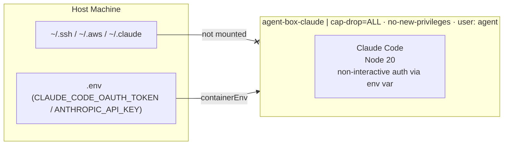

# agent-box - PoC Evaluation

| | |
| --- | --- |
| **Author** | Asutosh Panda |
| **Date** | `2026-05-20` |
| **Time invested** | `~6 hours` |
| **Tool version tested** | Claude Code `v2.1.159` |
| **Source / Docs** | [@anthropic-ai/claude-code](https://www.npmjs.com/package/@anthropic-ai/claude-code) · [containers.dev spec](https://containers.dev/) |
| **License** | Anthropic terms (Claude Code) |
| **Category** | AI coding agent · devcontainer · workload isolation |

---

## 1. What problem does this tool solve?

Claude Code runs with full access to your host filesystem and credentials by default. Every session can silently read `~/.ssh`, `~/.aws`, env vars, and anything else the process can reach on your machine. There is no isolation boundary between the agent and your host.

**agent-box** is a minimal, config-driven sandbox for running Claude Code in an isolated container. Security controls (capability drop, no-new-privileges) are applied at the container level. No host dotfiles or credential directories are mounted. Auth is non-interactive via env vars, so the same image works for both human-interactive use and unattended CI / ralph-loop use.

---

## 2. How it works (architecture)

A multi-stage `Dockerfile` builds a single image (`agent-box-claude`) on top of a minimal `base` layer. Agent config lives in `.devcontainer/agents.json`. `make claude` calls `scripts/start.sh`, which reads `agents.json`, generates `devcontainer.json` via `jq`, builds the image if missing, starts the container via the devcontainer CLI, writes the autorun command, and attaches a bash shell.



**Auth paths (pick one in `.env`):**

- **OAuth token (recommended for ralph loops / non-interactive use):** generate once on the host with `claude setup-token`, paste the printed token into `CLAUDE_CODE_OAUTH_TOKEN` in `.env`. Uses Pro/Max subscription rates. Valid ~1 year. Persistent across container rebuilds.
- **Anthropic API key:** set `ANTHROPIC_API_KEY` in `.env` (from [console.anthropic.com](https://console.anthropic.com/settings/keys)). Uses Anthropic API pricing.

The image bakes `~/.claude.json` with `hasCompletedOnboarding` + a trusted `/workspace` entry so first-run prompts (theme picker, syntax picker, `/login` URL, folder trust) are all skipped. Per the [Claude Code docs](https://code.claude.com/docs/en/authentication): if both env vars are set, `ANTHROPIC_API_KEY` wins over `CLAUDE_CODE_OAUTH_TOKEN`.

**What is in the image:**

| Tool | Version | Purpose |
|------|---------|---------|
| python:3.13-slim (base) | - | Debian bookworm runtime |
| Node.js | 20.x (LTS) | Claude Code runtime |
| Claude Code | 2.1+ | AI coding agent (Anthropic OAuth / API) |

---

## 3. Setup and reproduction steps

### Prerequisites

- Docker Desktop or OrbStack
- `jq` installed on host (auto-installed by `start.sh` if missing)
- `@devcontainers/cli` installed (auto-installed by `start.sh` via npm if missing)
- One auth method:
  - `CLAUDE_CODE_OAUTH_TOKEN` from `claude setup-token` on the host (recommended; Pro/Max subscription)
  - `ANTHROPIC_API_KEY` from [console.anthropic.com](https://console.anthropic.com/settings/keys)

### Step-by-step

```bash
# 1. Clone the repo
git clone https://github.com/one2nc/ai-bites.git
cd ai-bites/agent-box

# 2. Pick auth method and fill .env
#  OPTION A -- OAuth token (recommended for ralph loops / non-interactive):
#    On the host (one time):
#      claude setup-token       # prints a token, does not save
#    Then paste the token into CLAUDE_CODE_OAUTH_TOKEN in .env
#
#  OPTION B -- Anthropic API key:
#    Set ANTHROPIC_API_KEY in .env (from console.anthropic.com)

# 3. Start
make claude
# -> builds image on first run (~3 min), then reuses it
# -> first-run onboarding (theme/syntax/login/trust) is pre-skipped via baked
#    ~/.claude.json -- container starts straight at the Claude REPL
```

`make claude` is idempotent -- re-running reuses the existing container and image. `make down` tears down everything (containers + base + UID-remap wrapper images).

### `.env` reference

```bash
# Claude Code auth -- set ONE
#   OPTION A: long-lived OAuth token (Pro/Max subscription; ralph-loop friendly)
#     Generate on host: claude setup-token
CLAUDE_CODE_OAUTH_TOKEN=

#   OPTION B: Anthropic API key (API pricing)
ANTHROPIC_API_KEY=
```

### Known setup gotchas

- **`.env` is created automatically on first run** -- fill in your token/key and re-run.
- **Image is built automatically on first run** -- no separate build step. Takes ~3 min. Subsequent runs use Docker cache.
- **Claude auth is persistent** -- both `CLAUDE_CODE_OAUTH_TOKEN` and `ANTHROPIC_API_KEY` are read from `.env` on every container start, so auth survives `make down` + rebuild.
- **`devcontainer` CLI required** -- auto-installed by `start.sh` via npm if missing.
- **Token leak risk** -- `.env` is gitignored; never commit it. If you do, rotate the token via `claude setup-token` + revoke the old one in the Claude account settings.

---

## 4. Scenarios tested

### Scenario 1: Claude Code non-interactive auth via `CLAUDE_CODE_OAUTH_TOKEN`

**What I did:**
```bash
# One-time on host
claude setup-token   # printed an sk-ant-oat01-... token
# Paste the token into CLAUDE_CODE_OAUTH_TOKEN in .env
make claude
```

**What I expected:** Container starts, no browser, no OAuth URL, Claude REPL ready immediately.

**What actually happened:**
```
  ✓  claude auth: CLAUDE_CODE_OAUTH_TOKEN
╭─── Claude Code v2.1.159 ─────────────────────────╮
│  Welcome back!                                   │
│  Sonnet 4.6 · Claude API                         │
│  /workspace                                      │
╰──────────────────────────────────────────────────╯
❯
```

No theme picker, no syntax picker, no `/login` URL, no folder-trust dialog -- all four first-run prompts skipped via baked `~/.claude.json`. First prompt ran successfully on the env token.

### Scenario 2: `make down` cleans up base + wrapper images

**What I did:** `make claude` then `make down`.

**What I expected:** Both containers and images gone, including the `vsc-agent-box-<hash>-uid` UID-remap wrapper that the devcontainer CLI builds when host UID differs from the image UID (common in CI).

**What actually happened:** Containers removed, both `agent-box-claude` AND `vsc-agent-box-*` images removed. Idempotent on re-run (prints "no containers/images to remove").

---

## 5. Demo

A recording will be added once this PoC receives a green signal for pilot. The commands are intentionally designed to be the live demo -- `make claude` completes end-to-end in under 10 seconds after the first build, suitable for live demonstration without a pre-recorded video.

| Demo | Link | Duration |
|------|------|----------|
| `make claude` end-to-end | pending green signal | ~5s (after first build) |

---

## 6. Observations

- **Claude Code's non-interactive auth path is well-documented** -- the `CLAUDE_CODE_OAUTH_TOKEN` env var is supported per the [official docs](https://code.claude.com/docs/en/authentication), and `claude setup-token` generates a long-lived (1-year) token without saving it anywhere on the host. For CI use this is the right primitive.
- **Interactive Claude requires onboarding-state markers**, not just env-var auth. Even with a valid token, every fresh container would otherwise show theme picker -> syntax picker -> OAuth URL -> trust dialog on first run. The image bakes the `~/.claude.json` markers (`hasCompletedOnboarding`, `lastOnboardingVersion`, `projects[/workspace].hasTrustDialogAccepted`) so that flow is fully skipped. Reference: [anthropic/claude-code#9113](https://github.com/anthropics/claude-code/issues/9113).
- **Image size (~760 MB):** Node.js 20 runtime dominates; the base layer is intentionally minimal (`ca-certificates curl git jq make`).
- **agent-box vs kiln:** agent-box is container-level isolation (shared kernel). Kiln targets Firecracker VM isolation. Complementary -- agent-box is the good-enough answer for internal teams today.

---

## 7. Comparison with alternatives

Docker recently shipped [AI Sandboxes (`sbx`)](https://docs.docker.com/ai/sandboxes/agents/claude-code/) -- a managed sandbox runtime for Claude Code. It is the closest direct alternative.

| Dimension | agent-box (this) | Docker AI Sandboxes (sbx) | Run locally (no isolation) |
|-----------|-----------------|--------------------------|---------------------------|
| Isolation level | Container (cap-drop=ALL, no-new-privileges) | Container (Docker Desktop managed) | None |
| Credential exposure | Only explicit `containerEnv` forwarded | Docker-managed; host socket required | Full host access |
| Reproducible environment | Yes -- config-driven via `agents.json` + pinned Dockerfile | No -- runtime-provisioned, no image control | No |
| Auth via env token | Yes -- `CLAUDE_CODE_OAUTH_TOKEN` + onboarding markers baked in | Anthropic API key required | Yes |
| Onboarding on fresh container | Skipped (markers baked) | Not documented | Manual |
| Works without Docker Desktop | Yes (OrbStack or any Docker runtime) | Docker Desktop required | Yes |
| Team portability | Yes -- clone and run, image buildable anywhere | Requires Docker Desktop + sbx plugin | N/A |
| Open source / auditable | Yes -- Dockerfile, agents.json, Makefile | Closed -- managed by Docker | N/A |
| Cost | Free (token/API costs only) | Free (Docker Desktop) | Free |

**Summary:** sbx solves the same problem but requires Docker Desktop. agent-box is runtime-agnostic, team-portable, and ships with the onboarding-skip + non-interactive-auth setup baked in. For one2n's use case (team tooling, existing OrbStack/Linux infra, ralph-loop CI), agent-box is the better fit.

---

## 8. Pros

- Zero host credential exposure -- `~/.ssh`, `~/.aws`, `~/.claude` are not mounted by design
- Non-interactive auth + onboarding-skip baked into the image, so unattended runs (CI, ralph loops) work out of the box
- `make claude` gives a Codespaces-like experience locally -- one command, terminal lands at the Claude REPL
- Auto-builds image on first run, reuses on subsequent runs -- no separate build step
- Fully portable -- works on any machine with Docker when cloned
- Follows one2n Dockerfile principles -- ARG-based UID, non-root, OCI LABELs, `SHELL pipefail`, JSON CMD, `.dockerignore`

---

## 9. Cons

- Image is ~760 MB -- acceptable for a devcontainer, not a production runtime
- First run takes ~3 min to build; subsequent runs use Docker cache (~5s)
- `@devcontainers/cli` and `jq` are host dependencies (auto-installed but require network)
- `lastOnboardingVersion` marker in `~/.claude.json` is version-pinned to whatever `claude --version` reports at image build time. If Claude Code ships a new onboarding flow, a rebuild may be needed.

---

## 10. Cost analysis

- **Token/API costs:** Claude Code with a Pro/Max subscription has no per-token cost for individuals. With an API key, costs are per-token at standard Anthropic API rates.
- **Infra costs:** Docker only -- no cloud compute, no registry fee. Image built locally.
- **Human costs:** ~6 hours initial setup. Ongoing maintenance is low -- Claude Code is installed via npm; updates are a one-line bump and rebuild.

---

## 11. Verdict

**Pilot** -- trial with the one2n team for 2-3 weeks on a real project.

The isolation story is solid for internal developer tooling. The `make claude` experience matches Codespaces closely enough for a compelling demo. The non-interactive auth path means the same image works for human-interactive use AND unattended ralph loops without code changes. The main thing to validate in a pilot is day-to-day friction: does the 3-minute first-build time put people off, and does the env-token rotation cadence (~1 year per `claude setup-token`) need any team-wide tooling.

### Next steps for pilot

- Push image to GHCR so team members skip the first build
- Add CI: `hadolint` + `docker build --check` on every PR to `agent-box/`
- Record demo (Loom or asciinema) once pilot is approved -- `make claude` flow end-to-end

### Revisit trigger

If the baked `lastOnboardingVersion` marker stops being honored by future Claude Code releases (i.e. fresh containers start showing onboarding prompts again), revisit by checking what new keys `~/.claude.json` gains after a manual first-run on host and bake those in alongside.

---

## 12. Issues / PRs filed

None filed upstream.

| Type | Link | Status |
|------|------|--------|
| - | - | - |

---

## 13. References

- [@anthropic-ai/claude-code on npm](https://www.npmjs.com/package/@anthropic-ai/claude-code)
- [Claude Code Authentication docs](https://code.claude.com/docs/en/authentication)
- [anthropic/claude-code#9113 -- Workspace Trust Dialog Not Respecting Pre-configured ~/.claude/.claude.json](https://github.com/anthropics/claude-code/issues/9113)
- [VS Code Dev Containers spec](https://containers.dev/)
- [Docker AI Sandboxes - Claude Code](https://docs.docker.com/ai/sandboxes/agents/claude-code/)
- [Sysdig - Dockerfile security best practices](https://sysdig.com/learn-cloud-native/dockerfile-best-practices)
- [Docker official build best practices](https://docs.docker.com/build/building/best-practices/)
