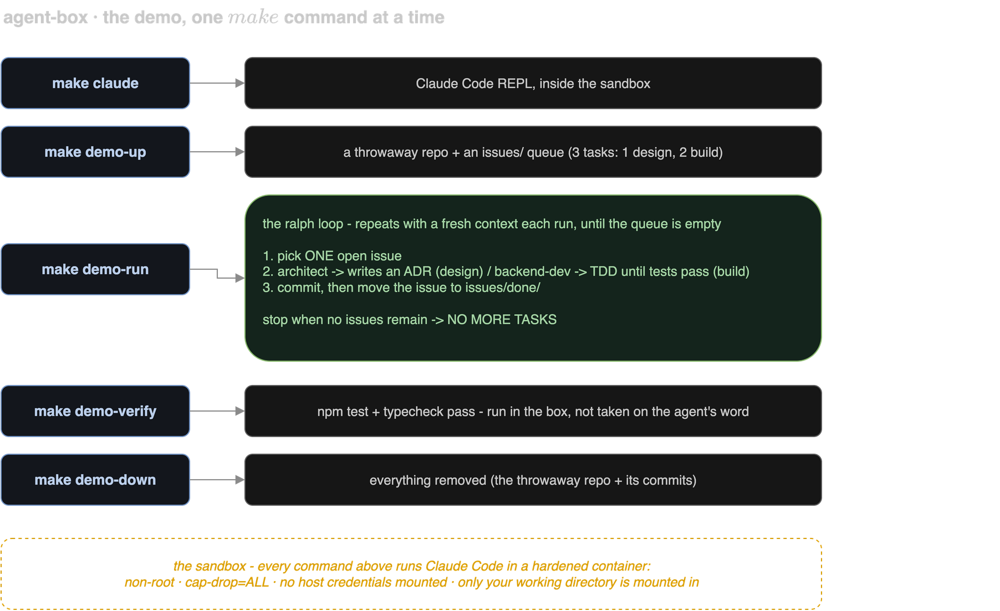

# agent-box -- PoC Evaluation

| | |
| --- | --- |
| **Author** | Asutosh Panda |
| **Date** | `2026-05-20` (skills + ralph loop added `2026-06`) |
| **Time invested** | `~10 hours` |
| **Tool version tested** | Claude Code `v2.1.159` |
| **Source / Docs** | [@anthropic-ai/claude-code](https://www.npmjs.com/package/@anthropic-ai/claude-code) · [containers.dev spec](https://containers.dev/) · [Ralph technique](https://ghuntley.com/ralph/) |
| **License** | Anthropic terms (Claude Code) |
| **Category** | AI coding agent · container isolation · autonomous loops |

---

## 1. What problem does this tool solve?

Claude Code runs with **full access to your host** by default: it can read `~/.ssh`, `~/.aws`, env vars, and anything else your user can reach. There is no boundary between the agent and your machine. That is tolerable for a human watching a REPL; it is not acceptable for **unattended** use (CI, or a "ralph" loop running with `--dangerously-skip-permissions`).

**agent-box** is a minimal, config-driven sandbox that runs Claude Code in an isolated container: capabilities dropped, non-root user, no host credentials mounted, auth injected as an env var. The **same image** serves two audiences:

- **Any one2n teammate, locally** -- an isolated agent in their own terminal, token sourced from the org (no per-person Anthropic account needed).
- **CI / unattended** -- the same image run headless, token from a CI secret.

---

## 2. How it works (architecture)

A multi-stage `Dockerfile` builds one image (`agent-box-claude`) on a minimal base. The interactive path (`make claude` -> `scripts/start.sh`) generates `devcontainer.json` from `agents.json` + `devcontainer.base.json`, builds the image if missing, brings the container up via the devcontainer CLI, and attaches a shell. The headless path (`scripts/headless.sh`, used by the ralph loop) is a plain `docker run --rm` with the same isolation flags.

The diagram below is the demo flow -- each `make` command and what it produces, with the ralph loop as the centerpiece, all inside the sandbox:

<div align="center">
<picture>
  <source media="(prefers-color-scheme: dark)" srcset="docs/architecture-dark.png">
  <source media="(prefers-color-scheme: light)" srcset="docs/architecture-light.png">
  
</picture>
</div>

**The isolation boundary:**

- `cap-drop=ALL` · `no-new-privileges` · non-root `agent` user.
- No host credentials mounted (`~/.ssh`, `~/.aws`, `~/.claude` stay on the host).
- Only your working directory is mounted, as `/workspace`. Agent writes land in *your* repo, nowhere else.
- Auth = one env var (`CLAUDE_CODE_OAUTH_TOKEN` or `ANTHROPIC_API_KEY`), read from your shell env or `.env`, never a mounted credential file.

Verify the boundary yourself (deterministic, no LLM call):

```bash
docker run --rm --entrypoint bash agent-box-claude:latest -lc 'id; ls ~/.ssh 2>&1 || true; env | grep -iE "secret|aws|token" || echo "no secret env"'
```

Non-root `agent`, no host keys, no secret env -- the only way in is the cwd mount and the one auth env var.

**Baked into the image:**

- **Skills** at `~/.claude/skills/`: `architect` (design -> ADR, no code) and `backend-dev` (strict TDD). Every run gets the same reviewed persona set.
- **Onboarding-skip markers** in `~/.claude.json` (`hasCompletedOnboarding` + trusted `/workspace`) so a fresh container lands straight at the REPL instead of the theme/syntax/login/trust prompts (ref: [claude-code#9113](https://github.com/anthropics/claude-code/issues/9113)).

**What is in the image:**

| Tool | Version | Purpose |
| --- | --- | --- |
| `python:3.13-slim` (base) | Debian bookworm | minimal runtime |
| Node.js | 20.x LTS | Claude Code runtime |
| Claude Code | 2.1+ | the agent |

---

## 3. Setup and reproduction steps

### Prerequisites

- Docker (OrbStack or Docker Desktop).
- For the interactive path: `jq` and `@devcontainers/cli` (auto-installed by `start.sh` if missing). The headless/ralph path needs only Docker.
- One auth value: `CLAUDE_CODE_OAUTH_TOKEN` (from `claude setup-token`, recommended) or `ANTHROPIC_API_KEY`.

### Step-by-step

```bash
git clone https://github.com/one2nc/ai-bites.git && cd ai-bites/agent-box
cp .env.example .env          # fill ONE auth value (or export it from the org secret store)
make claude                   # builds image first run (~3 min), then reuses it -> Claude REPL
```

### Make targets

| target | what |
| --- | --- |
| `make claude` | interactive sandboxed REPL |
| `make claude-headless ARGS='...'` | one non-interactive shot (forwards ARGS to `claude`) |
| `make demo-up` / `demo-run` / `demo-verify` / `demo-down` | the ralph-loop demo lifecycle |
| `make diagram` | re-render the architecture PNGs from `docs/architecture.drawio` |
| `make down` | tear down containers + images |

### Known setup gotchas

- `.env` is created from `.env.example` on first run if missing -- fill it and re-run.
- The image builds automatically on first run (~3 min); later runs use the Docker cache.
- Auth survives `make down` + rebuild (read from `.env`/env every start).
- `.env` is gitignored -- never commit it; rotate via `claude setup-token` + revoke if leaked.

---

## 4. Scenarios tested

### Scenario 1: Non-interactive auth via `CLAUDE_CODE_OAUTH_TOKEN`

**What I did:** `claude setup-token` on the host, pasted the token into `.env`, `make claude`.

**What I expected:** container starts, no browser/OAuth URL, REPL ready immediately.

**What actually happened:** `claude auth: CLAUDE_CODE_OAUTH_TOKEN`, then straight to the Claude v2.1.159 REPL at `/workspace`. No theme/syntax/login/trust prompts -- all four skipped via the baked `~/.claude.json`.

### Scenario 2: `make down` cleans up base + UID-remap wrapper images

**What I did:** `make claude`, then `make down`.

**What I expected:** containers + `agent-box-claude` AND the `vsc-agent-box-*-uid` wrapper image (built by the devcontainer CLI when host UID differs) all removed.

**What actually happened:** all removed; idempotent on re-run.

### Scenario 3: The ralph loop -- autonomous backlog burn-down (the real test)

**What I did:**
```bash
make demo-up      # throwaway repo: a Node project + a one-line BRIEF.md
make demo-run     # architect turns the brief into issues; backend-dev builds them, one per run
make demo-verify  # run the tests in the box, independent of the agent's claims
```

**What I expected:** from one brief, the architect writes the backlog, then backend-dev implements one issue per run, committing each, until the queue is empty.

**What actually happened:** 4 runs. Run 1 -> `architect` read `BRIEF.md`, wrote `docs/adr/001-*.md` (divide-by-zero policy) **and** wrote the task list into `ralph/issues/`, committed, handed off. Runs 2-3 -> `backend-dev`, strict TDD (`npm test` + typecheck green), one commit each, issues moved to `ralph/issues/done/`. Run 4 -> empty queue -> `<promise>NO MORE TASKS</promise>`. One clean commit per task; **commits landed in the throwaway repo, not in ai-bites** (the loop's only mount is its own cwd); `make demo-verify` confirmed the tests pass independently. (Verified end-to-end on a Linux CI runner too, before we retired the workflow.)

---

## 5. Demo

The `make` commands above *are* the demo, run live: `make claude` for the interactive REPL, then the ralph loop (`make demo-up` -> `make demo-run` -> `make demo-verify` -> `make demo-down`).

| Demo | How | Duration |
| --- | --- | --- |
| `make claude` + the ralph loop | live, via the `make` targets above | ~10 min |

---

## 6. Observations

- **Non-interactive auth is a first-class, documented path** (`CLAUDE_CODE_OAUTH_TOKEN` per the [auth docs](https://code.claude.com/docs/en/authentication)); `claude setup-token` issues a ~1-year token without saving it on the host. Right primitive for CI.
- **Interactive Claude needs onboarding-state markers, not just a token** -- without the baked `~/.claude.json`, every fresh container shows theme -> syntax -> login -> trust. Markers fix it (ref #9113).
- **Skills shape behavior** -- on the demo, the `architect` skill produced design-only output (ADR, no code) and the `backend-dev` skill held TDD discipline, with a clean architect->backend-dev handoff across iterations.
- **The ralph loop's memory is the filesystem** (issues + git log), not the context window -- each run starts fresh, which is what keeps it from drifting.
- **Image ~760 MB** -- Node 20 dominates; acceptable for a devcontainer.
- **agent-box vs kiln:** container-level isolation (shared kernel) vs Firecracker micro-VM. Complementary; agent-box is the good-enough answer for internal tooling today.

---

## 7. Comparison with alternatives

| Dimension | agent-box (this) | Docker AI Sandboxes (`sbx`) | Run locally (no isolation) |
| --- | --- | --- | --- |
| Isolation | Container (`cap-drop=ALL`, `no-new-privileges`) | Container (Docker Desktop managed) | None |
| Credential exposure | Only the auth env var forwarded | Docker-managed; host socket | Full host access |
| Reproducible env | Yes (pinned Dockerfile + `agents.json`) | No (runtime-provisioned) | No |
| Skills / personas baked | Yes (`architect`, `backend-dev`) | No | Manual |
| Autonomous loop included | Yes (`ralph.sh` + demo harness) | No | No |
| Works without Docker Desktop | Yes (OrbStack / any Docker) | No (Desktop required) | Yes |
| Open / auditable | Yes (Dockerfile + scripts) | No (closed/managed) | N/A |

`sbx` solves the same isolation problem but requires Docker Desktop. agent-box is runtime-agnostic, team-portable, auditable, and ships the skills + ralph harness baked in -- the better fit for one2n's OrbStack/Linux infra and CI.

---

## 8. Pros

- Zero host credential exposure -- `~/.ssh`, `~/.aws`, `~/.claude` not mounted by design.
- Same image for interactive **and** unattended use; non-interactive auth + onboarding-skip baked in.
- Curated skills baked in -- one reviewed persona set for the whole team, no per-dev drift.
- A working autonomous-loop harness (`ralph.sh` + `make demo-*`) with independent verification (`demo-verify`).
- Runtime-agnostic and portable -- runs on any Docker (OrbStack or Desktop), Linux or macOS.

---

## 9. Cons

- Container, not a VM (shared kernel) -- not a defense against a hostile kernel exploit; kiln covers that.
- The ralph loop uses `--dangerously-skip-permissions` -- safe only *because* it's sandboxed + cwd-only; must never be run un-sandboxed.
- "One task per run" is a prompt instruction, not harness-enforced -- a model can ignore it.
- Image ~760 MB; first build ~3 min.
- Onboarding-skip markers are pinned to the baked Claude version; a new onboarding flow needs a rebuild.

---

## 10. Cost analysis

- **Token/API:** Pro/Max subscription has no per-token cost for individuals; an API key bills at standard rates. The ralph loop spends tokens per iteration -- bound it with `make demo-run N=<cap>`.
- **Infra:** Docker only; image built locally, no registry/cloud fee.
- **Human:** ~10 hours to build (base sandbox + skills + ralph harness + demo). Maintenance is low (Claude Code is an npm bump + rebuild).

---

## 11. Verdict

**Pilot** -- trial with the one2n team for 2-3 weeks on a real backlog.

### Rationale

The isolation story is solid, the `make claude` experience matches Codespaces closely, and the same image already covers the two use cases this was built for (local-per-dev and unattended/CI). The ralph loop demonstrably burns a backlog into clean, verifiable commits without touching anything outside its own repo.

### If Pilot -- next steps

- Push the image to GHCR so teammates skip the first build.
- A CI workflow could run the loop headless (the `headless.sh` primitive already supports it) -- left out for now to keep Actions spend down.
- Document org-token sourcing for the team's secret store.
- **Success criteria:** does the 3-min first build deter adoption; does one-task-per-run hold on messy real issues; is token-rotation cadence manageable.

---

## 12. Issues / PRs filed

None filed upstream.

| Type | Link | Status |
| --- | --- | --- |
| - | - | - |

---

## 13. References

- [@anthropic-ai/claude-code (npm)](https://www.npmjs.com/package/@anthropic-ai/claude-code)
- [Claude Code authentication docs](https://code.claude.com/docs/en/authentication)
- [claude-code#9113 -- pre-configured trust dialog](https://github.com/anthropics/claude-code/issues/9113)
- [Ralph technique -- Geoffrey Huntley](https://ghuntley.com/ralph/)
- [Docker AI Sandboxes -- Claude Code](https://docs.docker.com/ai/sandboxes/agents/claude-code/)
- [VS Code Dev Containers spec](https://containers.dev/)

---

## Appendix: Raw notes / logs

<details>
<summary>Click to expand</summary>

- Skills baked at `/home/agent/.claude/skills/{architect,backend-dev}/SKILL.md`; verified present in-image and listed by Claude at runtime.
- Headless run mounts only `$PWD` as `/workspace`; `docker inspect` shows no `~/.ssh|~/.aws|~/.claude` mounts.
- Demo git history (one run): `seed` -> `adr: 001-...` -> `feat(calc): add/subtract` -> `feat(calc): multiply/divide`, then `NO MORE TASKS`.
- `make demo-verify` runs `npm test` + `npm run typecheck` inside the box against `.demo/`.

</details>
