# HolmesGPT — SREGym-Lite on a VM with gpt-oss-120b

| | |
| --- | --- |
| **Author** | `Sahil Joseph` |
| **Date** | `2026-10-23` |
| **Tool version tested** | HolmesGPT `0.45.0` (Docker image) |
| **Benchmark** | [SREGym-Lite](https://github.com/SREGym/SREGym/blob/main/docs/SREGym-Lite.md), 17 problems |
| **Model (agent and judge)** | `gpt-oss-120b` on the one2n GPUStack (vLLM 0.25.1) |
| **Cluster** | SREGym's upstream kind setup (1 control plane + 3 workers, Calico), `--profile full`. Control plane capped at 4 GiB; workers capped at 4 GiB for problem 1, uncapped from problem 2 (run note 1 below) |
| **Setup** | [setup.md](setup.md) |
| **Builds on** | [Experiment 3: HolmesGPT on SREGym-Lite](../3-sregym-lite/README.md) (Sonnet 4.5, single-node, `svelte`) |

---

## 1. What this answers

Experiment 3 ran HolmesGPT on SREGym-Lite with Claude Sonnet 4.5 on a single-node, 8 GB cluster, and
only 7 problems produced valid grades. This run repeats the full suite on SREGym's own 4-node kind
setup with the `full` profile, using a self-hosted open-weight model (`gpt-oss-120b`) instead of a
commercial API. The question: how does HolmesGPT score with a self-hosted model on the complete,
upstream-comparable benchmark?

Only the **diagnosis** stage is run: HolmesGPT is read-only, so mitigation would fail by construction.

---

## 2. Method

- Problems run one at a time, in SREGym-Lite order, by [`scripts/campaign.sh`](scripts/campaign.sh): each
  under a terminal recording (`make record-run`), after waiting for the model endpoint to answer.
- HolmesGPT gets the application name, namespace(s) and description from SREGym, and must end with a
  `ROOT CAUSE` section. It isn't told the fault type. Up to 60 steps, 3 attempts on a failed run,
  within SREGym's 30-minute agent budget.
- Data sources: Kubernetes through SREGym's filtered proxy, plus SREGym's Prometheus, Loki and Jaeger MCP
  servers. The driver checks the MCP server before each HolmesGPT run and re-opens its port-forward if needed.
- SREGym's LLM judge scores the diagnosis against the known root cause (pass/fail and a 0–100 composite).
- The same model is agent and judge, which can flatter the agent; the judge uses a fixed checklist rubric.

### Environment and testing

The VM has no desktop, so these are terminal recordings
([`scripts/record.sh`](scripts/record.sh), asciinema): each screenshot is the last frame, and each
recording is the whole session as a GIF. The `.cast` files in [`recordings/`](recordings/) replay at full
speed (`asciinema play recordings/<name>.cast`).

**Cluster:** SREGym's upstream kind setup, 4 nodes at 4 GiB each, Calico on every node

Recording (GIF)

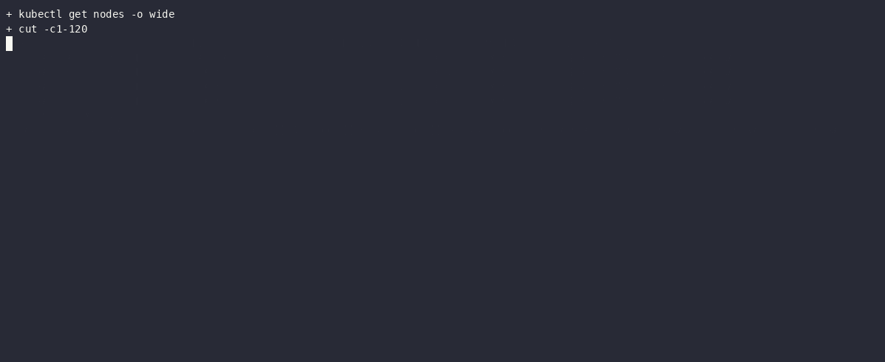

**Preflight:** everything a benchmark run needs

Recording (GIF)

**Model check:** GPUStack through the SSH tunnel, `gpt-oss-120b` returns a parsed tool call

Recording (GIF)

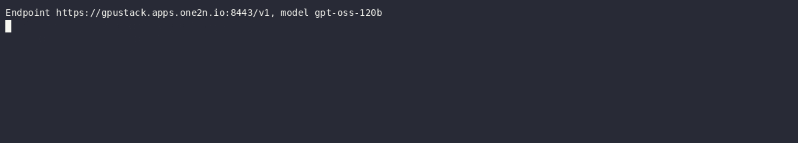

**HolmesGPT smoke test:** `holmes ask` against the cluster. The first tool call failed with "out of
memory" on a ~30K-character output; HolmesGPT switched to a narrower `jq` query and answered correctly.

Recording (GIF)

---

## 3. Results

Fresh run of all 17 problems, started 2026-10-23. An earlier partial attempt is archived in
[`archive/attempt-1/`](archive/attempt-1/README.md); see [run notes](#5-run-notes) for why it was restarted.

### Scorecard

| Problems run | ✅ Passed | ❌ Failed | ⚠️ Not graded | Pass rate | Avg judge score | Avg investigation |
|---:|---:|---:|---:|---:|---:|---:|
| 8/17 | 0 | 6 | 2 | 0% | 8/100 | 4.9 min |

### Per problem

| # | Problem | Diagnosis | Score | Investigation | Notes |
|---|---------|-----------|------:|--------------:|-------|
| 1 | `cronjob_sidecar_blocks_completion_hotel_reservation` | ❌ fail | 0 | 4.1 min | Verdict False (composite 0.00). D1 0.00, D2 0.00, D3 0.00. 24 tool calls, 25 LLM calls, 754K tokens, 1 Prometheus call |
| 2 | `edge_request_filter_cpu_saturation` | ❌ fail | 0 | 5.7 min | Verdict False (composite 0.00). D1 0.00, D2 0.00, D3 0.00. 27 tool calls, 28 LLM calls, 943K tokens; 5 Prometheus, 1 Jaeger, `kubectl top` |
| 3 | `network_policy_block` | ⚠️ invalid: model stalled (run note 3); rerun queued | | | Both HolmesGPT attempts timed out waiting on GPUStack; [logs](results/network_policy_block--invalid-model-stall/) |
| 4 | `env_variable_shadowing_astronomy_shop` | ❌ fail | 45 | 2.6 min | Verdict False (composite 0.45). D1 0.67, D2 0.00, D3 0.67. 12 tool calls, 13 LLM calls, 317K tokens; 1 Prometheus (alerts), `kubectl top` |
| 5 | `mutating_webhook_resource_limits_social_network` | ⚠️ invalid: model stalled (run note 4); rerun queued | | | Attempt 1 timed out after 17 tool calls; attempts 2–3 got `InternalServerError`; [logs](results/mutating_webhook_resource_limits_social_network--invalid-model-stall/) |
| 6 | `finalizer_deadlock_controller_hotel_reservation` | ❌ fail | 0 | 3.6 min | Verdict False (composite 0.00). D1 0.00, D2 0.00, D3 0.00. 15 tool calls, 16 LLM calls, 710K tokens; 0 observability calls |
| 7 | `kafka_poison_pill_hol_block` | ❌ fail | 0 | 3.8 min | Verdict False (composite 0.00). D1 0.00, D2 0.00, D3 0.00. 11 tool calls, 12 LLM calls, 452K tokens; 0 observability calls |
| 8 | `internal_traffic_policy_local_astronomy_shop` | ❌ fail | 0 | 9.6 min | Verdict False (composite 0.00). D1 0.00, D2 0.00, D3 0.00. 27 tool calls, 28 LLM calls, 1.57M tokens; 1 Prometheus (alerts). Needed a second attempt (attempt 1 ended `rc=1`) |
| 9 | `service_dns_resolution_failure_social_network` | pending | | | |
| 10 | `service_wrong_pod_selection_hotel_reservation` | pending | | | |
| 11 | `namespace_memory_limit` | pending | | | |
| 12 | `valkey_auth_disruption` | pending | | | |
| 13 | `secret_rotation_stale_env_credentials_astronomy_shop` | pending | | | |
| 14 | `unschedulable_incorrect_port_assignment` | pending | | | |
| 15 | `duplicate_pvc_mounts_social_network` | pending | | | |
| 16 | `rolling_update_misconfigured_social_network` | pending | | | |
| 17 | `search_rate_retry_collapse_hotel_reservation` | pending | | | |

---

## 4. Per-problem observations

Ground truth, what HolmesGPT concluded, and how it got there. Added after each problem finishes.

| # | Problem | Ground truth | What HolmesGPT concluded | Why it passed / missed |
|---|---------|--------------|--------------------------|------------------------|
| 1 | `cronjob_sidecar_blocks_completion_hotel_reservation` | CronJob `audit-log-archiver`: a sidecar keeps the Job pod from completing | Cluster-wide CoreDNS outage: `reservation` and `profile` panic (`no reachable servers`) because they can't resolve `mongodb-reservation`/`mongodb-profile` | Never listed CronJobs or Jobs (0 of 24 tool calls). It started from the MongoDB startup panics, which occur on every hotel-reservation deploy and have cleared by fault injection. To check them it used HolmesGPT's `tcp_check` connectivity tool, which runs **inside the HolmesGPT container on the VM**, where cluster DNS names never resolve. That `could not resolve host` was a harness artifact, and it turned startup noise into a "cluster-wide DNS outage". An empty Prometheus result for `coredns_dns_requests_total` (CoreDNS isn't scraped) seemed to confirm it. Experiment 3 also missed this problem, with Consul startup errors as the decoy. |
| 2 | `edge_request_filter_cpu_saturation` | `frontend-proxy`: a new edge/WAF filter regex backtracks catastrophically on long `waf` query values, saturating CPU and timing out healthy paths | The `email` service's Puma server has only 5 threads; under load it returns HTTP 408, so the frontend's shipping quotes and checkout fail; raise the thread pool | **Followed the symptom downstream.** The 408 timeouts on calls through the edge are the fault's *effect*; HolmesGPT traced them to `email` and explained them with Puma's default thread count, which is unchanged on every deploy. This was the first run where it used observability heavily: 5 Prometheus queries (all about `email`: latency quantiles, `up`, CPU, status codes), Jaeger traces for `frontend`, and `kubectl top pods -A`, which shows per-pod CPU and so could have exposed `frontend-proxy`, but it didn't follow that lead. It never opened `frontend-proxy`'s logs or config. Two more `<\|channel\|>` tool-name leaks, and `tcp_check` again resolved cluster DNS from the host (run note 2 of this run). |
| 4 | `env_variable_shadowing_astronomy_shop` | `frontend-proxy` defines `FRONTEND_HOST` twice; the later `localhost` shadows `frontend`, so it routes to the wrong upstream | `frontend-proxy` is OOMKilled at its 65Mi limit (restartCount 4, exit 137) and crash-loops, so the UI can't reach any service; raise its memory to 128Mi/256Mi | **Right component, wrong mechanism** (same answer as attempt 1, now 45/100). The OOMs are real and follow the fault: with `FRONTEND_HOST=localhost` the proxy most likely routes to itself until Envoy runs out of memory. HolmesGPT read `kubectl describe`, which lists the container's env and shows `FRONTEND_HOST` twice, but it stopped at the termination reason and the 65Mi limit. Prometheus' `KubePodNotReady` alert seemed to confirm it. A short, focused investigation (2.6 min) that committed to the first concrete error. |
| 6 | `finalizer_deadlock_controller_hotel_reservation` | A ConfigMap stuck Terminating behind a finalizer: ClusterRole `configmap-cleanup-controller` was made read-only, so the cleanup controller logs 403s and can't remove the finalizer | `reservation` crashed at startup (`panic: no reachable servers`, restartCount 2) because `mongodb-reservation` became ready 4 seconds after it; add an init container or retry logic | **Back on the startup decoy.** The `reservation` restarts at 10:06:21 come from the deploy itself, about 4 seconds before `mongodb-reservation` was ready, and had cleared before the fault was injected. HolmesGPT spent all 15 tool calls on `reservation` and its database (pods, logs, events, endpoints, probes) and never looked at ConfigMaps, finalizers, ClusterRoles or the controller's 403s. It made no Prometheus, Loki or Jaeger calls; the controller's 403s would have shown in Loki. Experiment 3 (Sonnet 4.5) also scored 0 here, inventing a QPS limit. |
| 7 | `kafka_poison_pill_hol_block` | Poison-pill record on topic `orders-fulfillment`: the consumer group can't deserialize it, never commits, and lag grows while every pod stays Ready | `grafana` restarts because it binds `0.0.0.0:8080`, which is "already in use by other services" (`checkout`, `cart`, ...); move Grafana to port 3000 | **Deploy noise plus a fabricated mechanism.** Grafana's restarts (restartCount 3) date from the slow astronomy-shop deploy, when it waited on OpenSearch (run note 1), not from the fault. HolmesGPT then explained them with a port conflict against other services' port 8080, which can't happen: each pod has its own network namespace. It never looked at Kafka, the `orders-validator` consumer's logs, or consumer lag (11 tool calls, 0 Prometheus/Loki). **This is the one problem Experiment 3 passed** (Sonnet 4.5, 78/100, from the consumer's parse error at offset 20), so on the same problem the model, not the harness, made the difference. |
| 8 | `internal_traffic_policy_local_astronomy_shop` | `recommendation` Service set to `internalTrafficPolicy: Local`, with its caller and backend pinned to different worker nodes, so in-cluster calls from the caller's node find no local endpoint | The OpenTelemetry Collector's `kubeletstatsreceiver` can't scrape kubelet metrics: the kubelet certificates have no IP SANs (`tls: failed to verify certificate … does not contain any IP SANs`); regenerate them or set `insecure_skip_verify` | **Closest yet, then pulled away by a kind quirk.** HolmesGPT was on the right path: Prometheus' `ServiceEndpointDown` alert for `recommendation`, then `recommendation`'s endpoints, pod IPs and host IPs (the node placement that is the heart of the fault). It never read the Service's spec (`internalTrafficPolicy`), and settled on the collector's TLS errors instead. Those are real but present on every kind cluster (kind's self-signed kubelet certs have no IP SANs), so they are environment noise unrelated to the fault. Experiment 3 couldn't run this problem (single node). |

### Execution

Each graded problem shows HolmesGPT's root cause with the judge's verdict, a GIF of the whole run (20×
speed: deploy, fault injection, HolmesGPT's investigation, judging, cleanup) and the run's last frame.
Logs are in `results/<problem>/`: `sregym.log` (conductor), `holmes.log` (HolmesGPT transcript),
`holmes.json` (every tool call, tokens, answer), `judge.csv` (verdict, checklist, timings), `run.log`
(`make run-one` output) and `answer.md`. The asciinema casts replay a run at full speed
(`asciinema play recordings/run-<problem>.cast`).

**1. `cronjob_sidecar_blocks_completion_hotel_reservation`**: ❌ fail · score 0/100 · [logs](results/cronjob_sidecar_blocks_completion_hotel_reservation/) · [asciinema cast](recordings/run-cronjob_sidecar_blocks_completion_hotel_reservation.cast)

*Run video (20× speed):*

End of the run (last frame)

**2. `edge_request_filter_cpu_saturation`**: ❌ fail · score 0/100 · [logs](results/edge_request_filter_cpu_saturation/) · [asciinema cast](recordings/run-edge_request_filter_cpu_saturation.cast)

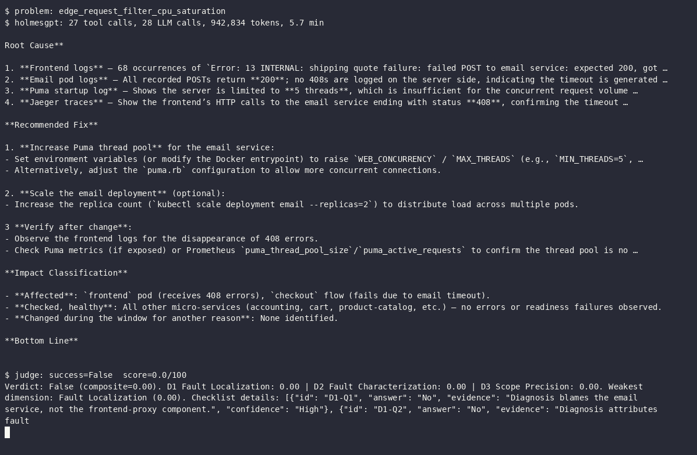

*Run video (20× speed):*

End of the run (last frame)

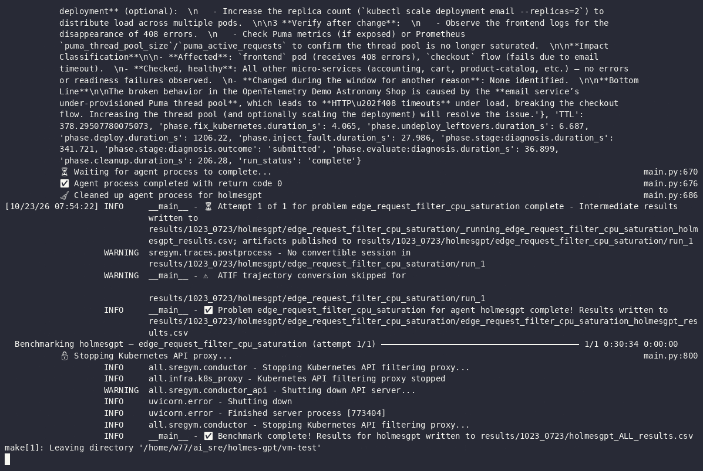

**3. `network_policy_block`**: ⚠️ invalid: model stalled (run note 3); rerun queued · [logs](results/network_policy_block--invalid-model-stall/)

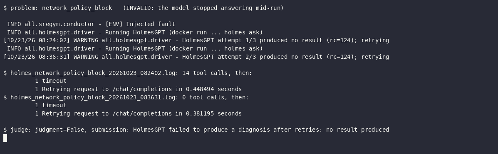

**4. `env_variable_shadowing_astronomy_shop`**: ❌ fail · score 45/100 · [logs](results/env_variable_shadowing_astronomy_shop/) · [asciinema cast](recordings/run-env_variable_shadowing_astronomy_shop.cast)

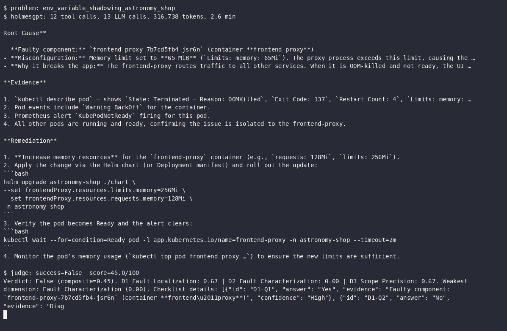

*Run video (20× speed):*

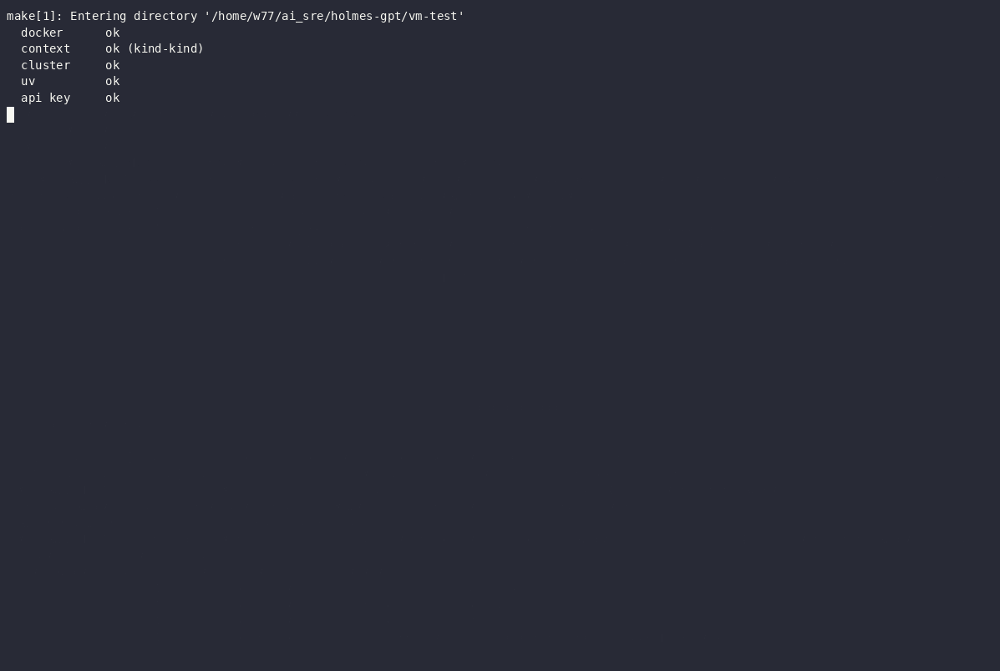

End of the run (last frame)

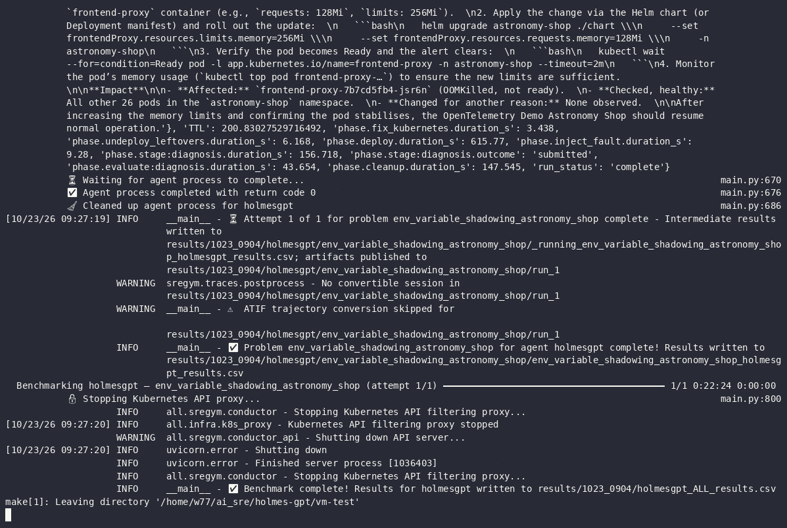

**5. `mutating_webhook_resource_limits_social_network`**: ⚠️ invalid: model stalled (run note 4); rerun queued · [logs](results/mutating_webhook_resource_limits_social_network--invalid-model-stall/)

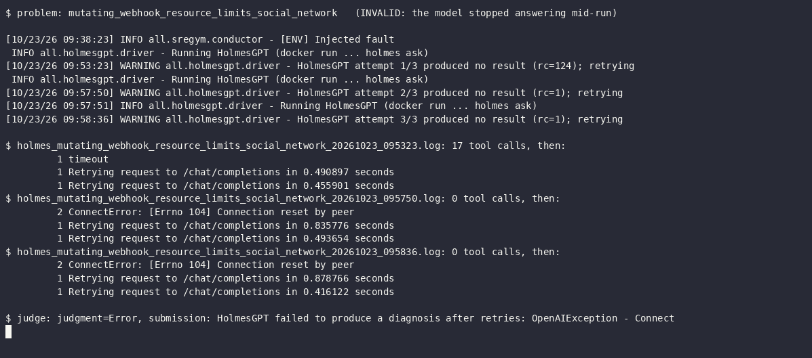

**6. `finalizer_deadlock_controller_hotel_reservation`**: ❌ fail · score 0/100 · [logs](results/finalizer_deadlock_controller_hotel_reservation/) · [asciinema cast](recordings/run-finalizer_deadlock_controller_hotel_reservation.cast)

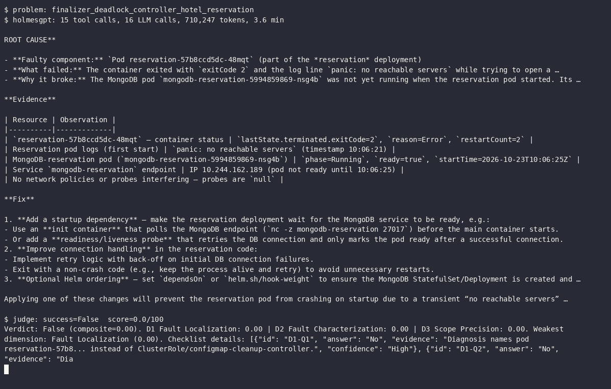

*Run video (20× speed):*

End of the run (last frame)

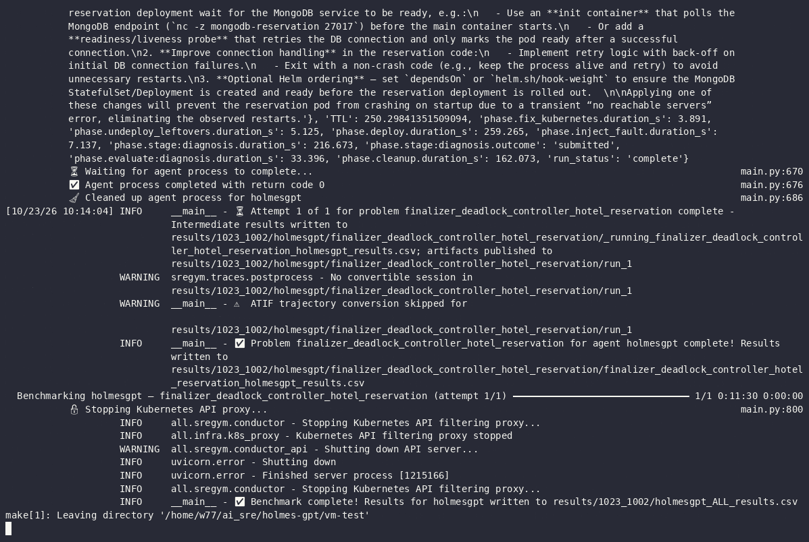

**7. `kafka_poison_pill_hol_block`**: ❌ fail · score 0/100 · [logs](results/kafka_poison_pill_hol_block/) · [asciinema cast](recordings/run-kafka_poison_pill_hol_block.cast)

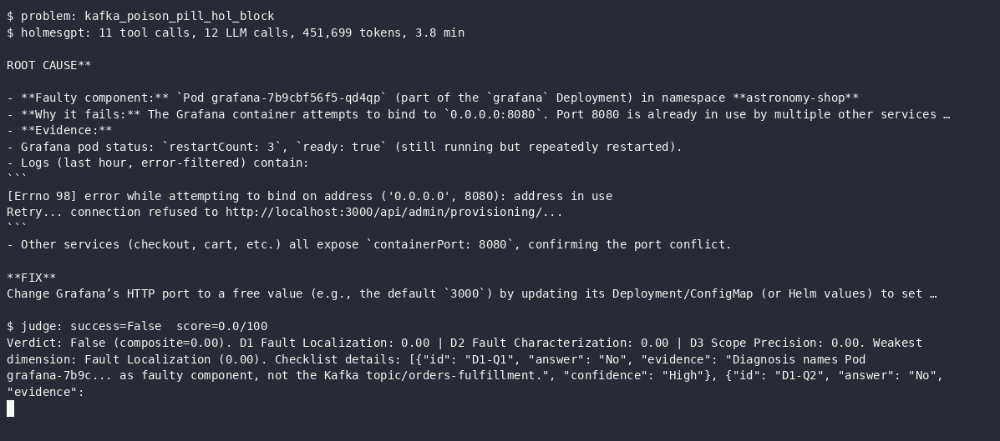

*Run video (20× speed):*

End of the run (last frame)

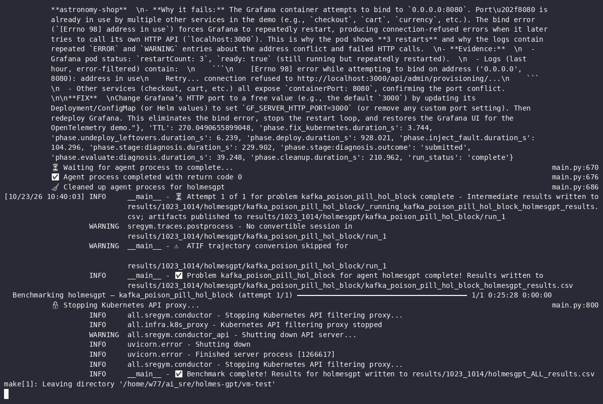

**8. `internal_traffic_policy_local_astronomy_shop`**: ❌ fail · score 0/100 · [logs](results/internal_traffic_policy_local_astronomy_shop/) · [asciinema cast](recordings/run-internal_traffic_policy_local_astronomy_shop.cast)

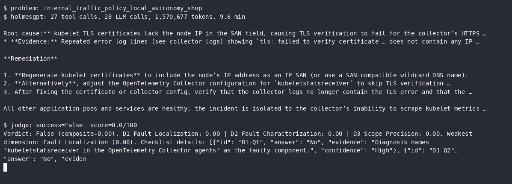

*Run video (20× speed):*

End of the run (last frame)

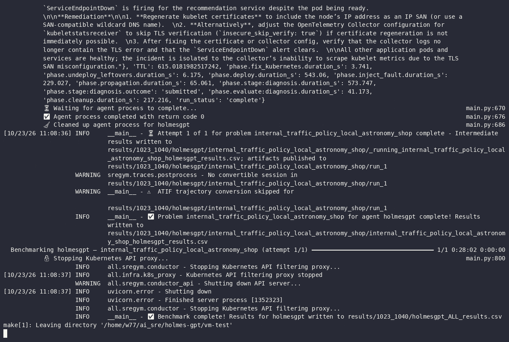

---

## 5. Run notes

### Before this run (attempt 1)

The first attempt ran problems 1–5 and was restarted from scratch. What it surfaced, and what changed:

1. **Cold downloads timed out the first deploy.** A Helm dependency from GitHub release assets and the
   300 MB `sregym-mcp` image exceeded SREGym's timeouts. Fix: pre-pulled the MCP image on all nodes and set
   `WAIT_FOR_POD_READY_TIMEOUT=1800`.
2. **MongoDB pods stuck Pending (OpenEBS).** The local-PV provisioner lost its leader lease mid-provision,
   left `init-pvc-*` helper pods behind, and every retry failed with `pods "init-pvc-…" already exists`.
   Fix: delete the stale helpers and restart the provisioner ([`scripts/openebs-watchdog.sh`](scripts/openebs-watchdog.sh) automates it).
3. **Problems 1–3 ran without Prometheus, Loki and Jaeger.** SREGym's MCP port-forward was gone by the time
   the agent started (21 minutes after deploy), so HolmesGPT logged `Failed to load mcp server`. Fix: the
   driver now checks the MCP server and opens its own port-forward when needed.
4. **Model endpoint dropped** (06:43) when the laptop end of the SSH tunnel lost its route to GPUStack.
5. **Model removed from GPUStack** (07:03): problem 6 got `Model not found` on every agent and judge call.
   [`scripts/campaign.sh`](scripts/campaign.sh) now waits for the model before each problem instead of failing.

Attempt 1 scores (problems 1–5, all fails, average 11/100) are in the [archive](archive/attempt-1/README.md).
They are not mixed into this run's results because problems 1–3 had no observability and recording
started at problem 4.

### This run
1. **Worker memory cap removed (07:46, during problem 2).** Problem 2's astronomy-shop deploy stalled for
   about 18 minutes: `opensearch-0` missed its startup-probe window twice and `grafana` failed its health
   checks while the host load average was 20 on 16 cores and `kind-worker` sat at 3.6 of its 4 GiB. The
   4 GiB cap on the three workers was lifted. Docker can't clear a memory limit, so each worker's limit was
   raised to the host's RAM (30.6 GiB, `docker update --memory=<host RAM> --memory-swap=<host RAM>`); the
   control plane stays at 4 GiB. Pods weren't restarted. The change landed about 2 minutes after problem 2's
   fault was injected (07:44:36), during HolmesGPT's investigation. Problem 1 ran with the cap and
   problems 3–17 run without it.
2. **HolmesGPT's `tcp_check` runs outside the cluster.** HolmesGPT's built-in connectivity tool runs inside
   the HolmesGPT container on the VM (host network), where cluster DNS names such as
   `mongodb-reservation` or `email.astronomy-shop.svc.cluster.local` never resolve. Every `tcp_check`
   therefore returns `could not resolve host`, which reads like a DNS outage. In problem 1 this produced a
   "cluster-wide CoreDNS outage" diagnosis. It is a property of running HolmesGPT outside the cluster (the
   same holds for its Docker image on any host), not of the cluster. It is left as is, since that is how
   HolmesGPT's Docker deployment behaves, and noted wherever it misled an answer.
3. **Problem 3: model stopped answering mid-run (08:09–08:41).** GPUStack was reachable when problem 3
   started, but stopped answering during HolmesGPT's investigation. Attempt 1 made 14 tool calls, then got
   no reply to its next request until the driver's 15-minute limit (`rc=124`); attempt 2 got no reply to its
   first request in 12 minutes. The judge graded "no result", which says nothing about HolmesGPT, so the
   run is marked invalid and queued for a rerun after problem 17. Logs: `results/network_policy_block--invalid-model-stall/`.
   From 08:41 the endpoint timed out entirely again, and the campaign is waiting before problem 4.
4. **Problem 5: model failed mid-run again (09:38–10:02).** HolmesGPT's first attempt made 17 tool calls,
   then waited on the model until the 15-minute limit (`rc=124`). Attempts 2 and 3 failed at once with
   `litellm.InternalServerError`, and the endpoint answered `Connection reset by peer`. Invalid, queued
   for a rerun after problem 17. The model was back at 10:02 and problem 6 started immediately.
