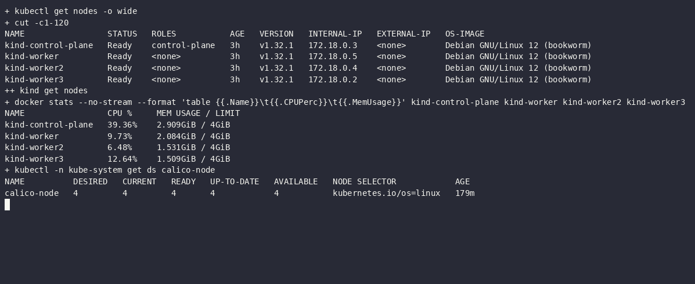
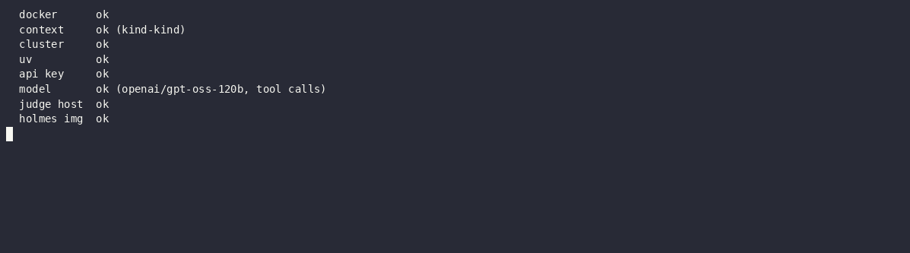
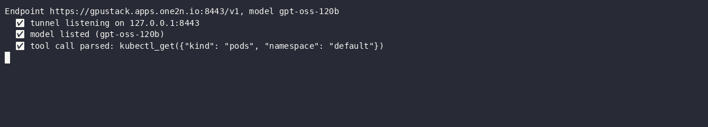
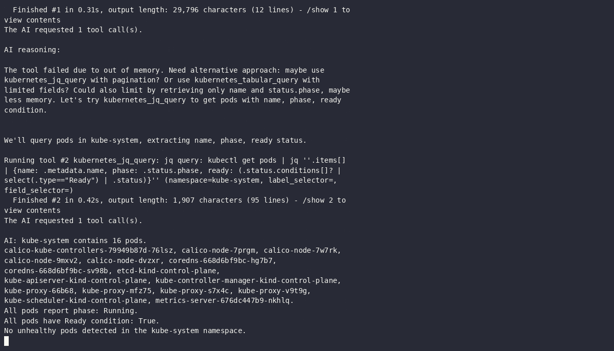
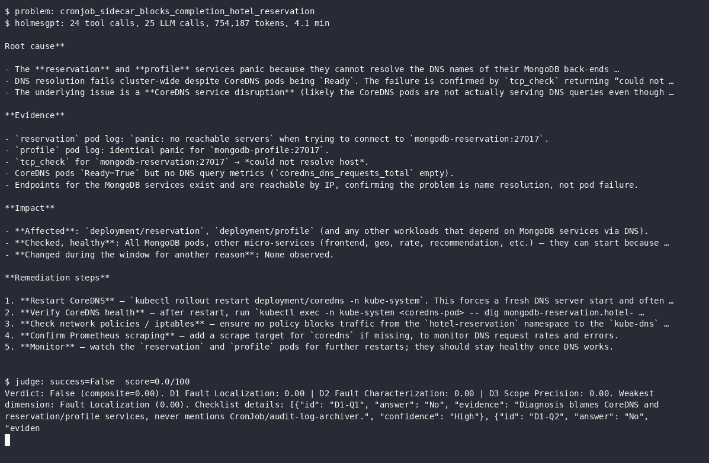
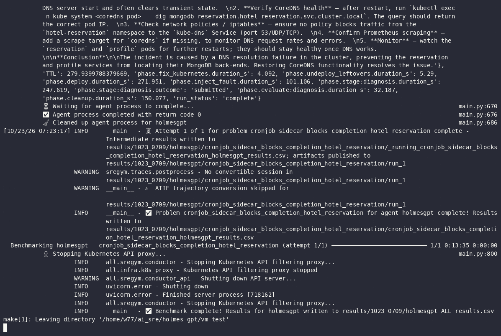

# HolmesGPT — SREGym-Lite on a VM with gpt-oss-120b

| | |
| --- | --- |
| **Author** | `Sahil Joseph` |
| **Date** | `2026-10-23` |
| **Tool version tested** | HolmesGPT `0.45.0` (Docker image) |
| **Benchmark** | [SREGym-Lite](https://github.com/SREGym/SREGym/blob/main/docs/SREGym-Lite.md), 17 problems |
| **Model (agent and judge)** | `gpt-oss-120b` on the one2n GPUStack (vLLM 0.25.1) |
| **Cluster** | SREGym's upstream kind setup (1 control plane + 3 workers, Calico), 16 GB, `--profile full` |
| **Setup** | [setup.md](setup.md) |
| **Builds on** | [Experiment 3: HolmesGPT on SREGym-Lite](../3-sregym-lite/README.md) (Sonnet 4.5, single-node, `svelte`) |

---

## 1. What this answers

Experiment 3 ran HolmesGPT on SREGym-Lite with Claude Sonnet 4.5 on a single-node, 8 GB cluster, and
only 7 problems produced valid grades. This run repeats the full suite on SREGym's own 4-node kind
setup with the `full` profile, using a self-hosted open-weight model (`gpt-oss-120b`) instead of a
commercial API. The question: how does HolmesGPT score with a self-hosted model on the complete,
upstream-comparable benchmark?

Only the **diagnosis** stage is run: HolmesGPT is read-only, so mitigation would fail by construction.

---

## 2. Method

- Problems run one at a time, in SREGym-Lite order, by [`scripts/campaign.sh`](scripts/campaign.sh): each
  under a terminal recording (`make record-run`), after waiting for the model endpoint to answer.
- HolmesGPT gets the application name, namespace(s) and description from SREGym, and must end with a
  `ROOT CAUSE` section. It isn't told the fault type. Up to 60 steps, 3 attempts on a failed run,
  within SREGym's 30-minute agent budget.
- Data sources: Kubernetes through SREGym's filtered proxy, plus SREGym's Prometheus, Loki and Jaeger MCP
  servers. The driver checks the MCP server before each HolmesGPT run and re-opens its port-forward if needed.
- SREGym's LLM judge scores the diagnosis against the known root cause (pass/fail and a 0–100 composite).
- The same model is agent and judge, which can flatter the agent; the judge uses a fixed checklist rubric.

### Environment and testing

The VM has no desktop, so these are terminal recordings
([`scripts/record.sh`](scripts/record.sh), asciinema): each image is the last frame. The full sessions
are in [`recordings/`](recordings/) as `.cast` files (replay with `asciinema play recordings/<name>.cast`)
and animated `.gif` files.

**Cluster:** SREGym's upstream kind setup, 4 nodes at 4 GiB each, Calico on every node

**Preflight:** everything a benchmark run needs

**Model check:** GPUStack through the SSH tunnel, `gpt-oss-120b` returns a parsed tool call

**HolmesGPT smoke test:** `holmes ask` against the cluster. The first tool call failed with "out of
memory" on a ~30K-character output; HolmesGPT switched to a narrower `jq` query and answered correctly.

---

## 3. Results

Fresh run of all 17 problems, started 2026-10-23. An earlier partial attempt is archived in
[`archive/attempt-1/`](archive/attempt-1/README.md); see [run notes](#5-run-notes) for why it was restarted.

### Scorecard

| Problems run | ✅ Passed | ❌ Failed | ⚠️ Not graded | Pass rate | Avg judge score | Avg investigation |
|---:|---:|---:|---:|---:|---:|---:|
| 1/17 | 0 | 1 | 0 | 0% | 0/100 | 4.1 min |

### Per problem

| # | Problem | Diagnosis | Score | Investigation | Notes |
|---|---------|-----------|------:|--------------:|-------|
| 1 | `cronjob_sidecar_blocks_completion_hotel_reservation` | ❌ fail | 0 | 4.1 min | Verdict False (composite 0.00). D1 0.00, D2 0.00, D3 0.00. 24 tool calls, 25 LLM calls, 754K tokens, 1 Prometheus call |
| 2 | `edge_request_filter_cpu_saturation` | pending | | | |
| 3 | `network_policy_block` | pending | | | |
| 4 | `env_variable_shadowing_astronomy_shop` | pending | | | |
| 5 | `mutating_webhook_resource_limits_social_network` | pending | | | |
| 6 | `finalizer_deadlock_controller_hotel_reservation` | pending | | | |
| 7 | `kafka_poison_pill_hol_block` | pending | | | |
| 8 | `internal_traffic_policy_local_astronomy_shop` | pending | | | |
| 9 | `service_dns_resolution_failure_social_network` | pending | | | |
| 10 | `service_wrong_pod_selection_hotel_reservation` | pending | | | |
| 11 | `namespace_memory_limit` | pending | | | |
| 12 | `valkey_auth_disruption` | pending | | | |
| 13 | `secret_rotation_stale_env_credentials_astronomy_shop` | pending | | | |
| 14 | `unschedulable_incorrect_port_assignment` | pending | | | |
| 15 | `duplicate_pvc_mounts_social_network` | pending | | | |
| 16 | `rolling_update_misconfigured_social_network` | pending | | | |
| 17 | `search_rate_retry_collapse_hotel_reservation` | pending | | | |

---

## 4. Per-problem observations

Ground truth, what HolmesGPT concluded, and how it got there. Added after each problem finishes.

| # | Problem | Ground truth | What HolmesGPT concluded | Why it passed / missed |
|---|---------|--------------|--------------------------|------------------------|
| 1 | `cronjob_sidecar_blocks_completion_hotel_reservation` | CronJob `audit-log-archiver`: a sidecar keeps the Job pod from completing | Cluster-wide CoreDNS outage: `reservation` and `profile` panic (`no reachable servers`) because they can't resolve `mongodb-reservation`/`mongodb-profile` | Never listed CronJobs or Jobs (0 of 24 tool calls). It started from the MongoDB startup panics, which occur on every hotel-reservation deploy and have cleared by fault injection. To check them it used HolmesGPT's `tcp_check` connectivity tool, which runs **inside the HolmesGPT container on the VM**, where cluster DNS names never resolve. That `could not resolve host` was a harness artifact, and it turned startup noise into a "cluster-wide DNS outage". An empty Prometheus result for `coredns_dns_requests_total` (CoreDNS isn't scraped) seemed to confirm it. Experiment 3 also missed this problem, with Consul startup errors as the decoy. |

### Execution

Each problem's logs are in `results/<problem>/`: `sregym.log` (conductor), `holmes.log` (HolmesGPT
transcript), `holmes.json` (every tool call, tokens, answer), `judge.csv` (verdict, checklist, timings),
`run.log` (`make run-one` output) and `answer.md`. Every run is recorded: a GIF of the whole run at 20×
speed and an asciinema cast for full-speed replay (`asciinema play recordings/run-<problem>.cast`).
Below: HolmesGPT's root cause with the judge's verdict, and the end of each run.

**1. `cronjob_sidecar_blocks_completion_hotel_reservation`**: ❌ fail · score 0/100 · [logs](results/cronjob_sidecar_blocks_completion_hotel_reservation/) ·
▶ [run video (GIF, 20× speed)](recordings/run-cronjob_sidecar_blocks_completion_hotel_reservation.gif) · [asciinema cast](recordings/run-cronjob_sidecar_blocks_completion_hotel_reservation.cast)

End of the run (last frame of the recording)

---

## 5. Run notes

### Before this run (attempt 1)

The first attempt ran problems 1–5 and was restarted from scratch. What it surfaced, and what changed:

1. **Cold downloads timed out the first deploy.** A Helm dependency from GitHub release assets and the
   300 MB `sregym-mcp` image exceeded SREGym's timeouts. Fix: pre-pulled the MCP image on all nodes and set
   `WAIT_FOR_POD_READY_TIMEOUT=1800`.
2. **MongoDB pods stuck Pending (OpenEBS).** The local-PV provisioner lost its leader lease mid-provision,
   left `init-pvc-*` helper pods behind, and every retry failed with `pods "init-pvc-…" already exists`.
   Fix: delete the stale helpers and restart the provisioner ([`scripts/openebs-watchdog.sh`](scripts/openebs-watchdog.sh) automates it).
3. **Problems 1–3 ran without Prometheus, Loki and Jaeger.** SREGym's MCP port-forward was gone by the time
   the agent started (21 minutes after deploy), so HolmesGPT logged `Failed to load mcp server`. Fix: the
   driver now checks the MCP server and opens its own port-forward when needed.
4. **Model endpoint dropped** (06:43) when the laptop end of the SSH tunnel lost its route to GPUStack.
5. **Model removed from GPUStack** (07:03): problem 6 got `Model not found` on every agent and judge call.
   [`scripts/campaign.sh`](scripts/campaign.sh) now waits for the model before each problem instead of failing.

Attempt 1 scores (problems 1–5, all fails, average 11/100) are in the [archive](archive/attempt-1/README.md).
They are not mixed into this run's results because problems 1–3 had no observability and recording
started at problem 4.

### This run
