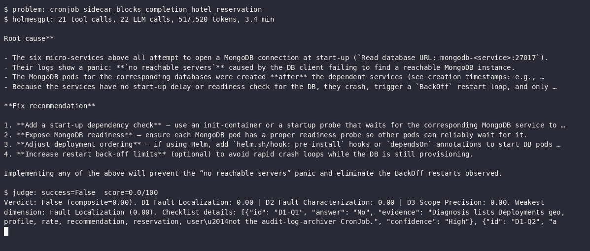
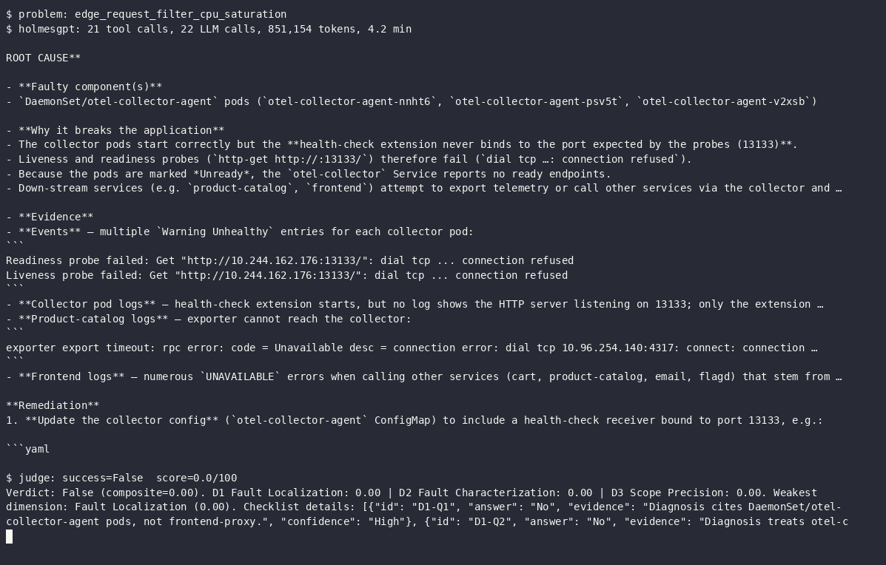
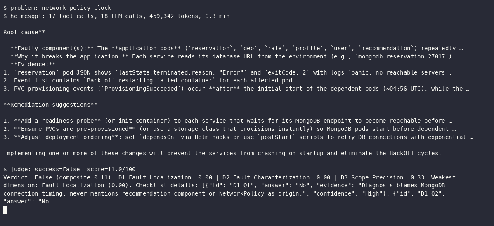
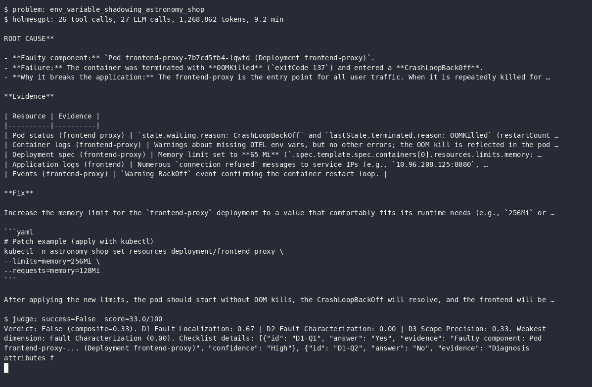
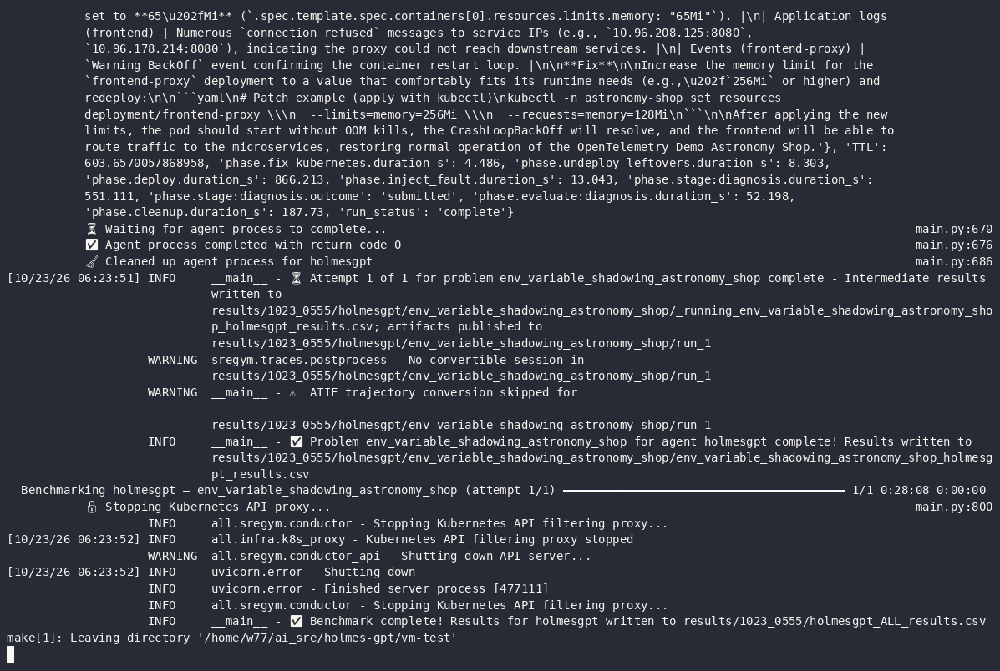
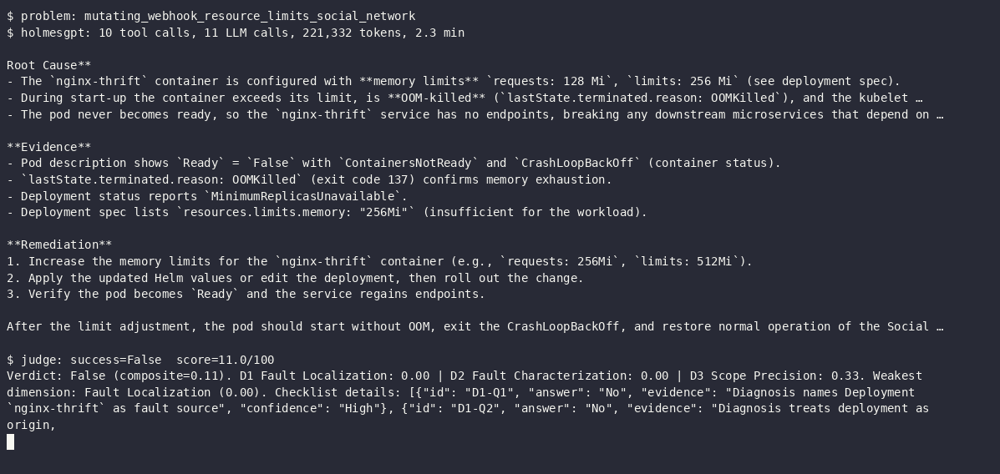
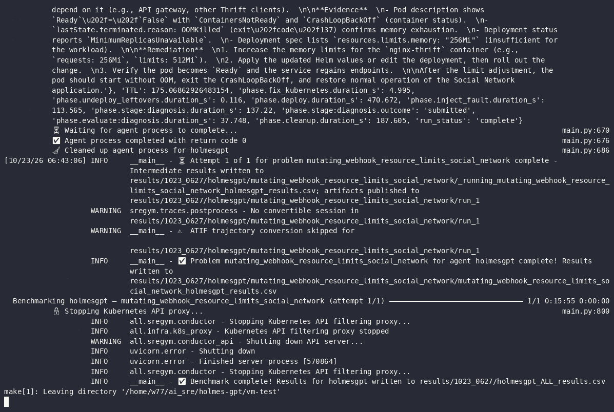

# HolmesGPT — SREGym-Lite on a VM with gpt-oss-120b

| | |
| --- | --- |
| **Author** | `Sahil Joseph` |
| **Date** | `2026-10-23` |
| **Tool version tested** | HolmesGPT `0.45.0` (Docker image) |
| **Benchmark** | [SREGym-Lite](https://github.com/SREGym/SREGym/blob/main/docs/SREGym-Lite.md), 17 problems |
| **Model (agent and judge)** | `gpt-oss-120b` on the one2n GPUStack (vLLM 0.25.1) |
| **Cluster** | SREGym's upstream kind setup (1 control plane + 3 workers, Calico), 16 GB, `--profile full` |
| **Setup** | [setup.md](setup.md) |
| **Builds on** | [Experiment 3: HolmesGPT on SREGym-Lite](../3-sregym-lite/README.md) (Sonnet 4.5, single-node, `svelte`) |

---

## 1. What this answers

Experiment 3 ran HolmesGPT on SREGym-Lite with Claude Sonnet 4.5 on a single-node, 8 GB cluster, and
only 7 problems produced valid grades. This run repeats the full suite on SREGym's own 4-node kind
setup with the `full` profile, using a self-hosted open-weight model (`gpt-oss-120b`) instead of a
commercial API. The question: how does HolmesGPT score with a self-hosted model on the complete,
upstream-comparable benchmark?

Only the **diagnosis** stage is run: HolmesGPT is read-only, so mitigation would fail by construction.

---

## 2. Method

- Problems run one at a time (`make run-one PROBLEM=<id>`), in SREGym-Lite order.
- HolmesGPT gets the application name, namespace(s) and description from SREGym, and must end with a
  `ROOT CAUSE` section. It isn't told the fault type. Up to 60 steps, 3 attempts on a failed run,
  within SREGym's 30-minute agent budget.
- Data sources: Kubernetes through SREGym's filtered proxy, plus SREGym's Prometheus, Loki and Jaeger MCP
  servers (from problem 4 on; problems 1–3 ran without them, see run note 3).
- SREGym's LLM judge scores the diagnosis against the known root cause (pass/fail and a 0–100 composite).
- The same model is agent and judge, which can flatter the agent; the judge uses a fixed checklist rubric.

### Environment and testing

The VM has no desktop, so these are terminal recordings
([`scripts/record.sh`](scripts/record.sh), asciinema): each image is the last frame. The full sessions
are in [`recordings/`](recordings/) as `.cast` files (replay with `asciinema play recordings/<name>.cast`)
and animated `.gif` files.

**Cluster:** SREGym's upstream kind setup, 4 nodes at 4 GiB each, Calico on every node

**Preflight:** everything a benchmark run needs

**Model check:** GPUStack through the SSH tunnel, `gpt-oss-120b` returns a parsed tool call

**HolmesGPT smoke test:** `holmes ask` against the cluster. The first tool call failed with "out of
memory" on a ~30K-character output; HolmesGPT switched to a narrower `jq` query and answered correctly.

---

## 3. Results

### Scorecard

| Problems run | ✅ Passed | ❌ Failed | ⚠️ Not graded | Pass rate | Avg judge score | Avg investigation |
|---:|---:|---:|---:|---:|---:|---:|
| 5/17 | 0 | 5 | 0 | 0% | 11/100 | 5.1 min |

### Per problem

| # | Problem | Diagnosis | Score | Investigation | Notes |
|---|---------|-----------|------:|--------------:|-------|
| 1 | `cronjob_sidecar_blocks_completion_hotel_reservation` | ❌ fail (K8s only, no MCP; rerun pending) | 0 | 3.4 min | Verdict False (composite 0.00). D1 0.00, D2 0.00, D3 0.00. 21 tool calls, 22 LLM calls, 518K tokens |
| 2 | `edge_request_filter_cpu_saturation` | ❌ fail (K8s only, no MCP; rerun pending) | 0 | 4.2 min | Verdict False (composite 0.00). D1 0.00, D2 0.00, D3 0.00. 21 tool calls, 22 LLM calls, 851K tokens |
| 3 | `network_policy_block` | ❌ fail (K8s only, no MCP; rerun pending) | 11 | 6.3 min | Verdict False (composite 0.11). D1 0.00, D2 0.00, D3 0.33. 17 tool calls, 18 LLM calls, 459K tokens |
| 4 | `env_variable_shadowing_astronomy_shop` | ❌ fail | 33 | 9.2 min | Verdict False (composite 0.33). D1 0.67, D2 0.00, D3 0.33. 26 tool calls, 27 LLM calls, 1.27M tokens. MCP loaded, 0 MCP calls |
| 5 | `mutating_webhook_resource_limits_social_network` | ❌ fail | 11 | 2.3 min | Verdict False (composite 0.11). D1 0.00, D2 0.00, D3 0.33. 10 tool calls, 11 LLM calls, 221K tokens, 1 Prometheus call |
| 6 | `finalizer_deadlock_controller_hotel_reservation` | ⚠️ invalid: model removed from GPUStack mid-run (run note 5); queued again | | | |
| 7 | `kafka_poison_pill_hol_block` | pending | | | |
| 8 | `internal_traffic_policy_local_astronomy_shop` | pending | | | |
| 9 | `service_dns_resolution_failure_social_network` | pending | | | |
| 10 | `service_wrong_pod_selection_hotel_reservation` | pending | | | |
| 11 | `namespace_memory_limit` | pending | | | |
| 12 | `valkey_auth_disruption` | pending | | | |
| 13 | `secret_rotation_stale_env_credentials_astronomy_shop` | pending | | | |
| 14 | `unschedulable_incorrect_port_assignment` | pending | | | |
| 15 | `duplicate_pvc_mounts_social_network` | pending | | | |
| 16 | `rolling_update_misconfigured_social_network` | pending | | | |
| 17 | `search_rate_retry_collapse_hotel_reservation` | pending | | | |

---

## 4. Per-problem observations

Ground truth, what HolmesGPT concluded, and how it got there. Added after each problem finishes.

| # | Problem | Ground truth | What HolmesGPT concluded | Why it passed / missed |
|---|---------|--------------|--------------------------|------------------------|
| 1 | `cronjob_sidecar_blocks_completion_hotel_reservation` | CronJob `audit-log-archiver`: a sidecar keeps the Job pod from completing | Six services crash at startup with `panic: no reachable servers` because their MongoDB pods are created after them (e.g. `mongodb-geo` 05:12:39 vs `geo` 05:11:10); fix with init containers or startup probes | Never listed CronJobs or Jobs (0 of 21 tool calls). It read pods, events and 12 sets of pod logs, found the startup crashes, and stopped. That startup race happens on **every** hotel-reservation deploy and has cleared by the time the fault is injected, so it is baseline noise. Experiment 3 (Sonnet 4.5) also missed this problem, anchoring on the equivalent Consul startup errors. One tool call came back named `kubernetes_tabular_query<\|channel\|>commentary`: gpt-oss's harmony channel marker leaked into the tool name, so the call matched no tool. |
| 2 | `edge_request_filter_cpu_saturation` | `frontend-proxy`: a new edge/WAF filter regex backtracks catastrophically on long `waf` query values, saturating CPU and timing out healthy paths | `otel-collector-agent` DaemonSet: the health-check extension never binds port 13133, probes fail, the `otel-collector` Service has no endpoints, and downstream services fail; fix the collector ConfigMap | Never looked at `frontend-proxy` (no logs, no config, no CPU) and never queried Prometheus, though CPU saturation is the whole symptom. It followed `Warning Unhealthy` probe events on the collector and exporter `connection refused` errors from `product-catalog`. All pods were Ready when SREGym injected the fault, so these are deploy-time events. It then generalized frontend `UNAVAILABLE` errors into a collector cascade. Experiment 3 also missed this, blaming the collector's `jaeger:4317` export. |
| 3 | `network_policy_block` | NetworkPolicy `deny-all-recommendation` blocks all traffic to the `recommendation` service | Six services crash-looped with `panic: no reachable servers` because their MongoDB pods started late, after slow PVC provisioning | Never queried NetworkPolicies (17 tool calls: pods, logs, events, jq queries). The OpenEBS stall (run note 2) made the startup crashes louder than usual (restart counts up to 7, late `ProvisioningSucceeded` events). Problem 1 later showed the same decoy and the same answer on a clean deploy, so this counts as a real miss. Experiment 3 scored 0 here with the same blind spot. |
| 4 | `env_variable_shadowing_astronomy_shop` | `frontend-proxy` defines `FRONTEND_HOST` twice; the later `localhost` shadows `frontend`, so it routes to the wrong upstream | `frontend-proxy` is OOMKilled at its 65Mi limit and crash-loops (restartCount 4), so the frontend can't reach services; raise the limit to 256Mi | **Right component, wrong mechanism.** The Envoy OOMs were real but started after the fault (pods Ready at injection 06:10:39, OOMKilled from 06:17). Routing to itself on `localhost` most likely makes Envoy loop until it runs out of memory, so the OOM is a symptom of the fault. HolmesGPT read the pod's last termination reason and stopped there: it never compared the container's env with the Deployment spec, and never checked the duplicate variable. First run with the MCP servers loaded; it still made 0 Prometheus/Loki/Jaeger calls. Experiment 3's run of this problem was invalid (ARM64 OOM before the fault); on x86 the problem is valid. Another `<\|channel\|>` tool-name leak (`fetch_pod_logs<\|channel\|>commentary`). |
| 5 | `mutating_webhook_resource_limits_social_network` | MutatingWebhookConfiguration `gatekeeper-mutating-webhook-configuration` overwrites `requests.memory`/`limits.memory` on `nginx-thrift` pods at admission, so they OOM; four decoy webhooks (cert-manager, Istio, Kyverno, Linkerd lookalikes) also match the namespace | `nginx-thrift`'s Deployment limit (`requests: 128Mi`, `limits: 256Mi`) is too small; it is OOMKilled at startup and crash-loops, leaving the Service without endpoints; raise to 256Mi/512Mi | **Took the problem's designed bait.** The Deployment's resources look legitimate on purpose, so an agent that reads the Deployment spec rules the webhook out. HolmesGPT read the pod's `OOMKilled` status and the Deployment spec, and never compared them with the pod's *actual* limits or listed admission webhooks (0 webhook queries in 10 tool calls). Shortest investigation so far (2.3 min): it committed after one OOM finding. First real MCP call of the run: one Prometheus `container_memory_working_set_bytes` query for `nginx-thrift`. SREGym removed all five webhooks at cleanup, unlike Experiment 3's aborted run. |

### Execution

Each problem's logs are in `results/<problem>/`: `sregym.log` (conductor), `holmes.log` (HolmesGPT
transcript), `holmes.json` (every tool call, tokens, answer), `judge.csv` (verdict, checklist, timings),
`run.log` (`make run-one` output) and `answer.md`. Collected with
[`scripts/collect-results.sh`](scripts/collect-results.sh). Below: HolmesGPT's root cause and the judge's verdict.
From problem 4 on, every run is also recorded (`make record-run`): a GIF of the whole run at 20× speed and
an asciinema cast for full-speed replay (`asciinema play recordings/run-<problem>.cast`). Problems 1–3 ran
before recording was set up; their reruns will be recorded.

**1. `cronjob_sidecar_blocks_completion_hotel_reservation`**: [logs](results/cronjob_sidecar_blocks_completion_hotel_reservation--k8s-only/)

**2. `edge_request_filter_cpu_saturation`**: [logs](results/edge_request_filter_cpu_saturation--k8s-only/)

**3. `network_policy_block`**: [logs](results/network_policy_block--k8s-only/)

**4. `env_variable_shadowing_astronomy_shop`**: [logs](results/env_variable_shadowing_astronomy_shop/) ·
▶ [run recording (GIF, 20× speed)](recordings/run-env_variable_shadowing_astronomy_shop.gif) ·
[asciinema cast](recordings/run-env_variable_shadowing_astronomy_shop.cast)

End of the run (last frame of the recording)

**5. `mutating_webhook_resource_limits_social_network`**: [logs](results/mutating_webhook_resource_limits_social_network/) ·
▶ [run recording (GIF, 20× speed)](recordings/run-mutating_webhook_resource_limits_social_network.gif) ·
[asciinema cast](recordings/run-mutating_webhook_resource_limits_social_network.cast)

End of the run (last frame of the recording)

---

## 5. Run notes

Issues hit while running, in order.

1. **First deploy timed out on cold downloads.** The first `network_policy_block` attempt never reached
   HolmesGPT. Deploy attempts 1 and 2 failed because a Helm dependency (`prometheus-node-exporter-4.23.2.tgz`
   from GitHub release assets) timed out. Attempt 3 got past that, but SREGym's in-cluster `mcp-server`
   didn't become ready within its 180 s rollout timeout: pulling `ghcr.io/sregym/sregym-mcp:latest`
   (300 MB) took 3m19s on a fresh node. Fix: pre-pulled that image on all four nodes
   (`docker exec <node> crictl pull ...`) and set `WAIT_FOR_POD_READY_TIMEOUT=1800`. Not counted as a run.
2. **MongoDB pods stuck Pending (OpenEBS).** On the second `network_policy_block` deploy, 4 of 6
   hotel-reservation MongoDB PVCs never bound, so `mongodb-{profile,recommendation,reservation,user}`
   stayed Pending and their services crash-looped. The OpenEBS local-PV provisioner lost its leader
   lease at 04:40:51 (API reads were timing out during the deploy) and restarted mid-provision. It left
   its finished `init-pvc-*` helper pods behind, and every retry failed with
   `pods "init-pvc-…" already exists`. Fix: deleted the stale helpers, restarted the provisioner, and
   restarted the two crash-looping services. All 19 pods were Ready at 04:57:35. SREGym was still waiting
   for readiness (thanks to the 1800 s timeout) and injected the fault at 04:57:37, so the run is valid.
   [`scripts/openebs-watchdog.sh`](scripts/openebs-watchdog.sh) now runs alongside the benchmark and
   applies the same fix automatically.
3. **Problems 1–3 ran without Prometheus, Loki and Jaeger.** In all three, HolmesGPT logged
   `Failed to load mcp server sregym-{prometheus,loki,jaeger}: All connection attempts failed` and
   investigated with Kubernetes tools only (0 observability tool calls). SREGym port-forwards its
   in-cluster MCP server to `127.0.0.1:9954` when it deploys (05:25:18 in problem 2), but the agent only
   starts after the app deploy and baseline (05:46:50, 21 minutes later), by which time the forward was
   gone. Networking was not the cause: a container on the host network reaches the forwarded SSE endpoint.
   Fix: the driver now checks the MCP server before each HolmesGPT run and, if SREGym's forward is down,
   opens its own (`kubectl port-forward svc/mcp-server 19954:9954`). From problem 4 on, HolmesGPT has
   metrics, logs and traces. **Problems 1–3 will be rerun with MCP at the end.** Their current results
   stay in the tables, marked as Kubernetes-only.
4. **Model endpoint dropped (06:43).** Problem 6 stopped at preflight: `make check-model` could not list
   models. The SSH tunnel's local end on the VM was still listening, but requests through it timed out
   (one HTTP 200 at 06:44, then 8 timeouts in a row from 06:45 to 06:47). The laptop end of the tunnel had
   lost its route to GPUStack (VPN disconnected or laptop asleep). Nothing was deployed, so problem 6 is
   rerun once the tunnel works.
5. **Model removed from GPUStack (07:03).** Problem 6's rerun deployed and injected its fault, but every
   HolmesGPT attempt and every judge call failed with `litellm.NotFoundError … Model not found`, and
   GPUStack's `/v1/models` then returned an empty list: `gpt-oss-120b` had been taken down or was being
   redeployed. SREGym recorded the run with judgment `Error`; it is not counted. The campaign
   ([`scripts/campaign.sh`](scripts/campaign.sh)) now waits without a time limit for the model to come
   back before each problem, and problem 6 is first in its queue again.
