# K8sGPT - Evaluation

|                         |                                       |
| ----------------------- | ------------------------------------- |
| **Author**              | `Sanket Rajgiri`                      |
| **Date**                | `2026-05-18`                          |
| **Time invested**       | `6 hours`                             |
| **Tool version tested** | `0.4.33`                              |
| **Source / Docs**       | `https://github.com/k8sgpt-ai/k8sgpt` |
| **License**             | `Apache 2.0`                          |
| **Category**            | `AI SRE Agent`                        |

---

## 1. What problem does this tool solve?

`k8sGPT` is a cluster analysis tool. It has built-in analyzers which will analyze cluster state and point out failures based on the rules configured in these analyzers. Additionally, LLMs are used to explain the detected failures from analyzers and possible remedies for them. It can be a good day-0 tool for analysis of cluster.

---

## 2. How it works (architecture)

- `k8sgpt` combines two layers :
  1. Built-In Analyzers: Rules/Checks over K8s Objects state to determine failures.
  2. LLM Explanation: If enabled, it sends already generated failure text to LLM Providers for Explanation and steps to solve the issues.

- What's the core architecture? (agent loop, plugin system, API proxy, etc.)
  - Parallel rule-based analyzers over API. Optional LLM Explanation per finding.
  - Operator mode provides a controller to run analysis periodically and integration support helps in publishing results to Slack, Mattermost, or CloudEvents. Optional remediation support is there with operator but for that it requires write access to cluster.
- What LLM providers / models does it use? How?
  - Supports all major LLM providers documented [here](https://k8sgpt.ai/docs/reference/providers). Most hosted backends need an API key; some (e.g. `ollama`, IAM-based Bedrock/Vertex) use local inference or cloud credentials instead.
- Where does it run? (local CLI, sidecar, SaaS, self-hosted server)
  - _Local CLI :_ Fetches default `kubeconfig` or credentials passed via `~/.config/k8sgpt/k8sgpt.yaml`. Can run analysis from local machine or CI.
  - _Operator mode :_ It runs in Continuous mode. Run pods in server mode and perform periodic analysis of cluster. Optional support for remote cache stores ( AWS S3, GCS, etc.) and auto-remediation.
  - _MCP :_ Can run as MCP Server and supports integration with external MCP Clients over Stdio or HTTP.
- What data does it need access to? What permissions?
  - It requires overall read permissions to cluster. Additionally, it can be restricted to scan only specific kinds of resources like pods, deployments, replicasets, etc.
  - If Operator Mode has enabled auto remediation then requires more privileges to edit resources.

### CLI Architecture

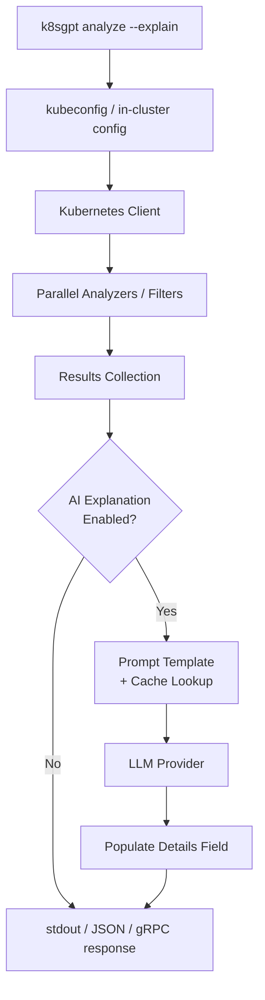

### MCP Architecture

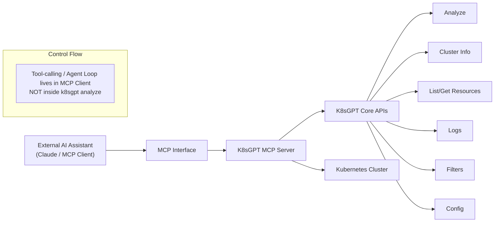

### Operator architecture

The operator **does not reimplement analyzers**. It:

1. Watches `K8sGPT` custom resources (`core.k8sgpt.ai/v1alpha1`).
2. Provisions **Deployment**, **Service**, **ServiceAccount**, **ClusterRole/Binding** (dynamic RBAC by default).
3. Connects to `k8sgpt serve` via **gRPC** and calls `Analyze`.
4. Persists findings as **`Result`** CRs.
5. Optionally emits to **Slack / Mattermost / CloudEvents** and runs **auto-remediation** via **`Mutation`** CRs.

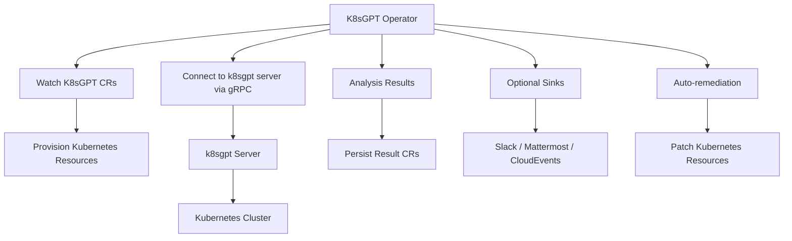

---

## 3. Setup and reproduction steps

### Prerequisites

- K8s Cluster
- API key or cloud IAM credentials for most hosted LLM backends (not required for all backends, e.g. `ollama` or IAM-based Bedrock/Vertex).

### Installation

#### CLI

**macOS**

```bash
  brew tap k8sgpt-ai/k8sgpt
  brew install k8sgpt
```

**Other platforms: see k8sgpt install [docs](https://k8sgpt.ai/docs/getting-started/installation).**

#### K8s Operator

```bash

helm repo add k8sgpt https://charts.k8sgpt.ai/
helm repo update
helm install k8sgpt-operator k8sgpt/k8sgpt-operator -n k8sgpt-operator-system --create-namespace

export OPENROUTER_KEY=<API_KEY>
kubectl create secret generic k8sgpt-secret --from-literal=openrouter-api-key=$OPENROUTER_KEY -n k8sgpt-operator-system

kubectl apply -f setup/operator/K8sGPT.yaml

```

### Known setup gotchas

- Docs do not provide config setup for OpenRouter. Had to use `localai` auth backend with `baseurl=https://openrouter.ai/api/v1` option in CLI.
  ```
  k8sgpt auth add --backend localai --baseurl https://openrouter.ai/api/v1 --model openai/gpt-5.4-nano --password 'API_KEY'
  ```

---

## 4. Scenarios tested

### Scenario 1: `CrashLoop due to missing env var`

**What I did:**

```bash
cd k8sgpt

kubectl apply -f setup/scenario-1.yaml
```

This manifest contains a deployment, which required an environment variable to be set during startup otherwise pods will fail to start.

**What I expected:**

- Detect CrashLoop / non-zero exit and explain root cause. Probably provide commands to fix the issue.

**What actually happened:**

- In the CLI Mode, It gave basic steps and some commands to debug this but it was not able to identify the root cause.
  - _GPT 5.4 Nano output_
    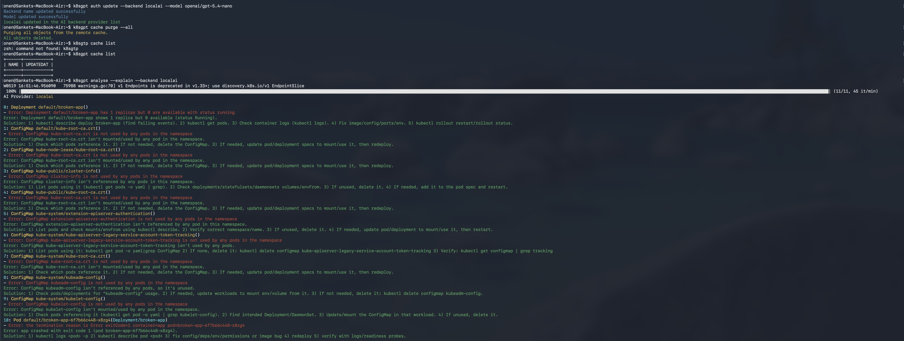

  - _Gemini 2.5 Flash output_
    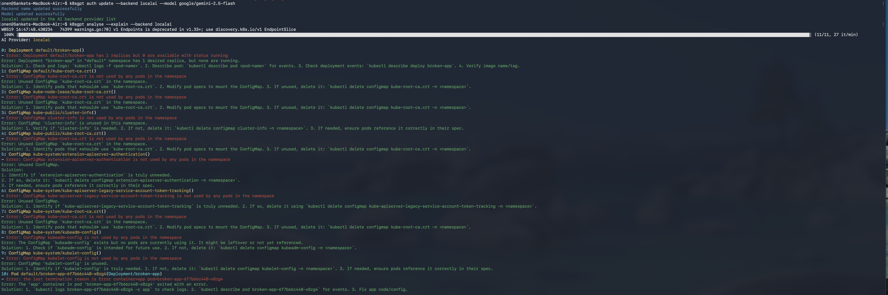

- In the Operator Mode, It was able to identify root cause and fixed the broken pod when used `gpt-5.4-mini` model.
  - _Results CRD Output_
    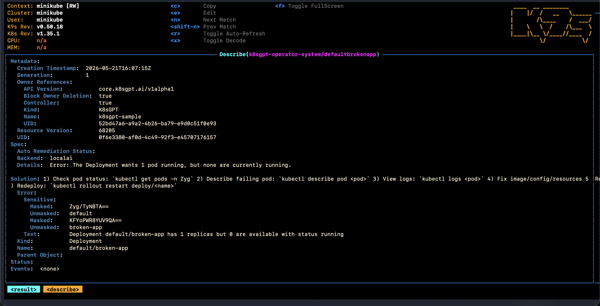

  - _Mutations CRD Output_
    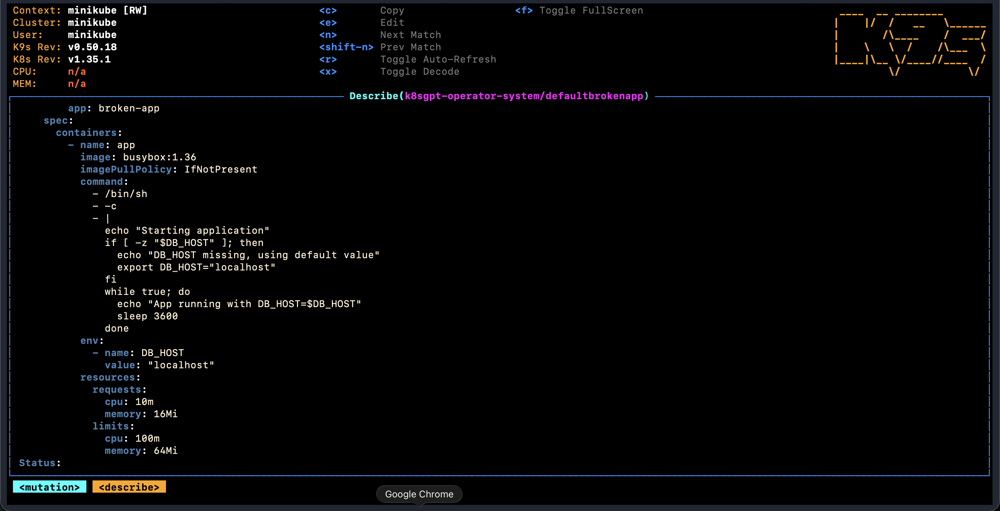

---

### Scenario 2: `Service Not accessible`

**What I did:**

```bash
kubectl apply -f setup/scenario-2.yaml
```

This scenario is taken from reference [iximiuz labs](https://labs.iximiuz.com/challenges/troubleshoot-website-not-accessible-173199c4)

- Goal is to fix issues with Kubernetes Service and Deployment, so that Service is accessible over its endpoint.

**What I expected**

- It should identify incorrect labels on the Service and patch the Service with correct labels.
- It should identify incorrect containerPort configured in Deployment. It should patch deployment with correct container port and update service with correct target port.

**What actually happened:**

- Output given by CLI was not useful. It gave similar steps as to Scenario 1.
  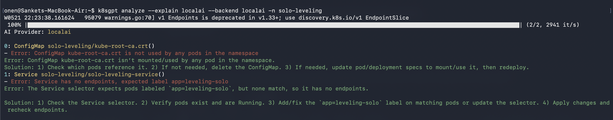
- Operator Mode Identified issues with incorrect service labels, it generated updated service manifest but was failing to update it. Mutation was stuck in In Progress State.
  - _Result CRD Output_
    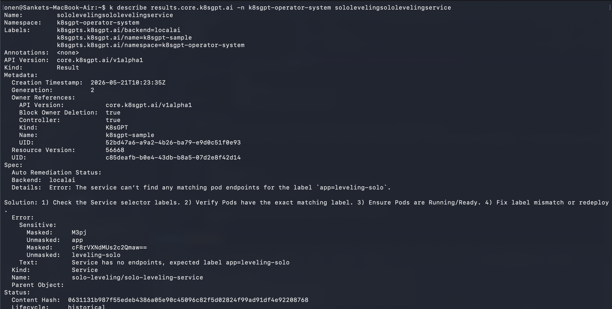
  - _Mutations CRD Output_
    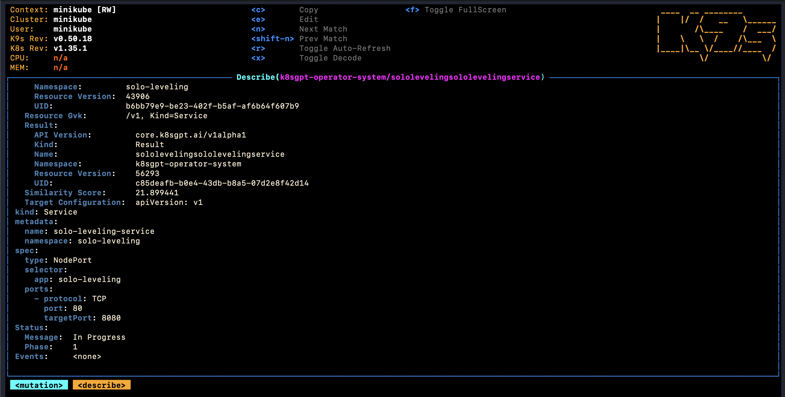
  - _Pending Mutation Resource_
    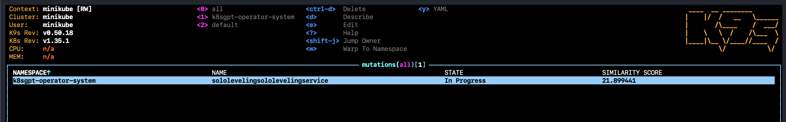

---

## 5. Demo

| Demo                  | Link                                                                                          | Duration |
| --------------------- | --------------------------------------------------------------------------------------------- | -------- |
| `CLI Scenario-1`      | [Link](https://drive.google.com/file/d/1kifqMr3e7w_wuMGjpPmC9cccWy0Hiu7j/view?usp=drive_link) | `03:25`  |
| `Operator Scenario-1` | [Link](https://drive.google.com/file/d/1z10T_xNF7iS36wvd8aIHfITRb1E2ldnE/view?usp=drive_link) | `07:55`  |
---

## 6. Observations

- **Code quality:**
  - Core and operator repos are structured (Cobra CLI, pkg/analysis, operator reconcile chain, CRDs).
  - Mature OSS layout with tests and Helm charts; not evaluated deeply in this PoC.
- **Community:**
  - Active Github Repo with 7.8K Stars. People are raising Issues and PRs for changes.
  - A public [#k8sgpt Slack](https://join.slack.com/t/k8sgpt/shared_invite/zt-332vhyaxv-bfjJwHZLXWVCB3QaXafEYQ) exists upstream; during this PoC it felt low-traffic compared to GitHub issues and PRs.
- **Documentation:**
  - Marketing is ahead of usability. We do not have control over what issue to look at. Tool will follow its built-in analysers and identify issues based on rules defined. Also provides capability to write custom analysers but not that feasible.
  - Configuration Setup for Openrouter is not documented cleanly. Had to search over internet for it.
- **Security posture:**
  - Tool is read-heavy by design. CLI/Operator requires broad list/get/watch permissions on cluster level.
  - Operator supports auto remediation feature which requires write permission. Writes can be controlled by allowing operator to patch only specific kinds of resource like Deployments, Pods, Services, etc. This feature is in experimental state, not recommended to use in production.
  - Invoking of configured LLM provider for analysis of failure.
- **Performance:**
  - Built-in Analyzers run in parallel and relatively faster than LLM.
  - One completion per result group when explain is on; cost scales with findings × scan interval (operator default requeue ~30s).
- **Stability:**
  - No crashes observed.
  - Output quality is not up to the mark. Generic LLM advice in CLI.
  - Mutation CRD resources in operator mode were stuck in in-progress state.

---

## 7. Pros

- Anonymization is the strongest production-minded feature. Before sending failure text to the LLM, K8sGPT can mask sensitive fields (object names, labels, etc.) with tokens and responses are de-masked afterward. It does not cover events (failure text from Pod events can still reach the model), so it is not full data governance.
- LLM explanation cache reduces repeat API cost. When the same failure text is seen again, K8sGPT reuses the stored explanation instead of calling the LLM again. That helps most with the operator’s periodic scans (same issues every ~30s). Cache can be local file or remote (S3, GCS, Azure) and changing model or provider may still return an old cached answer until you clear the cache.

---

## 8. Cons

- Positioned as an “AI SRE agent” but behaves like a linter with optional LLM commentary. It runs fixed analyzer rules on cluster state and the model only explains text the rules already found. It does not explore the cluster on its own or follow your instructions. For real troubleshooting, a general agent (e.g. Cursor with kubectl/logs context) was more useful in both scenarios.
- CLI `analyze --explain` was weak in practice. For Scenario 1 (missing env → CrashLoop) and Scenario 2 (Service labels/ports) both produced generic debug advice, not root cause or fixes. Cheaper models (`gpt-5.4-nano`, `gemini-2.5-flash`) were especially poor and even `gpt-5.4-mini` in CLI did not match operator quality on Scenario 2.
- Auto-remediation is experimental and unreliable. In Scenario 2, operator found wrong Service labels and created a `Mutation`, but it stayed `In Progress` and never applied the patch.
- You cannot steer what it investigates. Scans follow enabled analyzers/filters only, no “check this Deployment” or “fix this Service” workflow. Custom analyzers exist in docs but are not practical to adopt quickly.
- No hook to internal knowledge (runbooks, incidents, service catalog, docs). Analysis is limited to what analyzers read from the API at scan time, so explanations lack org-specific context. Tools that RAG over your knowledge base or an agent with repo/docs access—typically produce more actionable answers for the same failure.
- Limited integrations compared to other SRE tools. Operator sinks are mainly Slack, Mattermost, and CloudEvents. Other Integrations like Prometheus, Kyverno, KEDA, AWS are a small set versus full observability/GitOps platforms.
- No native Otel Support. Shipped telemetry is in Prometheus format in operator, not native OTLP traces/logs. If you need OTEL-native pipelines, you must scrape Prometheus and bridge yourself.
- Beyond anonymize and cache, the tool did not beat kubectl + events/logs + an interactive AI assistant for scenarios slightly above basic. Hard to justify as an on-call or primary RCA tool.

---

## 9. Cost analysis

- Did not go into details of Cost Analysis as tool was not able to pass baseline expectations.

---

## 10. Verdict

**Reject**

### Rationale

- K8sGPT does not meet baseline expectations for AI-assisted Kubernetes troubleshooting in this PoC.
- CLI explain mode failed to find root cause on Scenario 1 and Scenario 2 (slightly above basic).
- Operator mode only helped on Scenario 1, while auto-remediation on Scenario 2 stalled with `Mutation` stuck In Progress.
- The product is marketed as an AI SRE agent but acts as predefined rule checks plus optional LLM summaries.
- The only clear wins were anonymization (CLI `--anonymize`; operator `spec.ai.anonymized`) and explanation caching, but they are not enough to justify operator install, ongoing LLM cost, and broad cluster read access for on-call or adoption.

## 11. References

- [Reddit Discussion](https://www.reddit.com/r/kubernetes/comments/1go13i3/has_k8sgpt_helped_you_in_real_life/): This reddit thread is 2Y old but the tool still lacks the same features mentioned here.
- https://medium.com/@achanandhi.m/is-k8sgpt-a-game-changer-or-just-another-ai-hype-e5629d9d402f

---

## Appendix: Raw notes / logs

<details>
<summary>Click to expand</summary>

No Data

</details>
