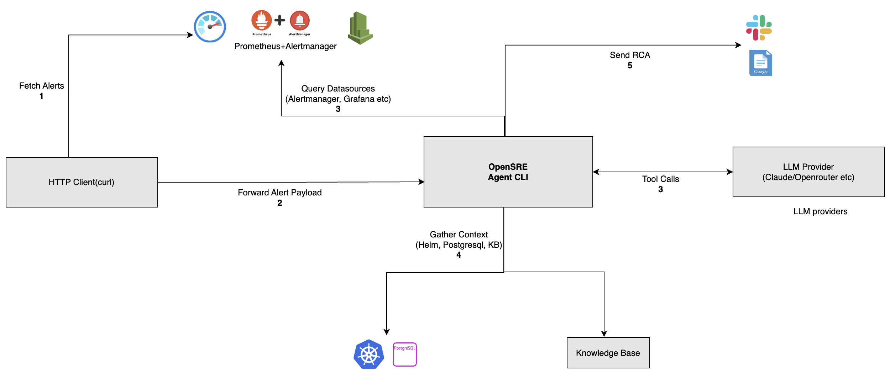
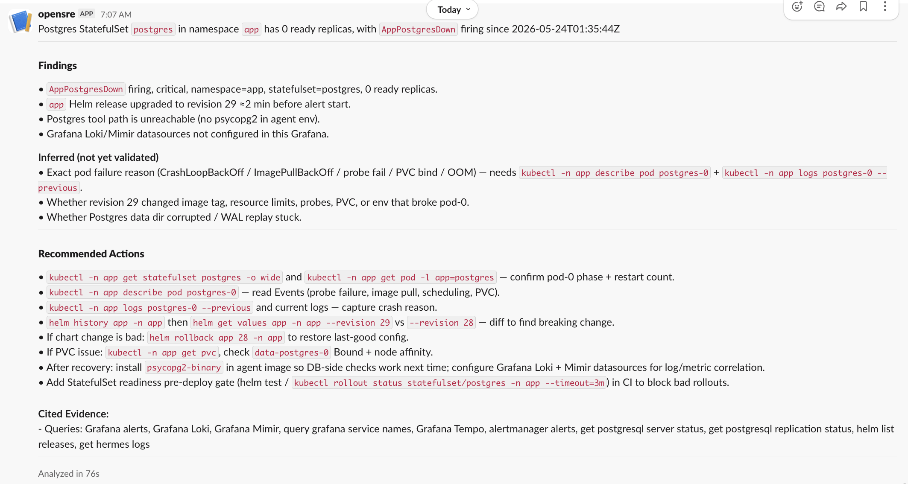
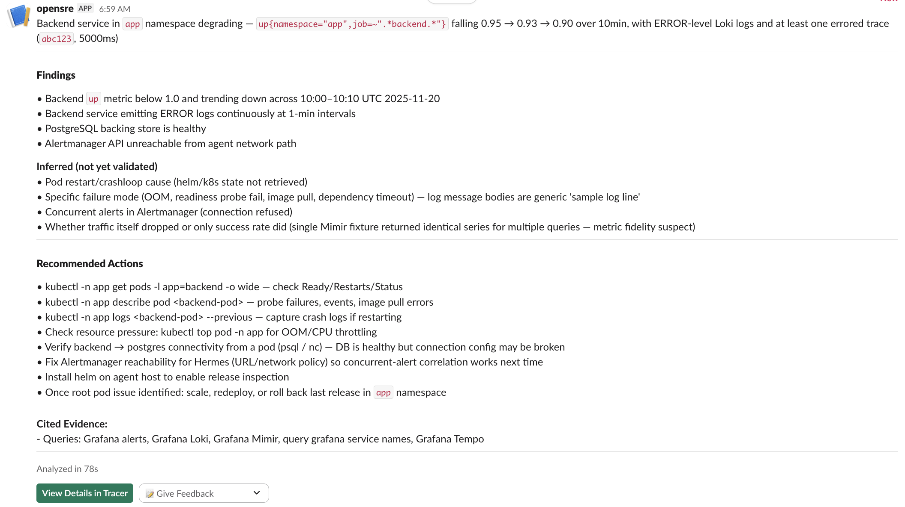
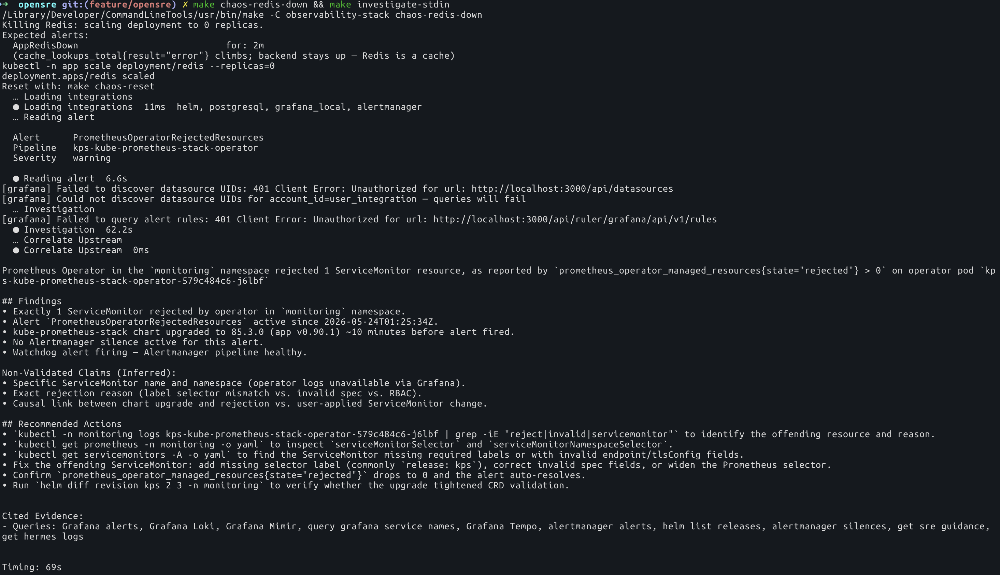

# OpenSRE — Evaluation

| | |
| --- | --- |
| **Author** | `Hemant Kumar` |
| **Date** | `2026-05-24` |
| **Time invested** | `~6 hours` |
| **Tool version tested** | `0.1` |
| **Source / Docs** | [Tracer-Cloud/opensre](https://github.com/Tracer-Cloud/opensre) · [docs](https://www.opensre.com/docs/) |
| **License** | `Apache-2.0` |
| **Category** | `AI SRE agent` |

---

## 1. What problem does this tool solve?

OpenSRE is an AI SRE agent that integrates with alerting systems (Alertmanager, Azure Monitor, etc.) and produces root cause analysis with suggested remediation steps.
It is available as both a CLI and a SaaS offering from Tracer Cloud. Rather than remediating problems directly, it primarily provides root cause analysis and guidance based on integrated data sources. For this proof of concept, the CLI was evaluated, as the SaaS platform itself utilises this agent and platform remains under active development.

---

## 2. How it works (architecture)



Component overview:
- **Agent** — The OpenSRE agent wraps tools for different workloads (Grafana metrics, Alertmanager alerts, logs, Helm releases), allowing LLMs to invoke them directly. This is also currently under development because currently it does not listen to alert systems actively but those need to be passed manually using curl etc. In this evaluation, Alertmanager was queried through curl and the alert was passed to OpenSRE.
- **LLM providers** — OpenRouter, Anthropic, and OpenAI-compatible providers. Tested with **Claude Code** integration (`claude-code` provider) — see [opensre Claude Code setup docs](https://www.opensre.com/docs/llm-providers#claude-code) for configuration steps.
- **Data sources** — Alertmanager API, Helm releases, local log files, and an embedded SRE Knowledge Base. Tested with Alertmanager, Grafana, Helm, and PostgreSQL integrations. Knowledge Base integration is yet to be validated. Still under development to listen alerts actively instead of user passing in those alerts.
- **No Kubernetes API** — `kubectl` is unavailable; Helm is the only cluster data source. So, cannot understand anything about the resources deployed using manifests, kustomize etc.
- **Deployment** — single Homebrew-installed binary, local CLI.

---

## 3. Setup and reproduction steps

### Prerequisites

- Homebrew, Helm, kubectl, make
- Docker Desktop with Kubernetes enabled, or any other Kubernetes engine.
- A supported LLM provider configured. This evaluation uses **Claude Code** (`LLM_PROVIDER=claude-code`). For other providers, see the [opensre provider docs](https://www.opensre.com/docs/llm-providers).
- Slack integration for Alertmanager and OpenSRE must be configured separately — refer to the [Slack Integration Guide](https://www.opensre.com/docs/messaging/slack). The current Helm chart installation expects a secret named `grafana-slack` to be created in advance with a `SLACK_TOKEN` key. [Reference](./observability-stack/platform/values-kube-prometheus-stack.yaml).

### Install

```bash
git clone https://github.com/one2nc/ai_sre.git && pushd ai_sre/opensre
make env           # copy .env.example → .env; set LLM_PROVIDER=claude-code (or any other), SLACK_WEBHOOK_URL
make install       # brew install tracer-cloud/tap/opensre
opensre onboard    # Configure integrations with Grafana using service tokens, LLM Provider (Claude/OpenRouter)
pushd observability-stack && make secrets && popd # Create secret for Slack-Alertmanager integration
make stack-up      # Deploy monitoring + app onto Docker Desktop or any other local platform. Update cluster labels accordingly.
make port-forward  # Grafana :3000, Alertmanager :9093 — keep running in a separate terminal
```

<details>
<summary>All make targets — <code>opensre/Makefile</code></summary>

```
make help                     Show this help

# Setup
make env                      Create .env from .env.example (first-time setup)
make install                  Install opensre CLI via Homebrew
make doctor                   Run opensre diagnostics
make integrations             Verify all opensre integrations

# Stack lifecycle
make stack-up                 Bring up the full observability stack (platform + app)
make stack-down               Tear down the observability stack
make stack-status             Show pod status across monitoring + app namespaces
make port-forward             Port-forward Grafana :3000, Alertmanager :9093, PostgreSQL :5432

# Investigation
make investigate              Investigate against tests/actual-dev-env.alert.json
make investigate-stdin        Pull live alerts from Alertmanager and feed to opensre

# Chaos
make chaos-postgres-down      Scale Postgres to 0 — triggers AppPostgresDown
make chaos-redis-down         Scale Redis to 0 — triggers AppRedisDown
make chaos-gateway-down       Scale gateway to 0 — triggers AppGatewayDown
make chaos-backend-down       Scale backend to 0 — triggers AppBackendDown
make chaos-backend-crashloop  Force backend into CrashLoopBackOff via bogus image —
                              triggers AppPodCrashLooping + AppBackendDown
make chaos-reset              Restore stack to baseline
make chaos-full-run           Run all chaos scenarios sequentially
                              (postgres→redis→backend→gateway→all-down), with
                              investigate + reset between each

# Load generation
make load-start               Start sustained background load against the gateway
make load-stop                Stop the background load generator
```

`investigate`, `investigate-stdin`, and `chaos-full-run` require an LLM provider configured in `.env`.

</details>


```
make help                     Show this help

# Lifecycle
make up                       repos + secrets + platform + tidy + build + deploy
make e2e                      Bring up the stack and run end-to-end verification
make down                     Uninstall all Helm releases, delete app + monitoring namespaces
make pause                    Silence alerts (alias for silence)
make resume                   Scale monitoring workloads back to pre-pause replica counts
make silence                  Create a 30-min Alertmanager silence on namespace=app
make secrets                  Create the grafana-slack Secret from .secrets/slack-token

# Build and deploy
make repos                    Add and update Helm repos
make platform                 Install kube-prometheus-stack, Loki, Promtail, Tempo
make tidy                     go mod tidy in both services (creates go.sum)
make build                    Build gateway + backend images
make deploy                   Install/upgrade the app Helm release
make redeploy                 Rebuild images and rollout-restart the app deployments

# Inspect
make verify                   End-to-end verification: pods Ready, app HTTP, Prometheus, Loki, Tempo.
                              Exit code equals the failure count
make status                   Show platform + app pod status
make port-forward             Grafana :3000, Alertmanager :9093, PostgreSQL :5432, Gateway :8080
make grafana-password         Print the Grafana admin password
make demo                     Hit the gateway in a loop to generate traces, logs, metrics

# Load generation
make chaos-load               Sustained background traffic against the gateway
make chaos-load-stop          Stop the background load generator
make chaos-load-status        Show whether the load generator is running, tail its log

# Chaos — availability
make chaos-postgres-down      Scale Postgres StatefulSet to 0. Cascade: backend liveness fails →
                              CrashLoopBackOff → gateway liveness fails → CrashLoopBackOff
make chaos-redis-down         Scale Redis to 0. Expect AppRedisDown (2m)
make chaos-gateway-down       Scale gateway to 0. Expect AppGatewayDown (2m)
make chaos-backend-down       Scale backend to 0. Expect AppBackendDown (2m)

# Chaos — degradation
make chaos-errors-backend     Kill Postgres for the full cascade to gateway CrashLoop
make chaos-errors-gateway     Kill backend while load runs. Expect
                              AppGatewayHighErrorRateFastBurn (2m) + AppBackendDown (2m)
make chaos-latency            Throttle backend CPU to 5m so p99 climbs. Expect
                              AppBackendHighLatencyP99 (10m), likely AppGatewayHighLatencyP99
make chaos-crashloop          Gateway CrashLoopBackOff via bogus image. Expect
                              AppPodCrashLooping (1m) + AppGatewayDown (2m)
make chaos-backend-crashloop  Backend CrashLoopBackOff via bogus image. Expect
                              AppPodCrashLooping (1m) + AppBackendDown (2m)
make chaos-oom                Patch backend memory limit to 8Mi so it OOMKills repeatedly.
                              Expect AppContainerOOMKilled (1m)
make chaos-reset              Restore baseline: re-deploy chart, restart deployments,
                              stop load, drop silences
```

</details>

### Known setup gotchas

**1. Alertmanager API format mismatch** — `/api/v2/alerts` returns a bare JSON array. `opensre investigate -i -` expects a webhook-format object with an `"alerts"` key. Piping raw output fails:

```
Alert payload from stdin must be a JSON object.
```

The `make investigate-stdin` Makefile target wraps the raw output into the expected format.

**2. Alert firing delay** — After `make chaos-<target>`, wait for the alert to fire before running `make investigate-stdin`.

**3. Helm integration fails** — The helm integration is broken. Refer to section 12 for the related issue filed.

**4. PostgreSQL integration fails** — The `psycopg` dependency is not bundled with the OpenSRE binary. Refer to section 12 for the related issue filed.

---

## 4. Scenarios tested

All scenarios were run against a three-tier application (Gateway → Backend → PostgreSQL / Redis) on Docker Desktop Kubernetes with `kube-prometheus-stack` firing real alerts.

### 4.1 Database Down

**Run:** PostgreSQL replicas set to zero.
```bash
make chaos-postgres-down && sleep 60 && make investigate-stdin
```

**Output:**
1. Identified replicas set to zero from Alertmanager. Incorrectly attributed the cause to a Helm release rather than the `kubectl scale` operation.
2. Grafana integration failed.
3. PostgreSQL client dependency (`psycopg2`) missing from the binary build.

**Result:**
Unable to correlate findings due to broken integrations across Grafana, PostgreSQL, and missing Kubernetes API access.

<details>
<summary>Details</summary>



</details>

### 4.2 Backend Down

**Run:** Backend replicas scaled to zero.
```bash
make chaos-backend-down && sleep 60 && make investigate-stdin
```

**Output:**
1. Identified replicas set to zero from Alertmanager; claim not validated via Prometheus.
2. Misidentified root cause as OOM/CrashLoopBackOff.
3. Inconsistently cited Alertmanager as unavailable while using its data as evidence.
4. Incorrectly citing Tempo traces.
**Result:**
Identified the deployment-down state from alerts, but validations were weak due to broken integrations and missing context.

<details>
<summary>Details</summary>




</details>

### 4.3 Redis Down

**Run:** Redis deployment scaled to zero.
```bash
make chaos-redis-down && sleep 60 && make investigate-stdin
```

**Output:**
1. Identified replicas set to zero from Alertmanager.
2. Incorrectly inferred continuous application error logs while the application was not running.
3. Misidentified root cause as OOM/CrashLoopBackOff.
4. Inconsistently cited Alertmanager as unavailable while using its data as evidence.

**Result:**
Identified the deployment-down state from alerts and Prometheus, but validations were weak due to broken integrations and missing context.

<details>
<summary>Details</summary>




</details>

### Summary

| Scenario | Alerts Firing | Confidence | Correct RCA | Notes |
|----------|---------------|------------|-------------|-------|
| Database Down | `AppPostgresDown` Critical| No | No | Incorrect correlation. Broken integrations. |
| Backend Down | `AppBackendDown` Critical | No | No | CrashLoopBackOff identified not validated; Helm revision correlated. Replicas were set to zero via `kubectl`. Kubernetes API support missing. |
| Redis Down | `AppRedisDown` Critical | No | No | Confused by an unrelated alert; included it as a possible cause in the evidence. |

---

## 5. Demo

| Demo | Link | Duration |
|------|------|----------|
| Scenario (4.2) | https://youtu.be/3T7KOOgfLko?si=HiJkarRk7gQ0Am6e | `06:23` |

---

## 6. Observations

- **Integrations** — Available integrations are limited and several are broken. As a result, the agent cites incorrect evidence as possible causes in its root cause analyses.
- **Single-alert triage** — `investigate -i -` processes one alert per run. There is no support for when multiple alerts fire simultaneously; only the first alert in sort order is processed. As a workaround, alerts can be manually captured from the alerting source, a payload constructed, and OpenSRE invoked in a loop — which adds operational overhead rather than reducing it.
- **EKS-first toolset** — All Kubernetes tools for GKE, AKS are pending and still under development. Supports EKS integrations for now. Full tool list: [Tools List](https://github.com/Tracer-Cloud/opensre/tree/main/app/tools).
- **Code quality:** The project is in public alpha and intended for exploration only. Releases occur daily, averaging seven per week, with a large number of open issues. Basic features cited in the documentation does not work like integrating of alert manager.
- **Community:** GitHub issues and Discord.
- **Documentation:** Incomplete and infrequently updated.
- **Security posture:** Read-only by design; no cluster write permissions required. Security guardrails in development, need further exploration - [Reference](https://github.com/Tracer-Cloud/opensre/blob/236b4a37186cfc570bff4620fc56e44ee2893f12/app/guardrails/cli.py#L18)
- **Stability:** v0.1 reintroduced a previously resolved Helm 3 issue after the fix was applied. This shows, project lacks stability. Further details are in section 12.

---

## 7. Comparison with alternatives

At this stage, there is insufficient operational data available for OPENSRE to conduct a meaningful comparison against alternative solutions. This evaluation should be revisited after the project has matured and sufficient stability and usage data have been collected to enable an informed assessment.

---

## 8. Pros

- No server, no cluster permissions, no persistent infrastructure required.
- LLM-agnostic — compatible with any OpenAI-compatible provider.
- Guardrails are being built from scratch with explicit rules. Requires further evaluation — [Guardrails](https://github.com/Tracer-Cloud/opensre/blob/599e9130a72bc2539a9314530f446dbedd743c69/app/guardrails/cli.py#L18).

---

## 9. Cons

- Unable to correlate many failures due to insufficient integrations (e.g., Kubernetes API, Prometheus, Loki).
- All remediation steps are manual. The tool functions more as a guidance document than an autonomous agent, largely due to limited context awareness resulting from broken data source integrations.
- Single-alert triage per run — no support for when multiple services fail simultaneously. This limits effectiveness at scale with high alert volumes.
- Documentation is not frequently updated and does not cover the integration steps in detail.
- Switching to more capable models does not improve outcomes, as broken and missing integrations prevent adequate context from being built.

---

## 10. Cost analysis

Given the current integration inconsistencies and issues, conducting a comparative cost analysis for different LLM providers at this stage would not yield meaningful or reliable conclusions.

---

## 11. Verdict

**Defer**

In its current state, OpenSRE is not a mature tool, and the Tracer Cloud SaaS platform remains under active development. It is not ready for on-call rotation. Reconsider when:
- Alerting system integrations are resolved and stable.
- Instead of relying on CLI, SAAS platform evolution over upcoming months.
- Support for additional Kubernetes platforms (GKE, AKS, on-premises Kubernetes) is available.
- Multi-alert notification is supported.

---

## 12. Issues / PRs filed

| Type | Link | Status |
|------|------|--------|
| Bug | [#1973 — Helm positional argument rejected; `setup helm` also broken; `verify` uses removed `--client` flag](https://github.com/Tracer-Cloud/opensre/issues/1973) | Re-opened |
| Bug | [#2459 — psycopg2 not bundled; `verify postgresql` fails in binary install](https://github.com/Tracer-Cloud/opensre/issues/2459) | Closed ([Ref](https://github.com/Tracer-Cloud/opensre/pull/2490)) |
| Bug | [#2500 — Grafana integration: API key authentication fails with 401 Unauthorized](https://github.com/Tracer-Cloud/opensre/issues/2500) | Closed |
