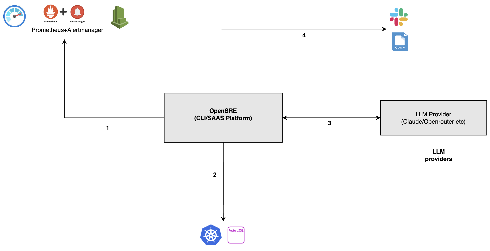
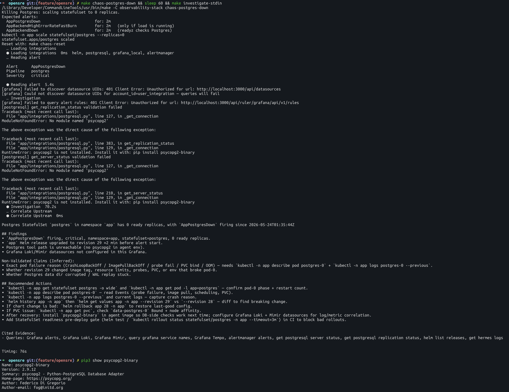
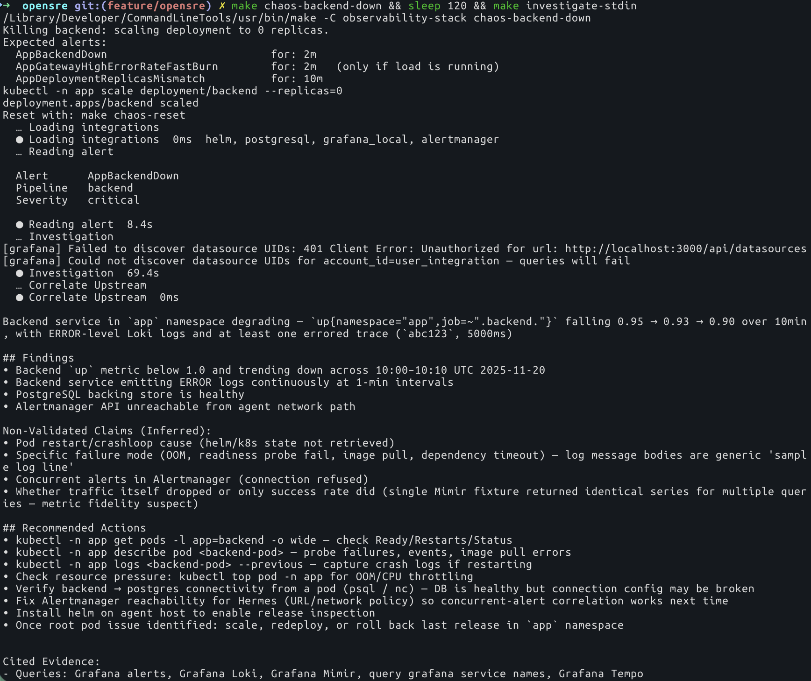
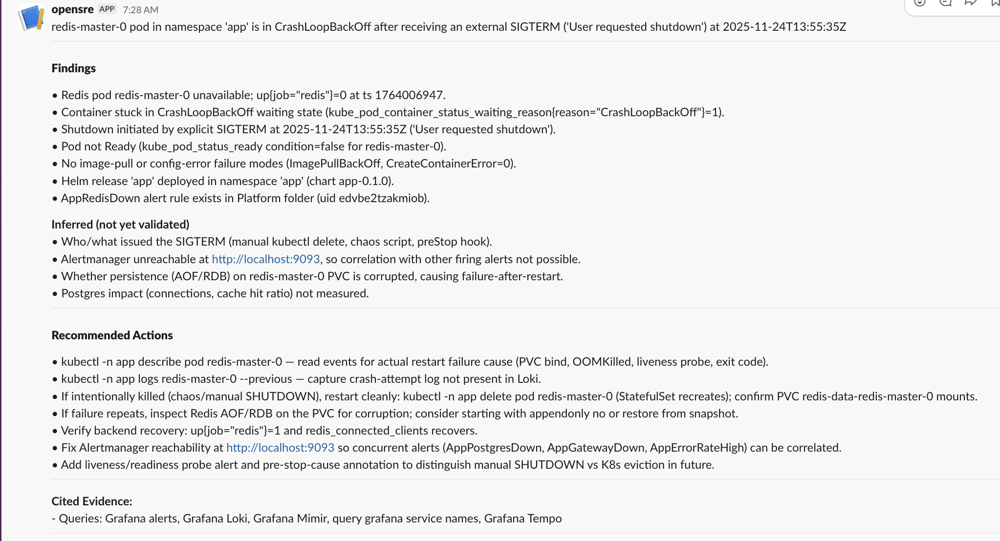

# OpenSRE — Evaluation

| | |
| --- | --- |
| **Author** | `Hemant Kumar` |
| **Date** | `2026-05-24` |
| **Time invested** | `~6 hours` |
| **Tool version tested** | `0.1` |
| **Source / Docs** | [Tracer-Cloud/opensre](https://github.com/Tracer-Cloud/opensre) · [docs](https://www.opensre.com/docs/) |
| **License** | `Apache-2.0` |
| **Category** | `AI SRE agent` |

---

## 1. What problem does this tool solve?

OpenSRE is an AI SRE agent that integrates with alerting systems (Alertmanager, Azure Monitor, etc.) and produces root cause analysis with suggested remediation steps.
It comes as a CLI and SaaS offering from Tracer Cloud. Rather than remediating problems directly, it primarily provides root cause analysis and guidance based on integrated data sources. For this POC we evaluated the CLI as SAAS platform utilises this agent itself and platform is currently under development.


---

## 2. How it works (architecture)

### 2.1 High-Level Design (HLD)



Component overview:
- **Agent** — OpenSRE agent wraps tools for different work (Grafana metrics, Alertmanager alerts, logs, Helm releases) allowing LLMs to invoke them directly.
- **LLM providers** — OpenRouter, Anthropic, OpenAI-compatible. Tested with **Claude Code** integration (`claude-code` provider) — see [opensre Claude Code setup docs](https://www.opensre.com/docs/) for configuration steps
- **Data sources** — Alertmanager API, Helm releases, local log files, embedded SRE Knowledge Base. Tested on Alertmanager, Grafana, Helm, PostgreSQL integration.
- **No Kubernetes API** — `kubectl` unavailable; Helm is the only cluster data source.
- **Deployment** — single Homebrew-installed binary, local CLI.
---

## 3. Setup and reproduction steps

### Prerequisites

- Homebrew
- Docker Desktop with Kubernetes enabled (`docker-desktop` context)
- A supported LLM provider configured. This evaluation uses **Claude Code** (`LLM_PROVIDER=claude-code`). For other providers see the [opensre provider docs](https://www.opensre.com/docs/integrations-overview)
- Helm, kubectl, make
- Slack integration for alertmanager and OpenSre needs to be done separately [Slack Integration Guide](https://www.opensre.com/docs/messaging/slack). The current helm chart installation expect the secret named as `grafana-slack` to be created first with SLACK_TOKEN key [Reference](./observability-stack/platform/values-kube-prometheus-stack.yaml)
### Install

```bash
git clone https://github.com/one2nc/ai-bites.git && pushd ai-bites/opensre
make env           # copy .env.example → .env; set LLM_PROVIDER=claude-code (or any other), SLACK_WEBHOOK_URL
make install       # brew install tracer-cloud/tap/opensre
opensre onboard    # Configure integrations with grafana using service tokens, LLM Provider(Claude/Openrouter)  
pushd observability-stack && make secret && popd # Create secret for slack-alertmanager integration
make stack-up      # deploy monitoring + app onto docker-desktop/Or any other local platform. Please change the cluster labels accordingly
make port-forward  # Grafana :3000, Alertmanager :9093 — keep running in separate terminal
```

<details>
<summary>All make targets</summary>

```
make env                    Create .env from .env.example
make install                Install opensre CLI via homebrew
make doctor                 Run opensre diagnostics
make integrations           Verify all opensre integrations
make stack-up               Bring up observability stack
make stack-down             Tear down observability stack
make stack-status           Show pod status (monitoring + app namespaces)
make port-forward           Port-forward Grafana :3000, Alertmanager :9093, PostgreSQL :5432
make investigate            Investigate against tests/actual-dev-env.alert.json
make investigate-stdin      Feed live Alertmanager alerts to opensre
make chaos-postgres-down    Scale Postgres to 0 — triggers AppPostgresDown
make chaos-redis-down       Scale Redis to 0 — triggers AppRedisDown
make chaos-gateway-down     Scale gateway to 0 — triggers AppGatewayDown
make chaos-backend-down     Scale backend to 0 — triggers AppBackendDown
make chaos-reset            Restore stack to baseline
```

</details>

### Known setup gotchas

**1. Alertmanager API format mismatch** — `/api/v2/alerts` returns a bare JSON array. `opensre investigate -i -` expects a webhook-format object with an `"alerts"` key. Piping raw output fails:

```
Alert payload from stdin must be a JSON object.
```

`make investigate-stdin` in the makefile target wraps it

**2. Alert firing delay** — after `make chaos-<target>`, wait a moment for the alert to fire before running `make investigate-stdin`.

**3. helm integration fails** — `helm version --client failed (exit 1): Error: unknown flag: --client`

---

## 4. Scenarios tested

All scenarios run against a three-tier app (Gateway → Backend → PostgreSQL / Redis) on Docker Desktop Kubernetes with `kube-prometheus-stack` firing real alerts after.

### 4.1 Database Down

**Run:** PostgreSQL replicas set to zero.
```bash
make chaos-postgres-down && sleep 60 && make investigate-stdin
```

**Output:** 
1. Identified replicas set to zero from Alertmanager. Incorrectly attributed cause to Helm release instead of `kubectl scale` operation.
2. Grafana integration failed.
3. PostgreSQL client dependency (`psycopg2`) missing from binary build.

**Result:** 
Unable to correlate findings due to broken integrations across Grafana, PostgreSQL, and missing Kubernetes API access.

<details>
<summary>Details</summary>



</details>

### 4.2 Backend Down

**Run:** Backend replicas scaled to zero
```bash
make chaos-backend-down && sleep 60 && make investigate-stdin
```

**Output:** 
1. Identified replicas set to zero from Alertmanager; claim validated via Prometheus.
2. Incorrectly inferred continuous app error logs while app was not running.
3. Misidentified root cause as OOM/CrashLoopBackOff.
4. Inconsistently cited Alertmanager as unavailable while using its data as evidence.

**Result:** 
Identified deployment down state from alerts and Prometheus, but validations were weak due to broken integrations and missing context.

<details>
<summary>Details</summary>

                  


</details>


### 4.3 Redis Down
**Run:** Redis deployment scaled to zero
```bash
make chaos-redis-down && sleep 60 && make investigate-stdin
```

**Output:** 
1. Identified replicas set to zero from Alertmanager; claim validated via Prometheus.
2. Incorrectly inferred continuous app error logs while app was not running.
3. Misidentified root cause as OOM/CrashLoopBackOff.
4. Inconsistently cited Alertmanager as unavailable while using its data as evidence.

**Result:** 
Identified deployment down state from alerts and Prometheus, but validations were weak due to broken integrations and missing context.

<details>
<summary>Details</summary>

                  


</details>


### Summary

| Scenario | Alerts Firing | Confidence | Correct RCA | Notes |
|----------|---------------|------------|-------------|-------|
| Database Down | Single | No | No |  Does not give correct correlation. Broken integrations |
| Backend Down | `AppBackendDown` critical | No | No | CrashLoopBackOff identified; Helm revision correlated. Whereas, replicas was set to zero through kubectl. K8s support missing |
| Redis Down | `AppRedisDown` warning | No | No| Got confused by another irrelevant alert and added that in the evidence as a possible cause |

---

## 5. Demo

| Demo | Link | Duration |
|------|------|----------|
| Scenario(4.2) | https://drive.google.com/file/d/1jZL7F28ZAcdgDp42cEgIqsHax10OHAAJ/view?usp=sharing | `06:24` |

---

## 6. Observations

- **Integrations** - Not many at the moment and those available are broken. As a result it cites wrong evidences as possible solution in the RCAs.
- **Single-alert triage** — `investigate -i -` processes one alert per run. No fan-out when multiple alerts fire simultaneously; first-in-sort-order wins. As an alternative, manually capture alerts from the alerting source, create the payload and run it in a loop with OpenSRE agent which is overdoing rather than solving a problem.
- **EKS-first toolset** — all Kubernetes tools (`EKSListPodsTool`, `EKSPodLogsTool`) are EKS-specific. AKS, GKE integrations pending. Supported tool list - [Tools List](https://github.com/Tracer-Cloud/opensre/tree/main/app/tools)
- **Code quality:** It is still at public alpha and for exploration only. A release every day and 7 releases over 1 week on average and lots of open issues.
- **Community:** GitHub issues, Discord.
- **Documentation:** Incomplete and infrequently updated.
- **Security posture:** Read-only by design; no cluster write permissions required. 
- **Stability:**  v0.1 restored the same issue again after the fix was applied for Helm 3. More details in section 12.
[Issue Reference](https://github.com/Tracer-Cloud/opensre/issues/1973)

---

## 7. Comparison with alternatives
    TODO
---

## 8. Pros

- No server, no cluster permissions, no persistent infrastructure
- LLM-agnostic — any OpenAI-compatible provider
- Guardrails are being build from scratch with all the rules. Needs to be evaluated - [Guardrails]( https://github.com/Tracer-Cloud/opensre/blob/599e9130a72bc2539a9314530f446dbedd743c69/app/guardrails/cli.py#L18)
- Slack webhook delivery out of the box

---

## 9. Cons

- Could not correlate lots of failures due to not enough integrations like K8s, Prometheus, Loki etc.
- Every remediation step is manual. It acts more as a guide than agent taking actions and take us towards a goal since context awareness is lacking due to broken datasource integrations.
- Single-alert triage per run — no fan-out when multiple services fail simultaneously. That causes performance at scale when it has large number of alerts to go through.
- `opensre integrations verify` broken for helm and postgresql. Documentation does not suggest anything.
- Switching to smart models does not help because of broken/lack of integrations.Context building does not work because of it/
---

## 10. Cost analysis
    TODO
---

## 11. Verdict

**Defer** 
In the current stage this is not a mature tool and TracerCloud SAAS platform is also under development and still evolving.
Not ready for on-call rotation. Revisit when:
- Alerting system's integrations are sroted
- Support for other platforms running Kubernetes like GKE, AKS, or K8s on DC.
- Multi-alert fan-out is supported

---

## 12. Issues / PRs filed

| Type | Link | Status |
|------|------|--------|
| Bug | [#1973 — helm positional arg rejected; `setup helm` also broken; `verify` uses removed `--client` flag](https://github.com/Tracer-Cloud/opensre/issues/1973) | Re-opened |
| Bug | [#2459 — psycopg2 not bundled; `verify postgresql` fails in binary install](https://github.com/Tracer-Cloud/opensre/issues/2459) | Closed As Not Planned But Opened Another Separately([Ref](https://github.com/Tracer-Cloud/opensre/pull/2490)) |
| Bug | [#2500 — Grafana integration: API key authentication fails with 401 Unauthorized](https://github.com/Tracer-Cloud/opensre/issues/2500) | Closed |
